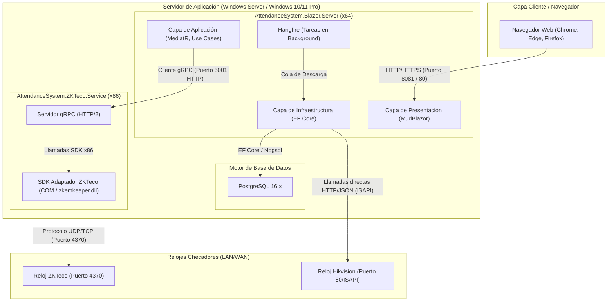
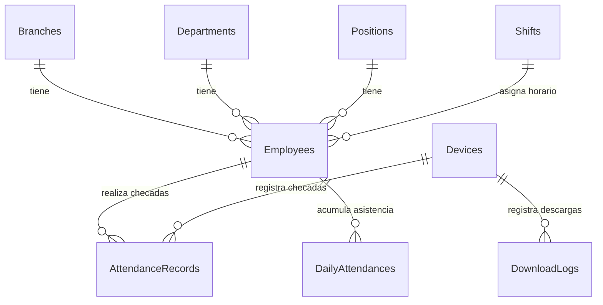

# 📘 Manual Técnico - Attendance System

Este documento proporciona la información técnica necesaria para desarrolladores, administradores de sistemas y equipos de TI encargados de desplegar, mantener y dar soporte a la aplicación **Attendance System**.

---

## 1. Arquitectura del Sistema

El sistema de asistencia está diseñado bajo una arquitectura de **Clean Architecture** (Arquitectura Limpia) y desacoplado en dos aplicaciones independientes que se comunican de manera segura a través de **gRPC**:

1. **AttendanceSystem.Blazor.Server (x64):** La aplicación web principal encargada de la interfaz de usuario (construida con MudBlazor), lógica de negocio, reportes y persistencia de datos. Se ejecuta en 64 bits para maximizar el rendimiento.
2. **AttendanceSystem.ZKTeco.Service (x86):** Un Servicio de Windows que actúa como bridge de comunicación con el hardware. Se ejecuta exclusivamente en **32 bits (x86)** debido a que las librerías nativas del SDK de ZKTeco (`zkemkeeper.dll`) no disponen de soporte para arquitecturas de 64 bits.

### 1.1 Diagrama de Arquitectura de Comunicación



### 1.2 Flujo de Datos

#### Registro y Prueba de Dispositivo
1. El usuario administrador registra el reloj checador en la interfaz web de Blazor ingresando la dirección IP, puerto, marca (`ZKTeco` o `Hikvision`) y método de descarga (`Sdk` o `Adms`).
2. El sistema persiste la configuración en la tabla `Devices` de la base de datos PostgreSQL.
3. Al presionar **Conectar / Probar Conexión**:
   - Si es **ZKTeco (SDK)**: La app Blazor envía una solicitud gRPC al servicio `AttendanceSystem.ZKTeco.Service` especificando la IP y puerto. El servicio carga las DLLs nativas de 32 bits, abre un canal TCP/IP al puerto 4370 del reloj, valida la conexión y retorna el estado.
   - Si es **Hikvision (ISAPI)**: La app Blazor realiza una petición HTTP/HTTPS (REST) directa al endpoint `/ISAPI/System/deviceInfo` del reloj. Si responde con código 200 OK y las credenciales son válidas, confirma la conexión.

#### Sincronización y Descarga de Asistencias (Flujo PULL)
1. **Programador de Tareas (Hangfire)** o un operador web dispara la acción de descarga.
2. El sistema lee las credenciales e IP del dispositivo desde la base de datos.
3. Se invoca el método correspondiente:
   - Para ZKTeco: Llamada gRPC `GetAttendanceLogs` $\rightarrow$ Conexión del SDK x86 al hardware $\rightarrow$ Retorno de DTOs con registros crudos $\rightarrow$ Guardado en Blazor.
   - Para Hikvision: Petición HTTP GET a `/ISAPI/AccessControl/AcsEvent` $\rightarrow$ Deserialización de JSON/XML $\rightarrow$ Guardado en Blazor.
4. La capa de aplicación procesa las asistencias crudas, ejecuta el motor de reglas de horarios y guarda los resultados calculados en `DailyAttendances` y las checadas crudas en `AttendanceRecords`.

---

## 2. Requisitos Técnicos

Para garantizar el correcto funcionamiento del sistema, el entorno de despliegue debe cumplir con las siguientes especificaciones reales y comprobadas:

### 2.1 Requisitos del Servidor (Hosting)

| Componente | Requisito Mínimo | Requisito Recomendado |
| :--- | :--- | :--- |
| **Arquitectura de CPU** | Procesador x64 de 2 núcleos a 2.0 GHz | Procesador x64 de 4 núcleos o superior (ej. Intel Core i5 / Xeon) |
| **Memoria RAM** | 4 GB a 8 GB | 16 GB (especialmente para entornos con múltiples terminales y Hangfire jobs continuos) |
| **Almacenamiento** | 20 GB de espacio libre (SSD) | 50 GB a 100 GB de espacio libre (SSD NVMe para BD y copias de seguridad) |
| **Sistema Operativo** | Windows 10/11 Pro o Enterprise (64-bit) | Windows Server 2019 / 2022 / 2025 Standard o Datacenter (64-bit) |
| **Puertos de Red Abiertos**| **8081** (Web Self-Hosted Kestrel), **5001** (gRPC local), **5432** (PostgreSQL) | **80/443** (IIS Web), **8081** (Web Kestrel), **5001** (gRPC local), **5432** (PostgreSQL) |

> [!NOTE]
> **Requisito Obligatorio de Windows (x64):** El servidor principal debe ser Windows de 64 bits debido a que el servicio puente de ZKTeco (`AttendanceSystem.ZKTeco.Service`) interactúa con librerías nativas COM/Win32 de 32 bits (`zkemkeeper.dll`) registradas en `SysWOW64`.

### 2.2 Requisitos de Conectividad (Red)

* **Puertos de Dispositivos (Entrada / Salida):**
  * **Puerto 4370 (TCP / UDP):** Puerto estándar utilizado por terminales biométricas ZKTeco para comunicación bidireccional vía SDK nativo.
  * **Puerto 80 / 443 (TCP):** Puerto utilizado por terminales biométricas y de control de acceso Hikvision para comunicación REST vía ISAPI HTTP/HTTPS.
  * **Puerto 5001 (TCP - HTTP/2):** Puerto interno gRPC para la comunicación local entre la aplicación web (x64) y el servicio Windows ZKTeco (x86). No requiere exposición hacia redes externas.
* **Soporte de WebSockets:**
  * **Obligatorio** para la aplicación web Blazor Server (comunicación bidireccional en tiempo real con SignalR). Si se aloja en IIS, el rol `WebSockets` debe estar habilitado en el servidor.
* **Segmentación de Red:** Se recomienda que los relojes checadores residan en la misma subred (LAN) o estén interconectados mediante una VPN corporativa estable (WAN) con latencias menores a 100 ms.

### 2.3 Requisitos del Cliente (Navegadores y Dispositivos de Usuario)

* **Navegadores Soportados:**
  * Google Chrome 110+ (o superior)
  * Microsoft Edge 110+ (o superior)
  * Mozilla Firefox 115+ (o superior)
  * Safari 16+ (macOS / iOS)
* **Resolución de Pantalla:** Mínima recomendada de **1280x720** (interfaz responsiva adaptada para monitores de escritorio, computadoras portátiles y tabletas táctiles).
* **JavaScript:** Habilitado (requerido para el motor de componentes MudBlazor y circuitos SignalR).

### 2.4 Software y Runtimes Requeridos

* **Motor de Base de Datos:**
  * **PostgreSQL:** Versión mínima **14.x**, versión recomendada **16.x (x64)**.
* **Herramientas cliente de PostgreSQL (respaldos y restauraciones):**
  * `pg_dump`, `pg_restore` y `psql` deben existir en el servidor de la aplicación, **de la misma instalación** y de versión **igual o mayor** que el servidor de PostgreSQL. El instalador de PostgreSQL para Windows las incluye en `C:\Program Files\PostgreSQL\<versión>\bin`.
  * Si la base de datos está en otro equipo, instale en el servidor de la aplicación sólo los *Command Line Tools* de PostgreSQL.
  * Se localizan en este orden: `Backup:PostgresBinPath` (configuración), `C:\Program Files\PostgreSQL\{17..12}\bin` y el `PATH`. `psql` se toma de la misma carpeta que `pg_restore`: los scripts de versiones recientes usan metacomandos (`\restrict`) que un `psql` más antiguo no reconoce.
* **Espacio para restaurar:** además del respaldo, una restauración necesita espacio para el snapshot de seguridad (del tamaño de un respaldo de la base actual, en la carpeta de respaldos) y, si el respaldo es `.zip`, para extraerlo en la carpeta temporal del usuario del servicio.
* **.NET Runtimes:**
  * **Modo Autocontenido (Self-Hosted Kestrel - Recomendado):** El instalador Todo-en-Uno ya incluye los binarios autocontenidos de **.NET 10.0**, por lo que **no es necesario** instalar el .NET SDK ni Runtime por separado.
  * **Modo IIS:** Requiere el **ASP.NET Core Hosting Bundle 10.0.x** (proporciona el módulo nativo `AspNetCoreModuleV2` en IIS).
* **Librerías de Soporte de C++ (x86):**
  * **Visual C++ Redistributable 2015-2022 (x86 / 32-bit):** Requerido para la ejecución adecuada de las DLLs COM nativas de ZKTeco (`zkemkeeper.dll`, `commpro.dll`).

---

## 3. Instalación y Despliegue con Inno Setup

El despliegue en producción se realiza mediante un instalador único compilado con Inno Setup (`AttendanceSystem_Setup.exe`), el cual automatiza toda la configuración del servidor.

### 3.1 Pre-instalación
1. Descargue el instalador y ejecútelo con **permisos de Administrador** (clic derecho $\rightarrow$ *Ejecutar como administrador*).
2. El instalador detectará si los siguientes prerrequisitos ya se encuentran en el sistema:
   * **PostgreSQL:** Comprueba los registros en `SOFTWARE\PostgreSQL\Installations`.
   * **ASP.NET Core Hosting Bundle:** Comprueba los registros en `SOFTWARE\Microsoft\ASP.NET Core\Shared Framework\v10.0` (o `v9.0`).
   * Si falta alguno de los dos, el instalador procederá a ejecutarlos de forma desatendida desde sus instaladores temporales.

### 3.2 Paso a Paso de la Ejecución del Instalador
1. **Selección de Idioma:** Ventana emergente inicial para configurar el instalador en idioma Español.
2. **Pantalla de Bienvenida:** Presentación del asistente de instalación de *Attendance System v2.1.6*.
3. **Selección de Carpeta de Destino:** Por defecto se establece `C:\Program Files\AttendanceSystem`.
4. **Selección de Tareas Adicionales:**
   * checkbox **Configurar como servidor IIS:** Seleccione esta opción si está instalando en un Windows Server corporativo y desea que la aplicación Blazor se aloje dentro del Internet Information Services local en el puerto 80. Si no se marca, funcionará de manera independiente (Kestrel) en el puerto 8081.
5. **Detección e Ingreso de Credenciales de BD:**
   * Si el instalador detecta que **ya existe** una instancia de PostgreSQL local, desplegará una pantalla personalizada solicitando ingresar la contraseña del superusuario `postgres` para poder configurar los esquemas y privilegios del sistema.
   * Si **no existe**, instalará PostgreSQL de forma desatendida usando la contraseña maestra por defecto `Blanquita.123`.
6. **Progreso de Instalación:**
   * Descompresión de archivos de la aplicación y el servicio.
   * Ejecución en segundo plano del instalador de PostgreSQL (`postgresql-installer.exe --mode unattended`).
   * Ejecución del Hosting Bundle de .NET 10 (`dotnet-hosting.exe /install /quiet /norestart`).
   * Registro del SDK ZKTeco en Windows (`regsvr32.exe /s zkemkeeper.dll` tanto en `System32` como en `SysWOW64` para entornos de 64 bits).
   * Creación del Servicio de Windows mediante `sc.exe create AttendanceSystem.ZKTeco.Service`.
   * Configuración de la base de datos llamando a `configure_db.bat`.
   * Apertura de los puertos 8081 y 5001 en el Firewall de Windows Defender.
7. **Pantalla de Finalización:** Opción de arrancar el servicio de forma inmediata y abrir el navegador para el acceso inicial.

### 3.3 Configuración Automática Realizada por el Instalador

El instalador realiza las siguientes tareas críticas en el sistema operativo:

* **Estructura de Directorios:**
  * `{app}\Web`: Archivos de publicación de la aplicación Blazor Server.
  * `{app}\Service`: Archivos del Windows Service de ZKTeco (compilado en x86 autocontenido).
  * `{app}\Database`: Scripts de creación de base de datos e inicialización.
  * `{app}\Logs` y `{app}\Backups`: Carpetas dedicadas a logs históricos y respaldos.
    * **Nota:** la aplicación **no** usa `{app}\Backups` de forma predeterminada: su directorio de respaldos por defecto es `{app}\Web\Backups`. Configure `{app}\Backups` (o, mejor, una carpeta en otro disco) en **Respaldo y Restauración → Directorio de Almacenamiento**. En IIS, `configure_iis.bat` otorga permiso de modificación a `IIS_IUSRS` sobre `{app}\Backups`; cualquier otra carpeta necesita ese permiso para la identidad del AppPool.
* **Configuración de PostgreSQL:**
  * Se crea un rol/usuario de base de datos exclusivo llamado `attendancesystem_user` con contraseña `Blanquita.123`.
  * Se crea la base de datos `"AttendanceSystem"`.
  * Se otorgan todos los privilegios sobre el esquema `public` y el esquema `hangfire` a dicho usuario.
* **Instalación del Windows Service:**
  * Registra el servicio `AttendanceSystem.ZKTeco.Service` con el comando:
    ```cmd
    sc.exe create AttendanceSystem.ZKTeco.Service binPath= "C:\Program Files\AttendanceSystem\Service\AttendanceSystem.ZKTeco.Service.exe" start= auto displayname= "Attendance System ZKTeco Service"
    ```
  * Inicia automáticamente el servicio.
* **Configuración de IIS (Si aplica):**
  * Ejecuta `enable_iis.ps1` que activa el rol de IIS en Windows con soporte para WebSockets y ASP.NET Core module.
  * Ejecuta `configure_iis.bat` que crea un AppPool dedicado e independiente (`AttendanceSystem`) y un sitio web asignado al puerto 80 apuntando a la carpeta `{app}\Web`.

### 3.4 Post-instalación y Verificación
Para validar que la instalación fue exitosa:
1. Abra una terminal de PowerShell como administrador y ejecute el script de diagnóstico del sistema:
   ```powershell
   & "C:\Program Files\AttendanceSystem\Tools\Diagnose-AttendanceSystem.ps1"
   ```
2. Verifique que los servicios de Windows estén en ejecución:
   ```powershell
   Get-Service "postgresql-x64-16"
   Get-Service "AttendanceSystem.ZKTeco.Service"
   ```
3. Abra el navegador web e ingrese a `http://localhost:8081` (o `http://localhost` si configuró IIS).
4. Inicie sesión con las credenciales maestras por defecto:
   * **Usuario:** `admin`
   * **Contraseña:** `Admin123!`

### 3.5 Desinstalación
Al desinstalar la aplicación desde el panel de control:
* Se detiene y se elimina el servicio `AttendanceSystem.ZKTeco.Service`.
* Se remueven los registros COM del SDK de ZKTeco.
* Se eliminan las reglas de firewall y las configuraciones de IIS (AppPool y sitio web).
* **⚠️ ATENCIÓN:** El instalador **no** borra la base de datos PostgreSQL en PostgreSQL ni elimina la carpeta de backups para resguardar la información histórica de la empresa ante desinstalaciones accidentales. Si requiere una limpieza absoluta, deberá borrar manualmente la base de datos desde pgAdmin.
  * Esto incluye los respaldos creados por la aplicación en `{app}\Web\Backups` (directorio predeterminado): el desinstalador sólo quita los archivos que instaló.

---

## 4. Configuración de la Base de Datos (PostgreSQL)

El sistema utiliza **PostgreSQL** para toda su persistencia, empleando Entity Framework Core en la capa de infraestructura con migraciones de base de datos autogestionadas.

### 4.1 Esquema de Base de Datos (Tablas Clave)

El esquema de base de datos se distribuye en las siguientes entidades principales:



#### Descripción de las Tablas Principales:
* **AspNetUsers / AspNetRoles / AspNetUserRoles:** Tablas de ASP.NET Core Identity que gestionan las credenciales, nombres completos, estado activo y roles de los operadores del sistema.
* **Branches (Sucursales):** Almacena las sucursales físicas (para configuraciones semi multi-empresa).
* **Departments (Departamentos):** Estructura organizacional de la empresa (Ventas, Sistemas, RH, etc.).
* **Positions (Puestos):** Puestos de trabajo asignados a los empleados.
* **Employees (Empleados):** Tabla núcleo del sistema. Contiene los datos personales del empleado, número de empleado, huellas digitales serializadas en formato JSON/Base64 (`EmployeeFingerprint`), cara enrolada (`FaceTemplate`), número de tarjeta física (`CardNumber`), sucursal, departamento, puesto y el identificador de su horario asignado (`ScheduleId`).
* **Shifts (Turnos / Horarios):** Define la hora de entrada (`StartTime`), hora de salida calculada mediante las horas de trabajo (`WorkHours`), minutos de tolerancia (`ToleranceMinutes`) y el tipo de turno (fijo, rotativo, etc.).
* **Devices (Dispositivos / Relojes):** Configura los relojes físicos. Registra la IP, puerto (por defecto 4370), marca (`ZKTeco` o `Hikvision`), método de sincronización, credenciales de administración del reloj (`Username` y `Password`) y el estado actual de conexión (`Online`, `Offline`, `Error`).
* **AttendanceRecords (Checadas Crudas):** Registro directo descargado de los relojes. Guarda el ID de empleado, fecha y hora de la checada (`Timestamp`) y el tipo de checada (Entrada, Salida, etc.).
* **DailyAttendances (Asistencias Diarias Calculadas):** Tabla generada por el motor de cálculo diario de nómina. Registra por cada empleado y día: hora exacta de entrada, hora de salida, minutos de retraso, horas extras calculadas y autorizadas, y estado de la incidencia (Asistencia, Falta, Retardo, etc.).
* **DownloadLogs:** Auditoría de cada descarga realizada (usuario, cantidad de registros obtenidos, errores detectados).
* **SystemAlerts:** Alertas internas generadas por el sistema cuando ocurren desconexiones de hardware o errores en segundo plano.

### 4.2 Migraciones y Actualizaciones de Esquema
La aplicación Blazor aplica las migraciones de Entity Framework Core al arrancar, antes de atender peticiones. Implementación: `StartupMigrationService` (`src/Infrastructure/AttendanceSystem.Infrastructure/Services/StartupMigrationService.cs`), invocado desde `Program.cs`. Los clientes WPF y el servicio ZKTeco nunca migran.

**Secuencia de arranque:**
1. **Conexión:** si PostgreSQL todavía no responde (p. ej. el servidor se reinició y PostgreSQL arranca después que IIS), se reintenta con espera creciente (`Database:StartupConnectAttempts`). Si la base no existe se crea vacía (desarrollo; el instalador ya la crea). Si tras los reintentos no hay conexión, la aplicación **se detiene** y el siguiente arranque lo vuelve a intentar.
2. **Bloqueo entre procesos:** se toma el bloqueo consultivo `pg_try_advisory_lock(7235002)` con una conexión `application_name = attendance_migration_lock`. Un segundo worker de IIS (o un reciclado solapado) espera a que el primero termine y después encuentra la base al día. El bloqueo propio de EF sobre `__EFMigrationsHistory` no basta: dura una sola transacción. La alineación de esquema de una restauración (4.4) usa el mismo bloqueo.
3. **Versión de la base:** si `__EFMigrationsHistory` contiene migraciones que esta versión no conoce (se reinstaló una versión anterior), **no se toca nada** y se arranca en mantenimiento. Los IDs de `RetiredMigrations` no cuentan: son migraciones que una versión instalada aplicó con un identificador que después cambió.
4. **Respaldo previo:** si hay migraciones pendientes y la base ya tenía migraciones aplicadas, se crea y verifica `PreMigration_Backup_<fecha>_<hora>.backup` en el directorio de respaldos. Aparece en la página de respaldos con la descripción *Estado previo a una actualización del esquema* y **la retención no lo borra**. Si el respaldo falla, **no se migra** y se arranca en mantenimiento. Una base recién creada no se respalda.
5. **Migraciones:** se aplican de una en una y el log registra cuál se aplica y cuánto tarda (`Aplicando migración 3/26: ...`). Cada comando tiene hasta `Database:MigrationTimeoutMinutes` (30 min); el valor por defecto de Npgsql (30 s) no alcanza para migraciones de datos sobre tablas grandes. Cada migración se confirma en su propia transacción: si una falla, la base queda en la última que terminó, nunca a medias, y se arranca en mantenimiento.
   * **Tiempo de arranque:** respaldo y migraciones tienen en total `Database:StartupMigrationBudgetMinutes` (50 min). Al agotarse, la migración en curso se deshace y se arranca en mantenimiento indicando cuál era; las ya aplicadas quedan y **el siguiente arranque continúa** con las demás. El presupuesto vence antes que `startupTimeLimit` de IIS (3600 s): si IIS mata el proceso no queda registro, y la sesión que estaba migrando sigue viva en PostgreSQL bloqueando las tablas.
   * **Tablas ocupadas:** un `ALTER TABLE` necesita la tabla en exclusiva. Si otra sesión la tiene (un cliente WPF con una transacción abierta, o la sesión de un arranque anterior que murió migrando), la sentencia espera como máximo `Database:MigrationLockTimeoutSeconds` (`lock_timeout`, también para la lectura del historial), se deshace y se arranca en mantenimiento. El mensaje lista esas sesiones (pid, `application_name`, IP, estado, antigüedad y tablas). Antes de migrar se avisa en el log (`WRN`) si ya hay sesiones con tablas tomadas. Ciérrelas, o termínelas con `SELECT pg_terminate_backend(<pid>);`, y reinicie.
6. **Datos iniciales** (roles y usuario `admin`) sólo si el esquema quedó al día.

**Arranque en mantenimiento por el esquema:** en los casos anteriores (base más nueva, respaldo previo fallido, migración fallida o cancelada por tablas ocupadas) la aplicación arranca en estado `Failed` con `owner_id = 'StartupMigration'`: todos los procesos rechazan escrituras, ADMS/API responden `503`, Hangfire queda en pausa y no se crean datos iniciales. El log (`FTL`) indica la causa, la última migración aplicada y la ruta del respaldo previo. Para salir:
* corrija la causa y **reinicie la aplicación**: a diferencia del `Failed` de una restauración, este estado se descarta al arrancar y se vuelve a intentar; o
* restaure un respaldo desde la página de respaldos (por ejemplo el `PreMigration_Backup` si la migración dejó datos que no se quieren conservar); la restauración aplica las migraciones al terminar.

**Otros casos:**
* **Restauración con fallo crítico:** si el estado guardado es `Failed` por una restauración (ver 4.4), el arranque **omite** las migraciones y la creación del usuario inicial y deja Hangfire en pausa. Migrar o sembrar datos sobre una base que quedó sin validar ocultaría el problema.
* **Restauración en curso en otro proceso:** se omiten migraciones y datos iniciales; la restauración deja el esquema al día al terminar.
* **Restauraciones:** al restaurar un respaldo de una versión anterior, sus migraciones pendientes se aplican durante la propia restauración; un respaldo de una versión más nueva se rechaza (ver 4.4).
* **IIS:** `web.config` sube `startupTimeLimit` de 120 s a 3600 s (el máximo) para que IIS no abandone una actualización larga; debe ser mayor que `Database:StartupMigrationBudgetMinutes`.

| Clave | Valor por defecto | Uso |
|---|---|---|
| `Database:MigrationTimeoutMinutes` | `30` (mín. 1) | Tiempo máximo de cada comando de migración y de la espera a que otro proceso termine de migrar. |
| `Database:StartupMigrationBudgetMinutes` | `50` (mín. 1) | Tiempo total del arranque para respaldar y migrar; menor que `startupTimeLimit` de IIS. |
| `Database:MigrationLockTimeoutSeconds` | `120` (mín. 1) | Lo que una sentencia de migración espera a que otra sesión suelte una tabla antes de cancelarse. |
| `Database:StartupConnectAttempts` | `6` | Intentos de conexión con PostgreSQL al arrancar. |
| `Database:StartupConnectRetrySeconds` | `2` | Espera inicial entre intentos; se duplica hasta 15 s. |

**Crear una migración (desarrollo):** genérela siempre con la herramienta, para que actualice el snapshot del modelo:
```powershell
dotnet ef migrations add <Nombre> --project src/Infrastructure/AttendanceSystem.Infrastructure --startup-project src/Presentation/AttendanceSystem.Blazor.Server
```
* EF aplica las migraciones **por orden de ID**. Varias migraciones existentes tienen fechas futuras (hasta `20261109120000`); mientras la fecha real no las supere, renombre la migración nueva (archivos y atributo `[Migration]`) con un ID posterior a la última.
* `MigrationsConsistencyTests` falla si el modelo tiene cambios sin migración o si la migración más reciente no es la última por ID. EF también se niega a migrar si el modelo no coincide con el snapshot (`PendingModelChangesWarning`), lo que en producción dejaría la aplicación en mantenimiento.
* Una migración que transforma o borra datos debe poder ejecutarse sobre tablas grandes y, si no tiene `Down`, decirlo en un comentario: el respaldo previo es la única vuelta atrás.

Para realizar una migración manual desde la consola de desarrollo de .NET:
```powershell
dotnet ef database update --project src/Infrastructure/AttendanceSystem.Infrastructure --startup-project src/Presentation/AttendanceSystem.Blazor.Server
```

### 4.3 Respaldos de PostgreSQL

Los respaldos se crean desde **Respaldo y Restauración** (`/backup`), manualmente o con el respaldo automático diario (**Configuración → Respaldos Automáticos**, tarea Hangfire `automated-database-backup`, tipo completo). Implementación: `BackupService` (`src/Infrastructure/AttendanceSystem.Infrastructure/Services/BackupService.cs`).

**Formatos:**
| Tipo | Archivo | Contenido |
| :--- | :--- | :--- |
| Completo | `Full_Backup_AAAAMMDD_HHMMSS.zip` | `database.backup` (pg_dump formato custom), `config/appsettings.json`, `metadata.json` |
| Solo BD | `DB_Backup_AAAAMMDD_HHMMSS.backup` | pg_dump formato custom |
| Snapshot de seguridad | `.safety_snapshot_AAAAMMDD_HHMMSS.backup` | estado previo a una restauración; sólo se conserva si ésta falla sin poder revertirse |

**Comando que ejecuta la aplicación** (la contraseña se pasa por `PGPASSWORD`, nunca en la línea de comandos):
```cmd
pg_dump -h <host> -p <puerto> -U "<usuario>" -w --lock-wait-timeout=30000 -T "logs" -T "Logs" -N "system_maintenance" -F c -b -v -f "<archivo>" "<base>"
```
* `-N system_maintenance`: el esquema del estado de mantenimiento pertenece al servidor, no a los datos; ni se respalda ni se restaura.
* Cada respaldo se verifica con `pg_restore -l` antes de darlo por bueno; un dump fallido, cancelado o ilegible se borra y no cuenta para la retención.
* Si dos respaldos coinciden en el mismo segundo, el segundo recibe un sufijo (`_2`) en vez de sobrescribir.

**Retención:** tras cada respaldo se conservan los `Backup:KeepLastNBackups` más recientes (10 por defecto; `0` desactiva la purga). Sólo se purgan los archivos con nombre `Full_Backup_*`/`DB_Backup_*`, ordenados por la fecha de su nombre. Los subidos o copiados con otro nombre y los snapshots de seguridad no se purgan nunca.

**Carga de respaldos** (`POST /api/backup/upload`, rol Administrador, hasta 1 GB, `.zip`/`.backup`/`.bak`): el archivo se escribe como `.upload_<guid>` oculto, se valida con `pg_restore -l` (también el `database.backup` de un `.zip`) y sólo entonces se renombra. Nunca sobrescribe un respaldo existente.

**Copia fuera del servidor:** la aplicación no copia los respaldos a otro equipo. Programe esa copia (por ejemplo con `robocopy` en el Programador de Tareas) desde el directorio de respaldos hacia un NAS u otro servidor.

**Configuración** (`appsettings.Production.json`):
```json
"Backup": {
  "PostgresBinPath": "C:\\Program Files\\PostgreSQL\\16\\bin",
  "KeepLastNBackups": 10,
  "DumpStallTimeoutSeconds": 600,
  "RestoreStallTimeoutSeconds": 900,
  "DrainTimeoutSeconds": 60
},
"Maintenance": {
  "PollIntervalSeconds": 5
}
```
| Clave | Predeterminado | Uso |
| :--- | :--- | :--- |
| `Backup:PostgresBinPath` | — | Carpeta de `pg_dump`/`pg_restore`/`psql` si no están en la ruta estándar. |
| `Backup:KeepLastNBackups` | `10` | Retención (ver arriba). |
| `Backup:DumpStallTimeoutSeconds` | `600` (mín. 60) | Corta `pg_dump` si no avanza en ese tiempo. |
| `Backup:RestoreStallTimeoutSeconds` | `900` (mín. 120) | Corta la restauración si no hay actividad; antes consulta `pg_stat_activity` para no cortar una sentencia larga (p. ej. un índice grande). |
| `Backup:DrainTimeoutSeconds` | `60` (mín. 1) | Espera a que terminen las escrituras en curso antes de restaurar; si no terminan, la restauración se cancela sin cambios. |
| `Maintenance:PollIntervalSeconds` | `5` | Cada cuánto cada proceso consulta el estado de mantenimiento de los demás (ver 4.5). `0` lo desactiva. |

### 4.4 Restauración de la Base de Datos

#### Desde la aplicación (procedimiento recomendado)
Se inicia en **Respaldo y Restauración** (rol Administrador). Sólo acepta archivos que estén directamente dentro del directorio de respaldos. Etapas:

1. **Bloqueo de mantenimiento:** se toma el bloqueo consultivo de PostgreSQL (ver 4.5). Si otro proceso lo tiene, o no se puede verificar, la restauración se rechaza. Desde aquí se rechazan escrituras en todos los procesos y las peticiones ADMS/API reciben `503` con `Retry-After: 30`.
2. **Validación del archivo** con `pg_restore -l` (el `.zip` se extrae en `%TEMP%\AttendanceRestore_*`, que se borra siempre al terminar).
3. **Drenaje** de escrituras en curso (`Backup:DrainTimeoutSeconds`) y **pausa de Hangfire**.
4. **Snapshot de seguridad** con `pg_dump`, verificado.
5. **Restauración atómica:** se terminan las demás conexiones a la base (salvo la del bloqueo) y se ejecuta, en **una sola transacción**:
   ```text
   pg_restore -f - --clean --if-exists -L <TOC sin system_maintenance> <archivo>  |  psql -X -q -v ON_ERROR_STOP=1
   ```
   precedido de `BEGIN; DROP SCHEMA public CASCADE; DROP SCHEMA hangfire CASCADE; CREATE SCHEMA public; ...` (con `lock_timeout` de 30 s). La aplicación envía el `COMMIT` sólo si `pg_restore` generó el script completo y sin errores. **Cualquier fallo antes del `COMMIT` (archivo truncado, error SQL, bloqueo, proceso cancelado o colgado) deja la base exactamente como estaba**, sin necesidad de rollback.
6. **Validación posterior** (tablas esenciales) y **alineación de versión** comparando `__EFMigrationsHistory` con las migraciones de la aplicación:
   * respaldo de una versión **anterior** → se aplican las migraciones pendientes;
   * respaldo de una versión **más nueva** → se rechaza.
7. Si la validación o la alineación fallan, **rollback automático** restaurando el snapshot con el mismo mecanismo atómico.
8. Al terminar se libera el bloqueo, se reanuda Hangfire y se pide reiniciar la aplicación.

**Requisitos de permisos:** el usuario de la cadena de conexión debe ser **dueño de la base de datos y de los esquemas `public` y `hangfire`** (así lo deja `configure_db.bat`/`init_db.sql`). No se requiere superusuario.

#### Restauración con fallo crítico (estado `Failed`)
Sólo ocurre si el respaldo se confirmó, no superó la validación posterior y además falló el rollback. Entonces:
* El estado `Failed` se guarda en `system_maintenance.maintenance_lock` y **sobrevive a reinicios**: todos los procesos rechazan escrituras, el arranque omite migraciones y datos iniciales y Hangfire queda en pausa.
* El snapshot se conserva y aparece en el listado como **SafetySnapshot**; el mensaje de error y el log incluyen su ruta.
* **Para recuperar:** corrija la causa que indique el log y restaure el SafetySnapshot (u otro respaldo confiable) desde la página. Una restauración exitosa limpia el estado en todos los procesos.
* **Liberación manual** (sólo si se verificó por otros medios que la base es correcta): detenga la aplicación web, los clientes de escritorio y el sitio de IIS, y ejecute
  ```sql
  UPDATE system_maintenance.maintenance_lock
     SET state = 'Normal', owner_id = NULL, details = 'Liberado manualmente', updated_at = NOW()
   WHERE id = 1;
  ```

#### Restauración manual desde consola (contingencia)
Úsela sólo si la aplicación no puede arrancar. Con la aplicación, el servicio de IIS y los clientes de escritorio **detenidos**, y como superusuario (para recrear la base):
```cmd
set PGPASSWORD=<contraseña de postgres>
set PGBIN=C:\Program Files\PostgreSQL\16\bin
"%PGBIN%\dropdb.exe" -h localhost -U postgres --if-exists "AttendanceSystem"
"%PGBIN%\createdb.exe" -h localhost -U postgres -O attendancesystem_user "AttendanceSystem"
"%PGBIN%\psql.exe" -h localhost -U postgres -d "AttendanceSystem" -c "ALTER SCHEMA public OWNER TO attendancesystem_user;"
set PGPASSWORD=<contraseña de attendancesystem_user>
"%PGBIN%\pg_restore.exe" -h localhost -U attendancesystem_user -d "AttendanceSystem" --single-transaction --exit-on-error --no-owner "C:\ruta\respaldo.backup"
"%PGBIN%\psql.exe" -h localhost -U attendancesystem_user -d "AttendanceSystem" -c "DROP SCHEMA IF EXISTS system_maintenance CASCADE;"
```
* Para un `.zip`, extraiga antes `database.backup`.
* `--single-transaction` hace la restauración atómica; el último comando descarta el estado de mantenimiento que traen los respaldos generados por versiones anteriores a este cambio.
* Al arrancar, la aplicación aplica las migraciones pendientes si el respaldo era de una versión anterior (con su respaldo previo, ver 4.2).

### 4.5 Coordinación entre Procesos y Estado de Mantenimiento
Varios procesos pueden usar la misma base: la aplicación web (uno o más workers de IIS) y los clientes de escritorio WPF. Cada uno tiene su propio `RestoreStateService`; se coordinan en PostgreSQL:
* **Bloqueo consultivo** (`pg_try_advisory_lock(7235001)`), retenido durante toda la restauración por una conexión con `application_name = attendance_maintenance_lock`. Garantiza que sólo un proceso restaure a la vez y sirve como prueba de vida: si el proceso muere, PostgreSQL libera el bloqueo.
* **Fila de estado** `system_maintenance.maintenance_lock` (`state`, `owner_id`, `instance_id`, `updated_at`, `details`), que cada proceso consulta cada `Maintenance:PollIntervalSeconds`:
  * otro proceso restaurando (bloqueo vivo) o `Failed` → se bloquean escrituras, ADMS y workers;
  * estado "en curso" **sin** bloqueo vivo (el proceso murió) → antes del `COMMIT` (`Preparing`, `Draining`, `Restoring`) se ignora porque la base no cambió; después (`Validating`, `Recovering`) se trata como `Failed`.

Estados: `Normal` → `Preparing` → `Draining` → `Restoring` → `Validating` → `Normal`; en caso de rollback, `Recovering` → `Normal` o `Failed`.

`Failed` también lo usa el arranque cuando no puede poner el esquema al día (ver 4.2), con `owner_id = 'StartupMigration'`. Los demás procesos lo tratan igual que el de una restauración; la diferencia es que el siguiente arranque de la aplicación web lo descarta y vuelve a intentar la migración. Las migraciones se serializan con un bloqueo aparte (`7235002`, `application_name = attendance_migration_lock`).

### 4.6 Tareas de Mantenimiento de BD
Se sugiere ejecutar una tarea programada semanal en PostgreSQL para optimizar índices y liberar espacio muerto:
```sql
-- Ejecutar en pgAdmin o psql
VACUUM ANALYZE;
REINDEX DATABASE "AttendanceSystem";
```

---

## 5. Integración con Relojes Checadores

La integración con dispositivos biométricos soporta dos tecnologías diferentes:

### 5.1 Comunicación vía ZKTeco (SDK Windows Service x86)
* **Librerías Utilizadas:** SDK COM oficial de ZKTeco (`zkemkeeper.dll` y dependencias auxiliares).
* **Servicio Windows:** `AttendanceSystem.ZKTeco.Service` expone un servidor gRPC en el puerto `5001` local.
* **Estrategias de Comunicación:**
  * **SDK (PULL):** El sistema inicia peticiones TCP directas de descarga al puerto 4370 de los relojes de forma síncrona.
  * **ADMS (PUSH):** Los dispositivos envían la información de manera proactiva al servidor web a través del protocolo HTTP ADMS (el reloj checador actúa como cliente enviando peticiones POST al servidor Blazor configurado como servidor ADMS).

### 5.2 Comunicación vía Hikvision (REST ISAPI HTTP)
* A diferencia de ZKTeco, los dispositivos Hikvision no requieren DLLs de 32 bits ni gRPC local.
* **Librerías Utilizadas:** Se utiliza un cliente HTTP estándar (`HttpClient`) integrado de forma directa en el servidor de Blazor Server (x64).
* **Protocolo ISAPI:** La comunicación se efectúa enviando comandos REST con payloads en formato XML o JSON.
  * **Endpoint para información del dispositivo:**
    `GET http://{IP_RELOJ}/ISAPI/System/deviceInfo`
  * **Endpoint para descarga de eventos/asistencia:**
    `POST http://{IP_RELOJ}/ISAPI/AccessControl/AcsEvent?format=json`
    *(Requiere cabecera de autenticación Basic o Digest configurada con las credenciales registradas del dispositivo)*.

### 5.3 Mapeo y Sincronización Bi-direccional
* **Descarga de Asistencias:** El servicio lee los registros crudos del reloj, los formatea a un DTO unificado `RawAttendanceRecord` y limpia la memoria del reloj si la opción `ShouldClearAfterDownload` está activa.
* **Carga de Empleados:** Se envían los nuevos empleados creados en la web hacia los relojes usando el método `RegisterEmployee`, sincronizando el número de ID del empleado, el nombre y el privilegio del dispositivo (Usuario o Administrador).

### 5.4 Manejo de Errores de Conexión
* Si una conexión falla, el sistema realiza hasta 3 intentos de reconexión con un intervalo de 5 segundos de espera.
* Si el reloj sigue inaccesible, se cambia su estado en la base de datos a `Error`, se registra el log con detalles del fallo, y se dispara una alerta visual en el dashboard principal mediante la tabla `SystemAlerts`.

---

## 6. API y Servicios Internos

### 6.1 Endpoints del gRPC ZKTeco Service
El servicio Windows `AttendanceSystem.ZKTeco.Service` define el siguiente contrato en su archivo `.proto`:

```protobuf
syntax = "proto3";

option csharp_namespace = "AttendanceSystem.ZKTeco.Service.Grpc";

service ZKTecoService {
  rpc ConnectDevice(ConnectDeviceRequest) returns (ConnectDeviceResponse);
  rpc GetAttendanceLogs(GetAttendanceLogsRequest) returns (GetAttendanceLogsResponse);
  rpc ClearDeviceLogs(ClearDeviceLogsRequest) returns (ClearDeviceLogsResponse);
  rpc DisconnectDevice(DisconnectDeviceRequest) returns (DisconnectDeviceResponse);
  rpc GetDeviceInfo(GetDeviceInfoRequest) returns (GetDeviceInfoResponse);
  rpc RegisterEmployee(RegisterEmployeeRequest) returns (RegisterEmployeeResponse);
  rpc DeleteEmployee(DeleteEmployeeRequest) returns (DeleteEmployeeResponse);
}
```

### 6.2 Autenticación en la Aplicación Web
La seguridad de la interfaz de usuario web está construida sobre **ASP.NET Core Identity** con autenticación basada en cookies seguras:
* **Cookies de Sesión:** Configurada para expirar a las 8 horas por defecto con política de `SlidingExpiration = true`.
* **Proveedor de Estado de Autenticación:** Se implementa un revalidador personalizado (`IdentityRevalidatingAuthenticationStateProvider.cs`) que verifica cada 30 minutos que el usuario sigue activo y con sus roles intactos en PostgreSQL.

### 6.3 Cliente de escritorio (WPF)
El cliente WPF (`src/Presentation/AttendanceSystem.WPF`) usa el mismo backend que el sitio web: los mismos comandos de
MediatR y la misma base de datos, con su propio `appsettings.json` junto al ejecutable (ver
`appsettings.example.json` y el `README.md` del proyecto). No ejecuta tareas programadas ni migraciones.

* **Inicio de sesión:** cuentas, política de contraseñas y bloqueo por intentos fallidos iguales a los de la web.
* **Permisos:** menú, pantallas, botones y campos siguen la matriz de roles (Usuario, RH, Administrador); el backend
  vuelve a validar cada comando.
* **Sesión:** al cerrar sesión se descartan todas las pantallas y el historial de navegación; tras restaurar un
  respaldo desde el cliente se cierra la sesión.
* **Mantenimiento:** consulta cada `Maintenance:PollIntervalSeconds` el estado compartido en PostgreSQL y muestra un
  aviso mientras hay una restauración en curso o tras una fallida.
* **Configuración:** al guardarla pide al sitio web (`BackendUrl`, `ApiKey`) recargar las tareas programadas; si el sitio
  no responde se avisa que el horario nuevo se aplicará al reiniciarlo.
* **Dispositivos:** "Eliminar" borra un reloj sin historial y desactiva uno con checadas o descargas (las checadas
  nunca se borran). "Vaciar memoria del reloj" descarga todo y sólo borra del reloj el rango guardado, si la lectura
  fue completa (no disponible para relojes ADMS).

---

## 7. Seguridad

El sistema implementa medidas avanzadas de protección de datos de acuerdo con los estándares corporativos de recursos humanos:

* **Encriptación de Connection Strings:** Las cadenas de conexión se almacenan en el archivo `appsettings.Production.json` (o variables de entorno de Windows) y sus valores sensibles (contraseñas de base de datos) se configuran para ser leídas de manera segura o cargadas en memoria.
* **Hashing de Contraseñas:** Las contraseñas de los usuarios del sistema se cifran en la tabla `AspNetUsers` mediante el algoritmo estándar de ASP.NET Core Identity (PBKDF2 con SHA-256 e iteraciones dinámicas).
* **Protección de Datos Biométricos:**
  * ⚠️ **MUY IMPORTANTE:** El sistema **no** almacena imágenes reales de rostros o huellas digitales de los empleados en la base de datos.
  * Únicamente se guardan las representaciones matemáticas codificadas (plantillas o templates biométricos en formato base64/binario), las cuales son inservibles para reconstruir la imagen original, cumpliendo así con las regulaciones de protección de datos personales.
* **Control de Acceso Basado en Roles (RBAC):**
  * **Administrador:** Acceso ilimitado a configuraciones, catálogos, registros de dispositivos y borrado de logs.
  * **Usuario:** Acceso a consulta de reportes, alta de empleados e incidencias. No puede registrar nuevos relojes checadores ni alterar parámetros de base de datos.
* **Respaldos:** contienen todos los datos del sistema, y el respaldo completo incluye `appsettings.json` con la contraseña de la base de datos. Descarga, carga, restauración y eliminación están restringidas al rol Administrador; los respaldos se descargan por `GET /api/backup/download/{archivo}` y sólo se sirven archivos del directorio de respaldos. Proteja la carpeta y sus copias externas como información confidencial.
* **Auditoría del Sistema:** Cada descarga, edición de empleado o configuración de turnos queda grabada con fecha, hora, usuario operador e IP de origen en la tabla de logs del sistema.

---

## 8. Monitoreo y Logs

El sistema utiliza **Serilog** para generar logs estructurados y segmentados.

### 8.1 Ubicación de Archivos de Log
Los logs de la aplicación Blazor Server se guardan en la carpeta `{app}\logs\` del servidor:
* `attendance-system-YYYYMMDD.log`: Contiene eventos del flujo normal del sistema (niveles `Information` y superior).
* `attendance-system-errors-YYYYMMDD.log`: Contiene errores técnicos y excepciones críticas no controladas (niveles `Error` y `Fatal`). Se mantiene en disco durante 90 días por defecto.

* Las restauraciones registran cada línea de `pg_restore` y `psql` con los prefijos `[pg_restore]` y `[psql]`, las transiciones de estado de mantenimiento y, ante un fallo crítico, la ruta del snapshot conservado (nivel `Fatal`/`Critical`).

### 8.2 Logs del Windows Service
El servicio ZKTeco reporta directamente al visor de eventos de Windows:
* **Visor de Eventos (`eventvwr.msc`)** $\rightarrow$ *Registros de Windows* $\rightarrow$ *Aplicación*.
* **Source:** `AttendanceSystem.ZKTeco.Service`.
* Permite diagnosticar si el servicio no arranca debido a fallos en el puerto 5001 o problemas de registro del SDK.

---

## 9. Mantenimiento y Actualizaciones

Para instalar una nueva actualización de la aplicación:

1. **Respaldar Base de Datos:** Cree un respaldo **Solo BD** desde **Respaldo y Restauración** (o con `pg_dump`, ver 4.3) y cópielo fuera del servidor. Es obligatorio: el respaldo automático previo a las migraciones (4.2) queda en el mismo servidor.
2. **Ejecutar Nuevo Instalador:** Al ejecutar el nuevo instalador `AttendanceSystem_Setup.exe` sobre una versión existente:
   * El instalador detectará la versión previa y llamará a la sección `CurStepChanged` con el paso `ssInstall`.
   * Detendrá automáticamente los servicios `AttendanceSystem.ZKTeco.Service` y liberará el IIS o Kestrel deteniendo los procesos web.
   * Sobrescribirá los ejecutables e iniciará los servicios automáticamente al finalizar.
   * El primer arranque de la aplicación web respalda la base y aplica las migraciones (4.2); con muchos datos puede tardar varios minutos. Si queda en mantenimiento, el log indica por qué.
3. **Rollback (Retorno a versión anterior):** Si la actualización falla, detenga los servicios, desinstale la aplicación, reinstale el ejecutable de la versión anterior y restaure el respaldo de la base de datos generado en el paso 1.
   * Use **ese** respaldo: la versión anterior rechaza los respaldos creados por la versión nueva (su esquema es más nuevo).
   * Al revés sí funciona: la versión nueva acepta respaldos de versiones anteriores y les aplica las migraciones al restaurarlos.

---

## 10. Información de Referencia del Sistema

* **Publicador / Desarrollador:** Aletsis
* **Versión del Sistema:** `2.1.6` (.NET 10.0 / PostgreSQL 16.x)
* **Repositorio y Soporte:** [https://github.com/Aletsis/AttendanceSystem](https://github.com/Aletsis/AttendanceSystem)
* **Modelos de Dispositivos Validados:**
  * **ZKTeco:** Serie MB (MB20, MB160, MB360, MB460), Serie K (K40, K20), Serie iClock, SilkBio y TF1700 (comunicación TCP/IP puerto 4370 vía Standalone SDK x86).
  * **Hikvision:** Terminales de control de acceso y asistencia facial / biométrica de la serie DS-K1T (ej. DS-K1T804, DS-K1T341, DS-K1T671) vía protocolo ISAPI HTTP/HTTPS.
* **Políticas de Retención de Logs:** 90 días para archivos de log en disco (`{app}\logs\`).
* **Rutas Predeterminadas de Despliegue:**
  * Carpeta Raíz: `C:\Program Files\AttendanceSystem`
  * Aplicación Web: `C:\Program Files\AttendanceSystem\Web`
  * Servicio Windows ZKTeco: `C:\Program Files\AttendanceSystem\Service`
  * Base de Datos y Scripts: `C:\Program Files\AttendanceSystem\Database`
  * Herramientas de Diagnóstico: `C:\Program Files\AttendanceSystem\Tools`
  * Respaldos Locales: `C:\Program Files\AttendanceSystem\Web\Backups` (predeterminado de la aplicación; configurable en **Respaldo y Restauración**). El instalador también crea `C:\Program Files\AttendanceSystem\Backups`, con permisos para IIS, para usarla como destino.

