# Manual de Recursos Humanos

Guía por tareas para el personal de RH, en el **sitio web** y en el **programa de escritorio**. Cada tarea indica
dónde está en cada uno, qué pide la pantalla y qué hace el sistema al guardar.

Al final de cada tarea, **Fuente** enlaza el código de la pantalla, para que soporte o desarrollo puedan comprobar lo
que dice este manual. Las reglas de cálculo detalladas están en el [motor de cálculo](../tecnico/03-motor-de-calculo.md).

> Las capturas se tomaron con un usuario **Administrador**. Las opciones que sólo ve ese rol se marcan con 🔑. La lista
> completa de capturas está en [capturas.md](capturas.md).

## Contenido

1. [Antes de empezar](#1-antes-de-empezar)
2. [Empleados](#2-empleados)
3. [Horarios y rol de turnos](#3-horarios-y-rol-de-turnos)
4. [Checadas](#4-checadas)
5. [Revisar la asistencia del día](#5-revisar-la-asistencia-del-día)
6. [Recalcular y cerrar periodos](#6-recalcular-y-cerrar-periodos)
7. [Reportes y nómina](#7-reportes-y-nómina)
8. [Cómo calcula el sistema](#8-cómo-calcula-el-sistema)
9. [Problemas frecuentes](#9-problemas-frecuentes)

---

## 1. Antes de empezar

### 1.1 Entrar y cambiar la contraseña

- **Sitio web:** abra la dirección que le dio soporte e ingrese su usuario y contraseña.
- **Programa de escritorio:** ábralo desde el menú Inicio e ingrese con el mismo usuario.

Reglas de la contraseña: 6 caracteres o más, con al menos una mayúscula, una minúscula y un número. Cinco intentos
fallidos bloquean la cuenta 15 minutos. La sesión del sitio dura 8 horas y se renueva mientras la use
([operación, 3.2](../tecnico/06-operacion.md#32-contraseñas-bloqueo-y-sesión)).

Para cambiarla en el sitio: **Configuración › Cambiar mi contraseña**. Pide la contraseña actual, la nueva y su
confirmación. Al cambiarla se cierra la sesión y hay que entrar con la nueva.

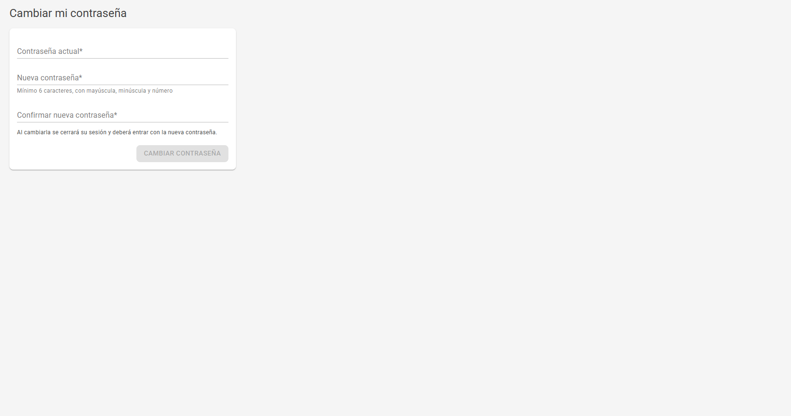

Si olvidó la contraseña o la cuenta quedó bloqueada, pida a un Administrador que la restablezca
([operación, 3.3](../tecnico/06-operacion.md#33-recuperar-el-acceso)).

**Fuente:** [ChangePassword.razor:9-21](../../src/Presentation/AttendanceSystem.Blazor.Server/Components/Pages/ChangePassword.razor#L9-L21).

### 1.2 El menú

| Sitio web | Programa de escritorio |
|---|---|
| **Gestión de personal:** Empleados, Marcajes sin empleado, Sucursales, Departamentos, Puestos, Horarios, Roster de Turnos | **Inicio**, **Empleados**, **Asistencia**, **Bitácora de marcajes**, **Reportes** |
| **Dispositivos y descargas:** Dispositivos 🔑, Hora de relojes, Descargas e Historial, Registros manuales, Cálculo de asistencia, Cierre de periodos | **Catálogos:** Sucursales, Departamentos, Puestos, Turnos |
| **Reportes y análisis:** Reporte de Asistencia, Análisis de Ausentismo, Análisis de Retardos, Impresión de Checadores, Reportes avanzados, Logs de Asistencia | **Dispositivos:** Relojes y descargas |
| **Configuración:** Configuración 🔑, Respaldo y Restauración 🔑, Usuarios 🔑, Hangfire 🔑, Cambiar mi contraseña | **Sistema:** Configuración 🔑, Respaldos 🔑 |

Cada opción aparece sólo si su rol tiene el permiso. Con rol RH, por ejemplo, no aparece *Dispositivos* en el sitio,
pero sí *Descargas e Historial*, que es donde se descargan los relojes.

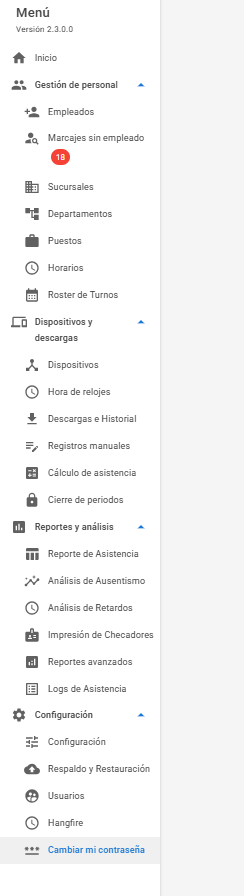

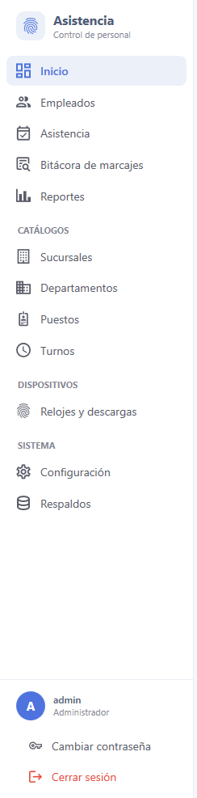

**Fuente:** [NavMenu.razor:3-69](../../src/Presentation/AttendanceSystem.Blazor.Server/Components/Layout/NavMenu.razor#L3-L69),
[ShellViewModel.cs:109-134](../../src/Presentation/AttendanceSystem.WPF/ViewModels/ShellViewModel.cs#L109-L134),
[PagePermissions.cs:11-26](../../src/Presentation/AttendanceSystem.WPF/Services/PagePermissions.cs#L11-L26).

### 1.3 Qué puede hacer cada rol

| Tarea | Usuario | RH | Administrador |
|---|:-:|:-:|:-:|
| Ver empleados, catálogos, asistencia y reportes | ✓ | ✓ | ✓ |
| Dar de alta y editar datos generales de empleados; importar y exportar | ✓ | ✓ | ✓ |
| Enviar empleados al reloj; descargar un reloj | ✓ | ✓ | ✓ |
| Ver las alertas de hora de los relojes | ✓ | ✓ | ✓ |
| Cambiar turno, horario y descansos de un empleado | | ✓ | ✓ |
| Autorizar y configurar horas extra | | ✓ | ✓ |
| Registrar vacaciones, incapacidades y bajas temporales | | ✓ | ✓ |
| Puestos y rol de turnos | | ✓ | ✓ |
| Recalcular y ajustar la asistencia; marcajes manuales; ver el historial de ajustes | | ✓ | ✓ |
| Cerrar periodos | | ✓ | ✓ |
| Exportar para nómina (CONTPAQi, Aspel NOI) | | ✓ | ✓ |
| Borrar empleados; privilegio en el reloj | | | ✓ |
| Sucursales, departamentos, turnos, relojes; descargar todos los relojes | | | ✓ |
| Resolver alertas de hora y marcajes en cuarentena | | | ✓ |
| Anular marcajes manuales; reabrir periodos | | | ✓ |
| Configuración, respaldos, usuarios y panel de tareas | | | ✓ |

Es un resumen de la tabla de 40 permisos de [operación, 3.1](../tecnico/06-operacion.md#31-roles-y-permisos). Un
Administrador puede dar o quitar permisos a cada rol.

### 1.4 La pantalla de inicio

La pantalla de inicio resume el día: puntuales, retardos y faltas; el estado de los relojes; y dos avisos que piden
trabajo de RH:

- **Horarios por corregir:** empleados sin horario o turnos sin horario para algún día. Los días calculados sin turno
  no tienen retardos ni faltas correctas hasta que se corrija el horario y se recalculen
  ([sección 3.1](#31-asignar-o-cambiar-el-horario-de-un-empleado) y [sección 6.1](#61-recalcular-la-asistencia)).
  El botón **Revisar ahora** vuelve a revisar sin esperar a la revisión automática.
- **ID(s) con marcajes que no cuentan en la asistencia:** ver [sección 4.2](#42-resolver-marcajes-sin-empleado).

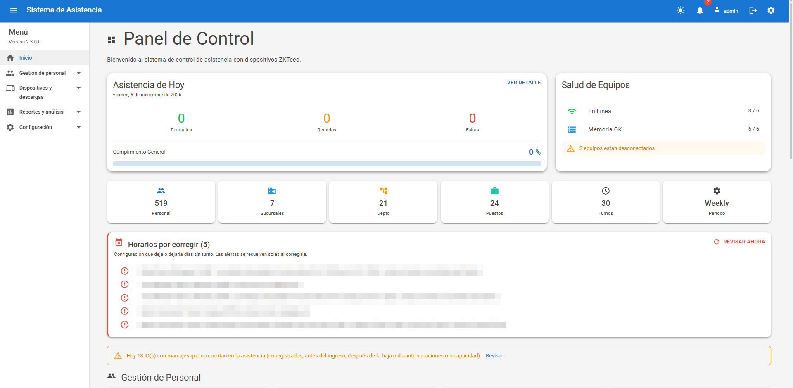

**Fuente:** [Index.razor:33](../../src/Presentation/AttendanceSystem.Blazor.Server/Components/Pages/Index.razor#L33), [líneas 148-154](../../src/Presentation/AttendanceSystem.Blazor.Server/Components/Pages/Index.razor#L148-L154),
[línea 213](../../src/Presentation/AttendanceSystem.Blazor.Server/Components/Pages/Index.razor#L213).

---

## 2. Empleados

### 2.1 Dar de alta un empleado

- **Sitio:** Gestión de personal › Empleados › **Nuevo Empleado**.
- **Escritorio:** Empleados › **Nuevo Empleado**.

El diálogo del sitio tiene cuatro pestañas:

| Pestaña | Campos | Obligatorios |
|---|---|---|
| **General** | ID de Empleado, Nombre, Apellido, Fecha de Contratación, Email, Teléfono, Sexo, Estatus | ID, nombre, apellido, fecha de contratación, sexo, estatus |
| **Puesto** | Sucursal, Departamento, Puesto | Los tres |
| **Horario** | Turno, Horario, Día(s) de Descanso, y las opciones de horas extra ([2.3](#23-configurar-las-horas-extra)) | Turno y horario |
| **Acceso** | Número de Tarjeta, Contraseña PIN (máximo 8 dígitos) | Ninguno |

- El **ID de Empleado** es el número con el que el empleado checa en el reloj. No se puede cambiar después.
- El **Horario** sólo muestra los del turno elegido.
- En el escritorio, el alta siempre empieza con estatus *Alta*; el estatus se cambia al editar.
- Un empleado de una **sucursal externa** no lleva fecha de contratación, sexo, horario ni PIN: no se le calcula
  asistencia. Se registra en la pestaña *Empleados Externos* del sitio o en *Sucursales Externas* del escritorio.

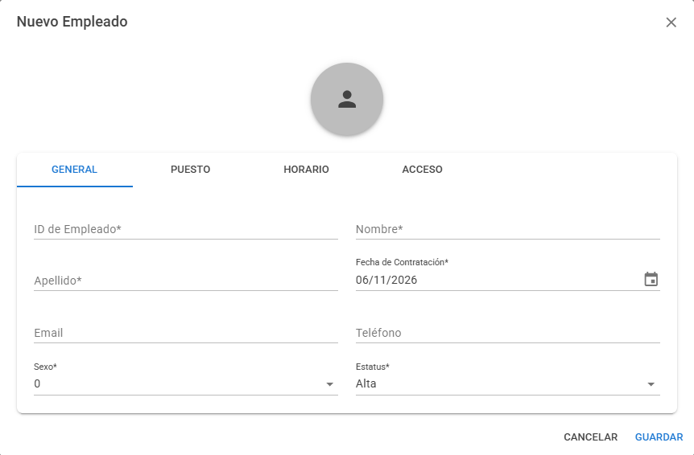

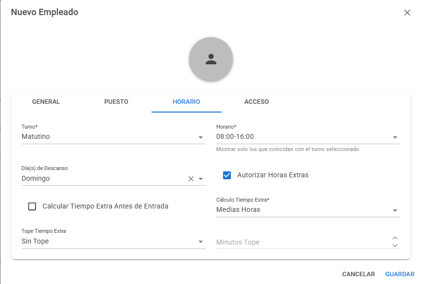

**Fuente:** [Employees.razor:34-36](../../src/Presentation/AttendanceSystem.Blazor.Server/Components/Pages/Employees.razor#L34-L36),
[EmployeeDialog.razor:54-120](../../src/Presentation/AttendanceSystem.Blazor.Server/Components/Dialogs/EmployeeDialog.razor#L54-L120),
[líneas 123-268](../../src/Presentation/AttendanceSystem.Blazor.Server/Components/Dialogs/EmployeeDialog.razor#L123-L268),
[EmployeeDetailView.xaml:70-159](../../src/Presentation/AttendanceSystem.WPF/Views/Employees/EmployeeDetailView.xaml#L70-L159).

### 2.2 Editar un empleado y la fecha de vigencia

Sitio: el lápiz (**Editar**) de la fila. Escritorio: **Editar** en *Acciones*.

Al cambiar **sucursal, turno, horario, días de descanso o estatus**, el diálogo pide una fecha:

| Cambio | Lo que pide |
|---|---|
| Horario, turno, sucursal o descansos | **Vigente desde** |
| A vacaciones, incapacidad o baja temporal | **Desde** y **Hasta (opcional)** |
| De vuelta a *Alta* tras un periodo así | **Regresa a trabajar el** |
| A *Baja* | **Último día laborado** |
| Reingreso tras una baja | **Vigente desde** |

**Si la fecha es pasada, las jornadas desde esa fecha se recalculan solas.** Use la fecha real del cambio: así los
reportes de días anteriores conservan el horario que tenía el empleado en esos días.

Cambiar turno, horario y descansos de un empleado ya dado de alta requiere rol RH o Administrador. Con rol Usuario
esos campos aparecen deshabilitados.

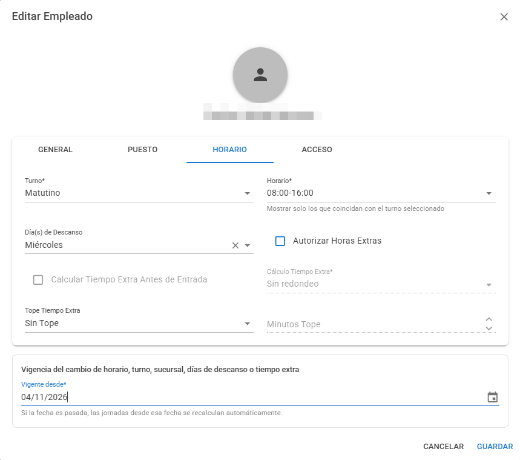

**Fuente:** [EmployeeDialog.razor:273-287](../../src/Presentation/AttendanceSystem.Blazor.Server/Components/Dialogs/EmployeeDialog.razor#L273-L287),
[líneas 356-367](../../src/Presentation/AttendanceSystem.Blazor.Server/Components/Dialogs/EmployeeDialog.razor#L356-L367),
[EmployeeDetailView.xaml:148](../../src/Presentation/AttendanceSystem.WPF/Views/Employees/EmployeeDetailView.xaml#L148),
[línea 171](../../src/Presentation/AttendanceSystem.WPF/Views/Employees/EmployeeDetailView.xaml#L171).

### 2.3 Configurar las horas extra

En la pestaña **Horario** (sitio) o la sección **Tiempo extra** (escritorio):

| Campo (sitio) | Campo (escritorio) | Qué hace |
|---|---|---|
| Autorizar Horas Extras | Autorizar tiempo extra | Sin esta casilla, el excedente de cada día **no se paga** hasta que RH lo autorice día por día ([5.4](#54-autorizar-horas-extra-de-un-día)) |
| Calcular Tiempo Extra Antes de Entrada | Contar tiempo extra antes de la hora de entrada | El tiempo cuenta desde la hora real de llegada, no desde la de entrada |
| Cálculo Tiempo Extra: Sin redondeo, Medias Horas, Horas Completas | Redondeo | Redondea **hacia abajo**: con *Medias Horas*, 50 min se pagan como 30 |
| Tope Tiempo Extra: Sin Tope, Por Día, Por Periodo | Tope | Límite de minutos pagados por día o por periodo de nómina |
| Minutos Tope | Minutos del tope | El límite |

Sólo RH y Administrador pueden cambiar estos campos. El detalle de las fórmulas está en
[motor de cálculo, 8](../tecnico/03-motor-de-calculo.md#8-horas-extra-de-bruto-a-efectivo).

> La regla C01 de la [sección 8.2](#82-reglas-en-revisión) afecta a *Calcular Tiempo Extra Antes de Entrada*.

**Fuente:** [EmployeeDialog.razor:215-258](../../src/Presentation/AttendanceSystem.Blazor.Server/Components/Dialogs/EmployeeDialog.razor#L215-L258),
[EmployeeDetailView.xaml:359-392](../../src/Presentation/AttendanceSystem.WPF/Views/Employees/EmployeeDetailView.xaml#L359-L392).

### 2.4 Vacaciones, incapacidades, bajas temporales y bajas

Edite al empleado y cambie el **Estatus**:

| Estatus | Efecto |
|---|---|
| Vacaciones, Incapacidad, Baja temporal | En ese periodo **no se calcula asistencia ni aparece en reportes**. Con fecha *Hasta*, al día siguiente regresa solo a Alta; sin ella, sigue así hasta que RH lo regrese a Alta. El periodo puede ser futuro |
| Baja | El último día laborado es la fecha que se indica; las checadas posteriores no cuentan |
| Alta | Regreso o reingreso |

Sólo RH y Administrador pueden registrar vacaciones, incapacidades y bajas temporales; con rol Usuario esas opciones
no aparecen en la lista. Si el empleado checa durante el periodo, sus marcajes aparecen en *Marcajes sin empleado*
([4.2](#42-resolver-marcajes-sin-empleado)).

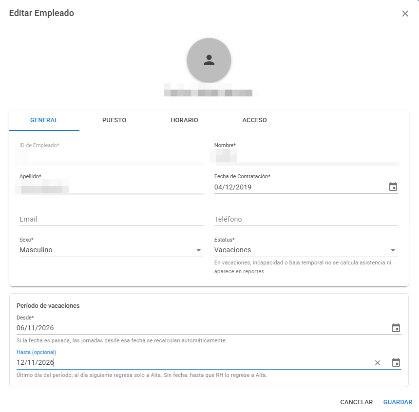

**Fuente:** [EmployeeDialog.razor:83-90](../../src/Presentation/AttendanceSystem.Blazor.Server/Components/Dialogs/EmployeeDialog.razor#L83-L90),
[líneas 281-285](../../src/Presentation/AttendanceSystem.Blazor.Server/Components/Dialogs/EmployeeDialog.razor#L281-L285),
[Employee.cs:57-58](../../src/Core/AttendanceSystem.Domain/Aggregates/EmployeeAggregate/Employee.cs#L57-L58).

### 2.5 Enviar un empleado al reloj

Para que pueda checar, el empleado debe existir en el reloj con su mismo ID.

- **Sitio:** **Enviar a Reloj** en la fila del empleado; elija el reloj en *Seleccione Reloj Checador*.
- **Escritorio:** **Sincronizar con Reloj Checador** en *Acciones*.

El campo *Rol / Privilegio* (administrador del reloj) sólo lo cambia un Administrador 🔑. La huella o el rostro se
registran en el propio reloj.

**Fuente:** [Employees.razor:142](../../src/Presentation/AttendanceSystem.Blazor.Server/Components/Pages/Employees.razor#L142),
[SendEmployeeToDeviceDialog.razor:27-50](../../src/Presentation/AttendanceSystem.Blazor.Server/Components/Dialogs/SendEmployeeToDeviceDialog.razor#L27-L50),
[línea 98](../../src/Presentation/AttendanceSystem.Blazor.Server/Components/Dialogs/SendEmployeeToDeviceDialog.razor#L98),
[EmployeesView.xaml:341](../../src/Presentation/AttendanceSystem.WPF/Views/Employees/EmployeesView.xaml#L341).

### 2.6 Importar y exportar empleados

- **Sitio:** **Importar** y **Exportar** arriba de la lista. El filtro por sucursal, departamento y estado se aplica
  con **Filtrar**.
- **Escritorio:** **Descargar Plantilla Excel**, **Importar desde Excel** y **Exportar a Excel**.

Al terminar una importación se muestran los resultados fila por fila.

**Fuente:** [Employees.razor:76-78](../../src/Presentation/AttendanceSystem.Blazor.Server/Components/Pages/Employees.razor#L76-L78),
[ImportEmployeesDialog.razor:49-59](../../src/Presentation/AttendanceSystem.Blazor.Server/Components/Dialogs/ImportEmployeesDialog.razor#L49-L59),
[EmployeesView.xaml:162-186](../../src/Presentation/AttendanceSystem.WPF/Views/Employees/EmployeesView.xaml#L162-L186).

---

## 3. Horarios y rol de turnos

### 3.1 Asignar o cambiar el horario de un empleado

Se hace al editar al empleado ([2.2](#22-editar-un-empleado-y-la-fecha-de-vigencia)): **Turno**, luego **Horario** y
**Día(s) de Descanso**, con la fecha *Vigente desde*.

Tipos de turno: Matutino, Vespertino, Nocturno, Mixto, Flexible, Partido y Rotativo
([ShiftType.cs](../../src/Core/AttendanceSystem.Domain/Enumerations/ShiftType.cs)).

### 3.2 Consultar los horarios

**Sitio:** Gestión de personal › Horarios. **Escritorio:** Catálogos › Turnos.

RH puede consultarlos. Crear o modificar un horario es de Administrador 🔑; al modificarlo, el sistema pregunta
**Aplica desde**: hoy o una fecha pasada recalcula los días ya calculados desde esa fecha, y una fecha futura no
recalcula nada.

**Fuente:** [Shifts.razor:27-77](../../src/Presentation/AttendanceSystem.Blazor.Server/Components/Pages/Shifts.razor#L27-L77), [línea 174](../../src/Presentation/AttendanceSystem.Blazor.Server/Components/Pages/Shifts.razor#L174),
[EffectiveDateDialog.razor:7-8](../../src/Presentation/AttendanceSystem.Blazor.Server/Components/Dialogs/EffectiveDateDialog.razor#L7-L8).

### 3.3 Rol de turnos rotativos

**Sitio:** Gestión de personal › Roster de Turnos. Muestra los empleados con esquema rotativo (2x8, 3x8, 4x3, 24x48),
su proyección y el estado de hoy.

- **Asignar Esquema Rotativo:** asigna un esquema y genera su proyección de turnos.
- La proyección se consulta por fechas; un día se puede cambiar de turno o marcar como descanso.

En el escritorio, el esquema se asigna en la ficha del empleado (*Esquema rotativo activo*, **Modificar esquema**) y
la proyección se genera al guardar con *Generar o actualizar la proyección de turnos al guardar*.

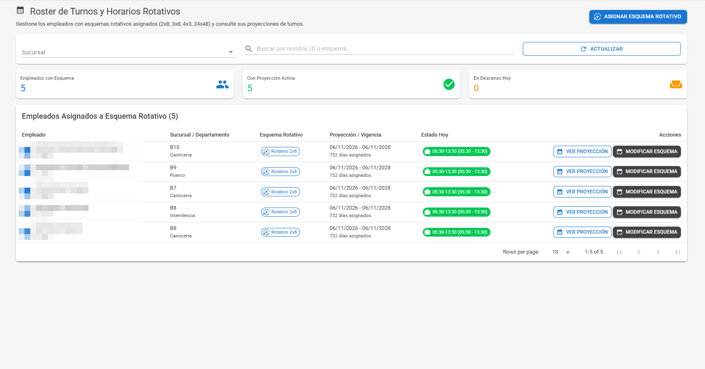

**Fuente:** [Roster.razor:20-30](../../src/Presentation/AttendanceSystem.Blazor.Server/Components/Pages/Roster.razor#L20-L30),
[RosterProjectionDialog.razor:36-127](../../src/Presentation/AttendanceSystem.Blazor.Server/Components/Dialogs/RosterProjectionDialog.razor#L36-L127),
[RosterDayDialog.razor:5-16](../../src/Presentation/AttendanceSystem.Blazor.Server/Components/Dialogs/RosterDayDialog.razor#L5-L16),
[EmployeeDetailView.xaml:223-352](../../src/Presentation/AttendanceSystem.WPF/Views/Employees/EmployeeDetailView.xaml#L223-L352).

---

## 4. Checadas

### 4.1 Descargar los relojes

Los relojes con envío automático (ADMS) mandan las checadas solos. Los demás se descargan:

- **Sitio:** Dispositivos y descargas › Descargas e Historial. En **Nueva Descarga**, opcionalmente *Desde* y
  *Hasta*, y el botón del reloj en *Descargar por Dispositivo*. *Re-descargar Todo* 🔑 pide al reloj toda su memoria.
- **Escritorio:** Dispositivos › Relojes y descargas › **Descargar Logs** en la fila del reloj.

Al terminar aparece *"Descarga de … completada: N registros (M nuevos)"*. Si el reloj tenía la hora mal, puede avisar
que algunos marcajes **quedaron en cuarentena**: no cuentan hasta que un Administrador los revise en *Hora de relojes*
([relojes, 6](../tecnico/04-dispositivos.md#6-cuarentena-de-marcajes)).

El **Historial de Descargas** muestra cada descarga con su estado, total, nuevos y duración.

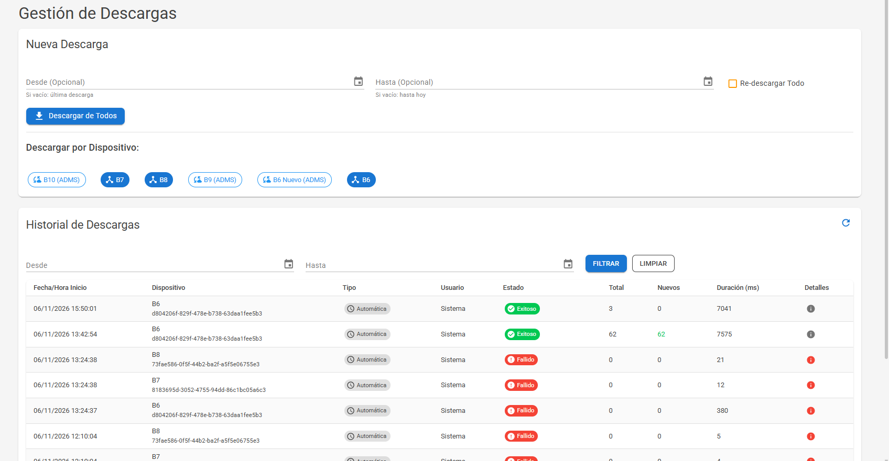

**Fuente:** [Download.razor:28-64](../../src/Presentation/AttendanceSystem.Blazor.Server/Components/Pages/Download.razor#L28-L64),
[líneas 95-187](../../src/Presentation/AttendanceSystem.Blazor.Server/Components/Pages/Download.razor#L95-L187),
[líneas 383-393](../../src/Presentation/AttendanceSystem.Blazor.Server/Components/Pages/Download.razor#L383-L393),
[DevicesView.xaml:208](../../src/Presentation/AttendanceSystem.WPF/Views/Devices/DevicesView.xaml#L208).

### 4.2 Resolver marcajes sin empleado

**Sitio:** Gestión de personal › Marcajes sin empleado (o *Revisar* en el aviso de inicio). Sólo en el sitio.

Lista los marcajes que **no cuentan en la asistencia**, por motivo:

| Motivo | Qué hacer |
|---|---|
| No registrado | El ID no es de ningún empleado. **Dar de alta** abre el alta con ese ID |
| Antes del ingreso | Revisar la fecha de contratación |
| Después de la baja | Revisar la fecha de baja, o reingresar al empleado |
| Vacaciones / incapacidad | Revisar el periodo registrado |
| Periodo cerrado | El marcaje llegó después de cerrar el periodo ([6.2](#62-cerrar-un-periodo)) |

Al dar de alta o reingresar al empleado, sus marcajes se calculan y el aviso desaparece.

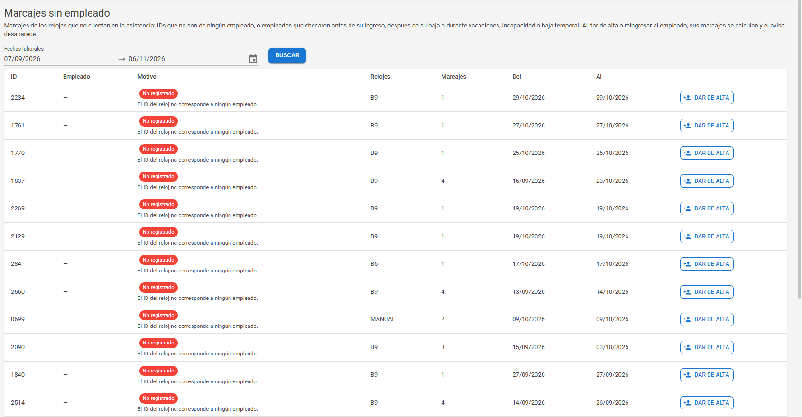

**Fuente:** [UnmatchedPunches.razor:10-13](../../src/Presentation/AttendanceSystem.Blazor.Server/Components/Pages/UnmatchedPunches.razor#L10-L13),
[líneas 59-66](../../src/Presentation/AttendanceSystem.Blazor.Server/Components/Pages/UnmatchedPunches.razor#L59-L66),
[líneas 86-92](../../src/Presentation/AttendanceSystem.Blazor.Server/Components/Pages/UnmatchedPunches.razor#L86-L92).

### 4.3 Registrar marcajes manuales

Para checadas que no quedaron en el reloj. Todas piden un **Motivo**, que se guarda con quién y cuándo lo registró.

| Forma | Dónde |
|---|---|
| Un marcaje de un empleado | Sitio: Logs de Asistencia › **Agregar Manual**. Escritorio: Asistencia o Bitácora de marcajes › **Registro manual** |
| La misma hora a varios empleados y días | Sitio: Registros manuales › **Asignación Masiva**: *Rango de Fechas*, *Hora*, *Empleados* (con *Seleccionar Todos* y filtro por sucursal), **Registrar Logs** |
| Desde archivo | Sitio: Registros manuales › **Importar Archivo (Excel/CSV)**. Columnas **EmployeeId**, **Date** (dd/MM/yyyy), **Time** (HH:mm). **Descargar Formato** da la plantilla. Máximo 5 MB |

No hace falta decir si es entrada o salida: el sistema decide qué es cada marcaje y a qué jornada pertenece, y
recalcula la asistencia al terminar. Anular un marcaje manual es de Administrador 🔑.

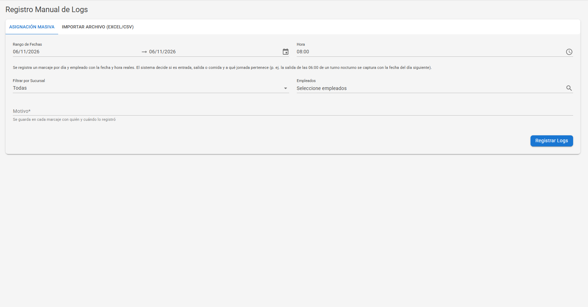

**Fuente:** [ManualLogs.razor:25-75](../../src/Presentation/AttendanceSystem.Blazor.Server/Components/Pages/ManualLogs.razor#L25-L75),
[líneas 82-104](../../src/Presentation/AttendanceSystem.Blazor.Server/Components/Pages/ManualLogs.razor#L82-L104),
[línea 302](../../src/Presentation/AttendanceSystem.Blazor.Server/Components/Pages/ManualLogs.razor#L302),
[AttendanceLogs.razor:46-48](../../src/Presentation/AttendanceSystem.Blazor.Server/Components/Pages/AttendanceLogs.razor#L46-L48),
[ManualPunchDialog.xaml:27-64](../../src/Presentation/AttendanceSystem.WPF/Views/Attendance/ManualPunchDialog.xaml#L27-L64).

---

## 5. Revisar la asistencia del día

### 5.1 Dónde se revisa

| Para | Sitio | Escritorio |
|---|---|---|
| Ver el resultado por empleado y día | Reportes y análisis › Reporte de Asistencia › **Ver Reporte** | **Asistencia** |
| Ver cada checada y cómo se usó | Reportes y análisis › Logs de Asistencia › **Ver Logs** | **Bitácora de marcajes** |
| Ver sólo faltas, retardos, extras o descansos | Reportes y análisis › Reportes avanzados | Reportes |

El Reporte de Asistencia muestra entrada y salida programadas y reales, retardo, extra, **Estado** (Falta, Retardo,
Sin Entrada, Sin Salida, Descanso, Trabajo en Descanso) y **Notas**. En el escritorio, el recuadro **Pendientes de RH**
cuenta las salidas sin clasificar y el tiempo extra sin autorizar.

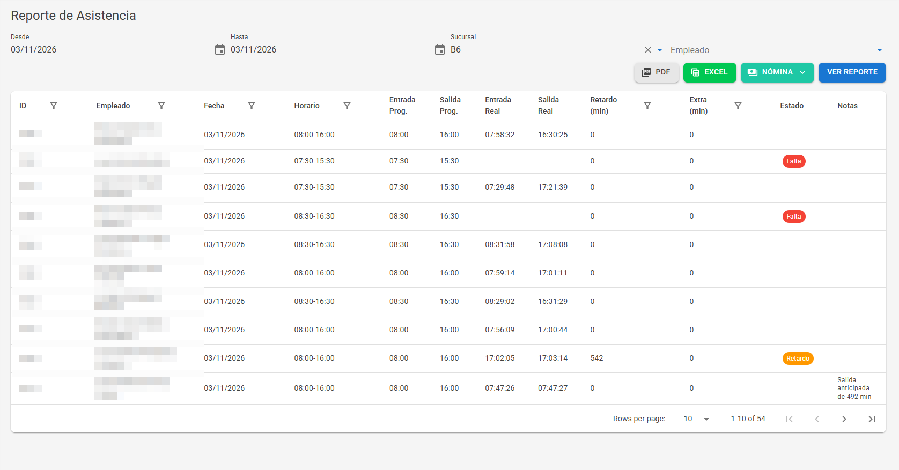

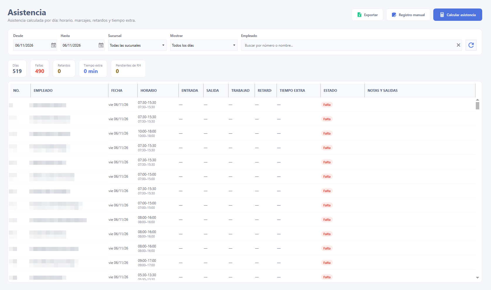

**Fuente:** [AttendanceReport.razor:97-185](../../src/Presentation/AttendanceSystem.Blazor.Server/Components/Pages/AttendanceReport.razor#L97-L185),
[AttendanceView.xaml:51-211](../../src/Presentation/AttendanceSystem.WPF/Views/Attendance/AttendanceView.xaml#L51-L211).

### 5.2 Asignar o desasignar un marcaje

Cuando el sistema tomó una checada como entrada en lugar de salida, o tomó un toque repetido:

- **Sitio:** Logs de Asistencia › elija *Fecha* y *Empleado* › **Ver Logs** › menú de la checada: **Asignar como
  Entrada (B1)**, **Asignar como Salida B1**, **Asignar como Entrada B2**, **Asignar como Salida (B2)**,
  **Desasignar (dejar vacío)** o **Restaurar cálculo automático**.
- **Escritorio:** Bitácora de marcajes › **Cambiar...** en la checada.

B1 y B2 son los dos bloques de un turno partido; en un turno corrido sólo se usan *Entrada (B1)* y *Salida (B2)*.
Cada cambio pide un **Motivo** y recalcula el día.

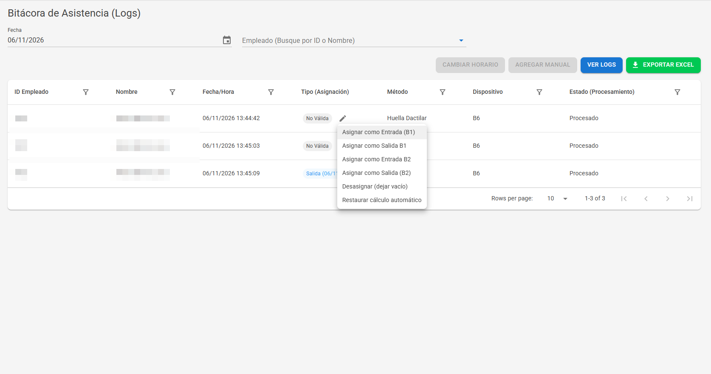

**Fuente:** [AttendanceLogs.razor:126-131](../../src/Presentation/AttendanceSystem.Blazor.Server/Components/Pages/AttendanceLogs.razor#L126-L131),
[línea 315](../../src/Presentation/AttendanceSystem.Blazor.Server/Components/Pages/AttendanceLogs.razor#L315),
[PunchLogView.xaml:140-179](../../src/Presentation/AttendanceSystem.WPF/Views/Attendance/PunchLogView.xaml#L140-L179).

### 5.3 Cambiar el horario de un día o marcarlo como descanso

- **Horario de un día:** Logs de Asistencia › **Cambiar Horario** (escritorio: *Cambiar horario del día*). Aparece el
  aviso *Horario cambiado a mano* y el botón **Regresar al horario del roster** para deshacerlo.
- **Descanso o laborable:** Reportes avanzados › **Descanso Erróneo** › *Ver Detalles* › **Hacer Laborable** o
  **Hacer Descanso**. Se deshace con **Regresar al descanso del roster** en Logs de Asistencia.
- **Historial (N):** muestra cada ajuste del día con fecha, usuario, movimiento y motivo.

**Fuente:** [AttendanceLogs.razor:40-80](../../src/Presentation/AttendanceSystem.Blazor.Server/Components/Pages/AttendanceLogs.razor#L40-L80),
[ReportDetailsDialog.razor:36-56](../../src/Presentation/AttendanceSystem.Blazor.Server/Components/Dialogs/ReportDetailsDialog.razor#L36-L56),
[AttendanceHistoryDialog.razor:14-51](../../src/Presentation/AttendanceSystem.Blazor.Server/Components/Dialogs/AttendanceHistoryDialog.razor#L14-L51),
[PunchLogView.xaml:103-114](../../src/Presentation/AttendanceSystem.WPF/Views/Attendance/PunchLogView.xaml#L103-L114).

### 5.4 Autorizar horas extra de un día

A un empleado **sin** *Autorizar Horas Extras* el excedente no se le paga, y aparece la nota *"Tiempo extra no
autorizado: N min"*. Para autorizarlo ese día:

- **Sitio:** Reporte de Asistencia › en *Notas*, **Autorizar extras** › *Completo (N min)* o un bloque de 30 min.
- **Escritorio:** Asistencia › **Autorizar...** en la columna *Tiempo extra*.

Sólo se autoriza el excedente completo o bloques de 30 minutos que no lo pasen. **Si el día se recalcula y el
excedente cambia, la autorización deja de valer** y aparece *"El tiempo extra cambió de X a Y min: autorícelo
nuevamente"*. **Retirar autorización de extras** la quita.

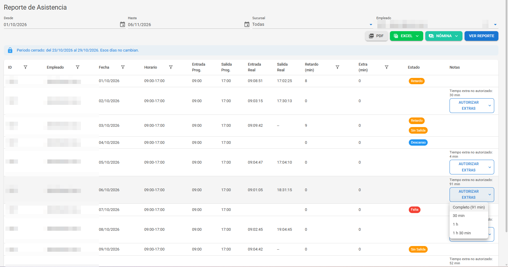

**Fuente:** [AttendanceReport.razor:190-212](../../src/Presentation/AttendanceSystem.Blazor.Server/Components/Pages/AttendanceReport.razor#L190-L212),
[AttendanceView.xaml:196-203](../../src/Presentation/AttendanceSystem.WPF/Views/Attendance/AttendanceView.xaml#L196-L203),
[motor de cálculo, 10](../tecnico/03-motor-de-calculo.md#10-decisiones-de-rh).

### 5.5 Clasificar salidas durante la jornada

Una salida y regreso en medio de la jornada que no es la comida queda como **salida pendiente** y **se descuenta**
hasta que RH la clasifique. En el sitio aparece como botón en *Notas* del Reporte de Asistencia; en el escritorio, en
*Notas y salidas*.

| Opción | ¿Se descuenta? |
|---|---|
| (sin clasificar) | Sí, completa |
| Comida | Sólo lo que pase de los minutos de comida con goce |
| Permiso con goce | No |
| Permiso sin goce (descontar) | Sí, completa |
| Error de checada | No |
| Quitar clasificación | Vuelve a como la clasificó el sistema |

Las ausencias de 15 minutos o menos se toman como toque doble y no se clasifican
([motor de cálculo, 7](../tecnico/03-motor-de-calculo.md#7-comida-y-salidas-temporales)).

**Fuente:** [AttendanceReport.razor:214-237](../../src/Presentation/AttendanceSystem.Blazor.Server/Components/Pages/AttendanceReport.razor#L214-L237),
[AttendanceViewModel.cs:441-447](../../src/Presentation/AttendanceSystem.WPF/ViewModels/Attendance/AttendanceViewModel.cs#L441-L447).

---

## 6. Recalcular y cerrar periodos

### 6.1 Recalcular la asistencia

La asistencia se recalcula sola al descargar un reloj, al registrar marcajes y al guardar ajustes. Recalcule a mano después
de corregir horarios o cuando un reporte no refleje un cambio.

- **Sitio:** Dispositivos y descargas › Cálculo de asistencia: **Por Día**, **Rango de Fechas** o **Por Periodo**
  (semana, quincena o mes según la configuración), *Sucursal (Opcional)*, *Empleado (Opcional)*, **Calcular**.
- **Escritorio:** Asistencia › **Calcular asistencia** recalcula el rango de fechas seleccionado.

Los días de un periodo cerrado no se recalculan.

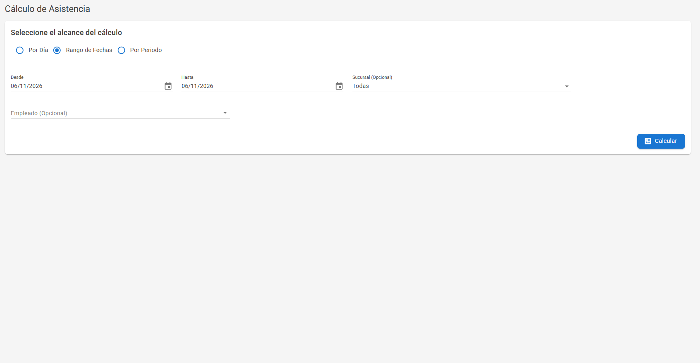

**Fuente:** [DownloadFromDeviceCommand.cs:25](../../src/Core/AttendanceSystem.Application/Features/Attendance/Commands/DownloadFromDevice/DownloadFromDeviceCommand.cs#L25),
[línea 533](../../src/Core/AttendanceSystem.Application/Features/Attendance/Commands/DownloadFromDevice/DownloadFromDeviceCommand.cs#L533),
[ManualLogs.razor:255-263](../../src/Presentation/AttendanceSystem.Blazor.Server/Components/Pages/ManualLogs.razor#L255-L263),
[CalculateAttendance.razor:25-103](../../src/Presentation/AttendanceSystem.Blazor.Server/Components/Pages/CalculateAttendance.razor#L25-L103),
[AttendanceView.xaml:70-73](../../src/Presentation/AttendanceSystem.WPF/Views/Attendance/AttendanceView.xaml#L70-L73).

### 6.2 Cerrar un periodo

**Sitio:** Dispositivos y descargas › Cierre de periodos › **Cerrar**. Sólo en el sitio.

Un periodo cerrado **congela la asistencia entregada**: sus días ya no se recalculan ni aceptan ajustes. Los
periodos se cierran solos **3 días después de terminar**. **Reabrir** es de Administrador 🔑, pide un motivo, y el
periodo reabierto hay que cerrarlo de nuevo a mano. Las checadas que lleguen después del cierre aparecen en
*Marcajes sin empleado* con el motivo *Periodo cerrado*.

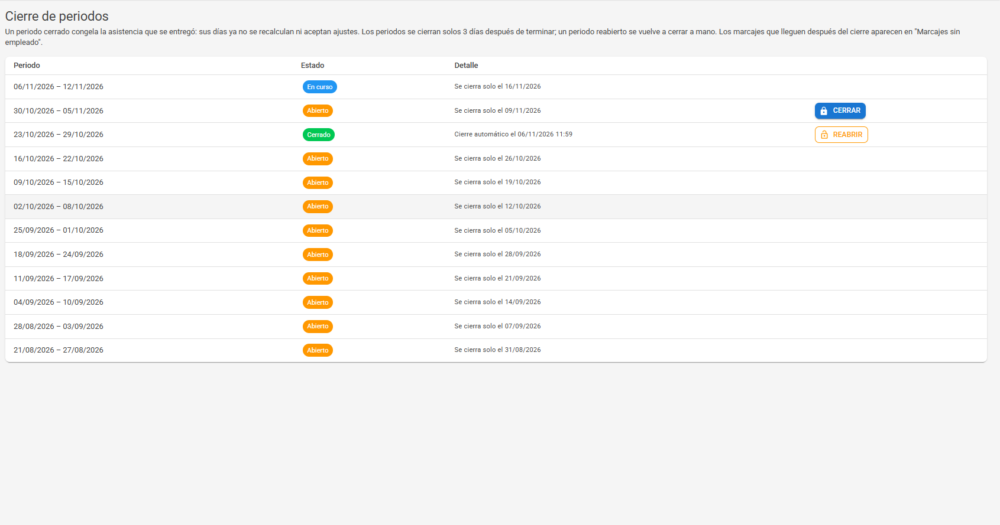

**Fuente:** [PeriodClosures.razor:10-15](../../src/Presentation/AttendanceSystem.Blazor.Server/Components/Pages/PeriodClosures.razor#L10-L15),
[líneas 65-70](../../src/Presentation/AttendanceSystem.Blazor.Server/Components/Pages/PeriodClosures.razor#L65-L70),
[línea 106](../../src/Presentation/AttendanceSystem.Blazor.Server/Components/Pages/PeriodClosures.razor#L106),
[PeriodClosureService.cs:34](../../src/Core/AttendanceSystem.Application/Features/Attendance/PeriodClosure/PeriodClosureService.cs#L34).

---

## 7. Reportes y nómina

### 7.1 Reportes

| Reporte | Sitio | Escritorio (Reportes) | Formatos |
|---|---|---|---|
| Asistencia general | Reporte de Asistencia | Asistencia general | PDF, Excel resumido o detallado |
| Faltas, Retardos, Horas extra, Horas extra por departamento, Descanso trabajado | Reportes avanzados | Con el mismo nombre | Excel |
| Horario erróneo, Descanso erróneo | Reportes avanzados | — | En pantalla |
| Tarjetas de asistencia | Impresión de Checadores | Tarjetas de asistencia | PDF; en el sitio, también **Imprimir** |
| Ausentismo y retardos por departamento y sucursal | Análisis de Ausentismo, Análisis de Retardos | — | En pantalla |

En el escritorio, **Generar y guardar** pregunta dónde guardar el archivo. Si no hay datos, avisa que revise que la
asistencia esté calculada.

La **Impresión de Checadores** filtra por rango de fechas o periodo, sucursal y empleados (*Todos*, *Rango de
Empleado* o *Empleado Específico*), con *Incluir Horas Extra* y observaciones.

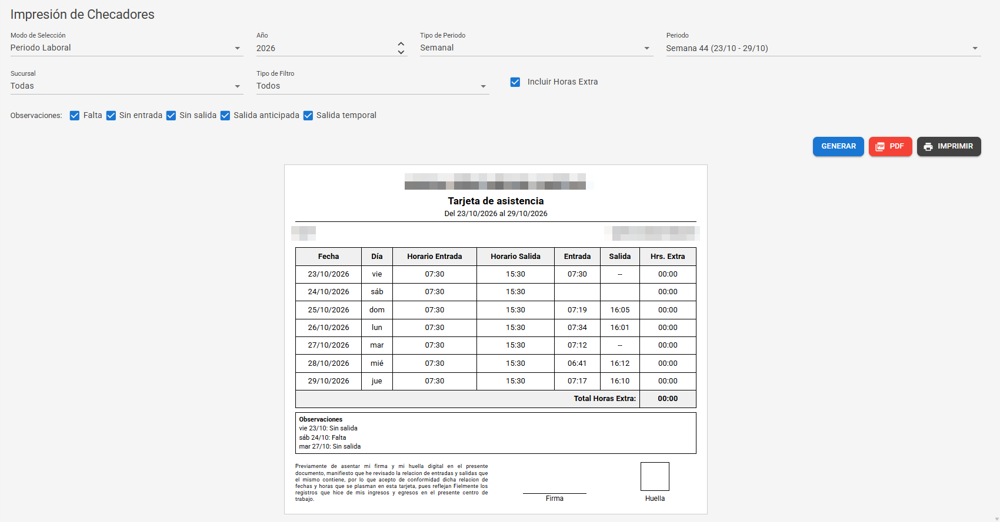

**Fuente:** [AttendanceReport.razor:26-85](../../src/Presentation/AttendanceSystem.Blazor.Server/Components/Pages/AttendanceReport.razor#L26-L85),
[AdvancedAttendanceReports.razor:29-81](../../src/Presentation/AttendanceSystem.Blazor.Server/Components/Pages/AdvancedAttendanceReports.razor#L29-L81),
[AttendanceCards.razor:179-272](../../src/Presentation/AttendanceSystem.Blazor.Server/Components/Pages/AttendanceCards.razor#L179-L272),
[AbsenteeismAnalysis.razor:17-29](../../src/Presentation/AttendanceSystem.Blazor.Server/Components/Pages/AbsenteeismAnalysis.razor#L17-L29),
[TardinessAnalysis.razor:17-29](../../src/Presentation/AttendanceSystem.Blazor.Server/Components/Pages/TardinessAnalysis.razor#L17-L29),
[ReportsViewModel.cs:56-68](../../src/Presentation/AttendanceSystem.WPF/ViewModels/Reports/ReportsViewModel.cs#L56-L68),
[líneas 119-123](../../src/Presentation/AttendanceSystem.WPF/ViewModels/Reports/ReportsViewModel.cs#L119-L123),
[línea 188](../../src/Presentation/AttendanceSystem.WPF/ViewModels/Reports/ReportsViewModel.cs#L188).

### 7.2 Exportar para nómina

- **Sitio:** Reporte de Asistencia › menú **Nómina** › *CONTPAQi Nóminas (.csv)* o *Aspel NOI (.txt)*.
- **Escritorio:** Reportes › *Nómina CONTPAQi* (CSV) o *Nómina Aspel NOI* (TXT).

Requiere rol RH o Administrador. Antes de exportar: descargue los relojes, clasifique las salidas pendientes,
autorice las extras y, de preferencia, cierre el periodo, para que lo exportado no cambie después.

**Fuente:** [AttendanceReport.razor:67-69](../../src/Presentation/AttendanceSystem.Blazor.Server/Components/Pages/AttendanceReport.razor#L67-L69),
[ReportsViewModel.cs:63-68](../../src/Presentation/AttendanceSystem.WPF/ViewModels/Reports/ReportsViewModel.cs#L63-L68).

---

## 8. Cómo calcula el sistema

### 8.1 Reglas principales

| Concepto | Regla | Ejemplo |
|---|---|---|
| Retardo | Si la llegada pasa de la tolerancia, el retardo es el retraso **completo** | Entrada 08:00, tolerancia 15: llegar 08:20 son 20 min de retardo |
| Desde cuándo cuenta el tiempo | Pasada la tolerancia, desde el siguiente bloque de 30 min | Entrada 08:00, tolerancia 15: de 08:16 a 08:45 cuenta desde 08:30 |
| Comida | Lo que pase de los minutos con goce se descuenta y hay que reponerlo al salir | Exceder la comida 20 min obliga a salir 20 min después |
| Falta | Día laborable sin ningún marcaje | — |
| Un solo marcaje | Tiempo trabajado 0, con *Sin Entrada* o *Sin Salida* | — |
| Descanso trabajado | Se calcula con el horario del día | — |
| Horas extra | Sin autorización no se pagan; con autorización se redondea hacia abajo y se aplica el tope | 50 min con *Medias Horas*: 30 |

Detalle y ejemplos comprobados con pruebas: [motor de cálculo, 5](../tecnico/03-motor-de-calculo.md#5-fórmulas-comunes) y
[8](../tecnico/03-motor-de-calculo.md#8-horas-extra-de-bruto-a-efectivo).

### 8.2 Reglas en revisión

Estas son las **reglas actuales** del sistema. Están en revisión con RH: si alguna no corresponde al reglamento
interno, se corregirá ([limitaciones, 4](../tecnico/07-limitaciones.md#4-reglas-de-cálculo-por-confirmar)).

| ID | Regla actual |
|---|---|
| C01 | Con *Calcular Tiempo Extra Antes de Entrada*, quien entra 08:00 y llega 08:10 dentro de la tolerancia trabaja 470 min, no 480 |
| C02 | Un descanso trabajado se mide contra el horario normal: puede dar salida anticipada y 0 de extra |
| C03 | El exceso de comida resta del tiempo trabajado y además genera salida anticipada |
| C04 | Una guardia de 24 h seguida de un día laborable pierde la salida marcada después de las 24 h |
| C05 | El faltante de la bolsa semanal aparece en el último día de la semana con bolsa, aunque sea descanso |
| C06 | En multi-marcaje, un intervalo sin cerrar suma 0 |
| C07 | El retardo es el retraso completo, no lo que pasa de la tolerancia |
| C08 | En multi-marcaje, el redondeo de entrada usa la hora UTC (sin efecto en México) |

---

## 9. Problemas frecuentes

| Problema | Causa probable | Qué hacer |
|---|---|---|
| Un empleado checó pero no aparece | No está dado de alta, o checó antes de su ingreso, después de su baja o en vacaciones | [4.2](#42-resolver-marcajes-sin-empleado) |
| Las checadas de hoy no aparecen | El reloj no se ha descargado o está desconectado (ver *Salud de Equipos* en inicio) | [4.1](#41-descargar-los-relojes); si sigue, avise a soporte |
| Retardos o faltas a un empleado que no trabajaba ese día | Horario o descansos mal capturados, o un día sin turno | Corrija el horario con la fecha real ([2.2](#22-editar-un-empleado-y-la-fecha-de-vigencia)) o marque el día ([5.3](#53-cambiar-el-horario-de-un-día-o-marcarlo-como-descanso)) |
| *Horarios por corregir* en inicio | Empleado sin horario o turno incompleto | [3.1](#31-asignar-o-cambiar-el-horario-de-un-empleado), luego [6.1](#61-recalcular-la-asistencia) |
| La entrada se tomó como salida | Toques repetidos u horario equivocado | [5.2](#52-asignar-o-desasignar-un-marcaje) |
| Descuentos que no esperaba | Salidas pendientes sin clasificar | [5.5](#55-clasificar-salidas-durante-la-jornada) |
| Extras en 0 | Empleado sin autorización, o el excedente cambió después de autorizarlo | [5.4](#54-autorizar-horas-extra-de-un-día) |
| No deja ajustar ni recalcular un día | El periodo está cerrado | Pida a un Administrador que lo reabra ([6.2](#62-cerrar-un-periodo)) |
| *"Este día fue modificado por otra persona…"* | Otra persona lo ajustó al mismo tiempo | Revise los datos recargados y repita el ajuste |
| Marcajes *en cuarentena* al descargar | El reloj tenía la hora mal | Avise a un Administrador (*Hora de relojes*) |
| El sitio dice que está en mantenimiento | Actualización o restauración en curso | Espere; si sigue, avise a soporte ([operación, 2](../tecnico/06-operacion.md#2-arranque-actualización-y-mantenimiento)) |

**Fuente del aviso de modificación simultánea:** [AttendanceReport.razor:363](../../src/Presentation/AttendanceSystem.Blazor.Server/Components/Pages/AttendanceReport.razor#L363).
