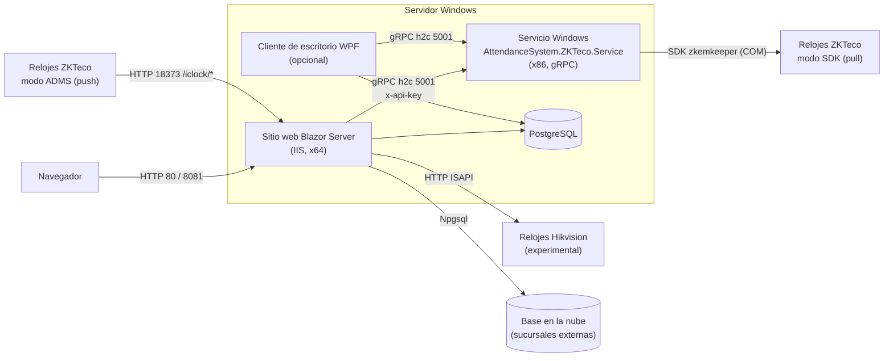
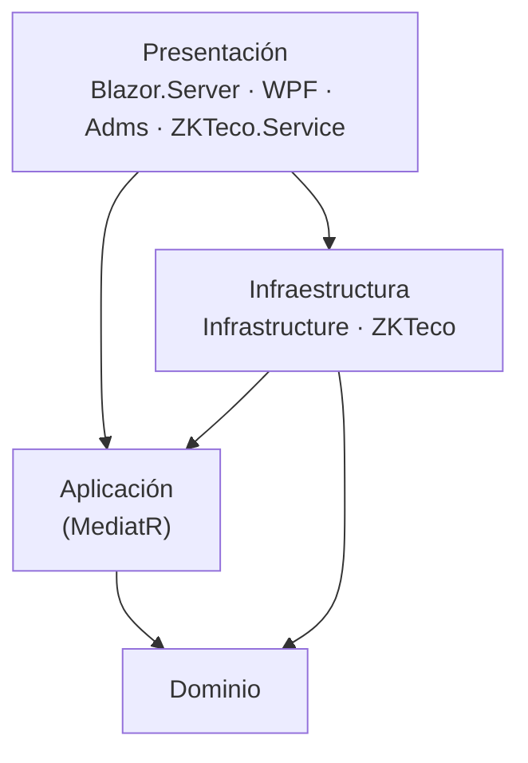
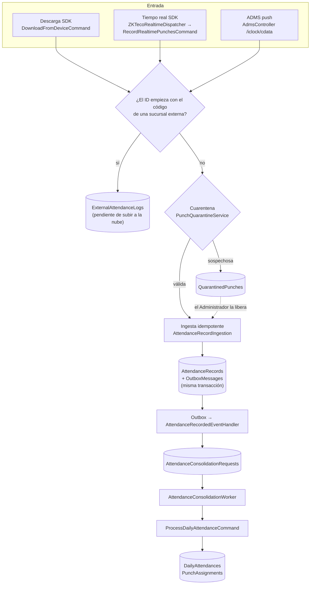

# Arquitectura y funcionamiento

Verificado contra el código en el commit `a019748` (versión `2.3.0`, [Directory.Build.props](../../Directory.Build.props)).
Cada afirmación lleva el archivo y la línea que la respalda; las rutas son relativas a la raíz del repositorio.

## Contenido

1. [Vista general](#1-vista-general)
2. [Proyectos de la solución](#2-proyectos-de-la-solución)
3. [Procesos en ejecución](#3-procesos-en-ejecución)
4. [Formas de instalación](#4-formas-de-instalación)
5. [Puertos y protocolos](#5-puertos-y-protocolos)
6. [Capas y dependencias](#6-capas-y-dependencias)
7. [Recorrido de una checada](#7-recorrido-de-una-checada)
8. [Trabajo en segundo plano](#8-trabajo-en-segundo-plano)
9. [Arranque y modo mantenimiento](#9-arranque-y-modo-mantenimiento)
10. [Integración Hikvision (experimental)](#10-integración-hikvision-experimental)
11. [Observaciones verificadas](#11-observaciones-verificadas)

---

## 1. Vista general

El sistema tiene tres programas: el **sitio web** (la aplicación principal), el **servicio ZKTeco** (un puente de 32
bits hacia el SDK de ZKTeco) y un **cliente de escritorio WPF** opcional. Todos guardan en una sola base PostgreSQL.

El servicio ZKTeco existe porque el SDK de ZKTeco (`zkemkeeper.dll`, un componente COM) es de 32 bits y el sitio
web es de 64. El servicio se compila para x86
([AttendanceSystem.ZKTeco.Service.csproj](../../src/Presentation/AttendanceSystem.ZKTeco.Service/AttendanceSystem.ZKTeco.Service.csproj),
`<PlatformTarget>x86`) y el instalador registra el DLL como componente de 32 bits
([setup_script.iss:140](../../Deploy/setup_script.iss#L140), flags `regserver 32bit`).

## 2. Proyectos de la solución

| Proyecto | Tipo | Framework / plataforma | Responsabilidad |
|---|---|---|---|
| `AttendanceSystem.Domain` | Biblioteca | `net10.0` | Entidades, agregados, enumeraciones, objetos de valor y eventos de dominio. No referencia otros proyectos. |
| `AttendanceSystem.Application` | Biblioteca | `net10.0` | Casos de uso como comandos y consultas de MediatR 14.2.0, permisos, reglas del cálculo. Referencia sólo a `Domain`. |
| `AttendanceSystem.Infrastructure` | Biblioteca | `net10.0` | EF Core / PostgreSQL, repositorios, Hangfire, clientes de relojes (gRPC hacia el servicio ZKTeco, HTTP hacia Hikvision), respaldos, correo, exportación (ClosedXML, QuestPDF). |
| `AttendanceSystem.ZKTeco` | Biblioteca | `net10.0` | Contrato gRPC ([zkteco.proto](../../src/Infrastructure/AttendanceSystem.ZKTeco/Protos/zkteco.proto)), adaptador del SDK, sesiones por reloj y escucha en tiempo real. Incluye los DLL del SDK en `lib/`. |
| `AttendanceSystem.Adms` | Biblioteca | `net10.0` | Receptor del protocolo ADMS (`AdmsController`) y el middleware que responde 503 durante una restauración. Lo cargan el sitio web y el WPF. |
| `AttendanceSystem.Blazor.Server` | Aplicación web | `net10.0`, SDK `Microsoft.NET.Sdk.Web` | Interfaz web (Blazor Server + MudBlazor 9.7.0), API ADMS, panel de Hangfire, aplicación de migraciones. |
| `AttendanceSystem.ZKTeco.Service` | Servicio Windows | `net10.0`, **x86**, SDK `Microsoft.NET.Sdk.Worker` | Servidor gRPC que ejecuta las operaciones del SDK de ZKTeco. |
| `AttendanceSystem.WPF` | Aplicación de escritorio | `net10.0-windows10.0.17763.0`, `UseWPF` | Interfaz de escritorio; también ejecuta el trabajo en segundo plano (sección 4). |

Fuente de la tabla: los `.csproj` de cada proyecto (`TargetFramework`, `PlatformTarget`, `Sdk`, `ProjectReference`,
`PackageReference`).

Fuera de `src/` hay pruebas (`tests/`) y herramientas de diagnóstico (`tools/`); no forman parte de lo que se
instala ([setup_script.iss:127-140](../../Deploy/setup_script.iss#L127-L140) sólo copia `Release\Web`,
`Release\Desktop` y `Release\Service`).

## 3. Procesos en ejecución

### 3.1 Sitio web (`AttendanceSystem.Blazor.Server`)

Arranque en [Program.cs](../../src/Presentation/AttendanceSystem.Blazor.Server/Program.cs). En orden:

1. Registra Blazor, MudBlazor, los controladores (incluido el receptor ADMS, línea 74), las capas de aplicación e
   infraestructura (líneas 86-88), Identity (líneas 95-124), autorización por permisos (líneas 128-136) y Hangfire
   sobre PostgreSQL (líneas 144-152).
2. Registra el suscriptor de checadas en tiempo real del servicio ZKTeco (líneas 157-160). **Sólo el sitio web lo
   registra:** el servicio ZKTeco admite un único suscriptor (comentario de las líneas 157-158).
3. Prepara la base: aplica migraciones y datos iniciales (línea 168, ver [sección 9](#9-arranque-y-modo-mantenimiento)).
4. Arma el pipeline HTTP: registro de peticiones ADMS, Serilog, archivos estáticos, `RestoreMaintenanceMiddleware`
   (línea 195), autenticación, autorización, panel `/hangfire` (líneas 203-206).
5. Programa las tareas recurrentes (línea 209) y empieza a atender.

Sesión de usuario: cookie `HttpOnly`, 8 horas con renovación deslizante, bloqueo de cuenta tras 5 intentos fallidos
durante 15 minutos, contraseña de al menos 6 caracteres con dígito, minúscula y mayúscula (líneas 95-124).

### 3.2 Servicio ZKTeco (`AttendanceSystem.ZKTeco.Service`)

Arranque en [Program.cs](../../src/Presentation/AttendanceSystem.ZKTeco.Service/Program.cs):

- Se registra como servicio de Windows con el nombre `AttendanceSystem.ZKTeco.Service` (líneas 85-88). El
  instalador crea el servicio con ese nombre e inicio automático
  ([setup_script.iss:168-169](../../Deploy/setup_script.iss#L168-L169)).
- Escucha gRPC sobre HTTP/2 **sin TLS** en el puerto `GrpcPort` (5001 por omisión), **sólo en localhost** salvo que
  `GrpcBindLocalOnly` sea `false` (líneas 140-158).
- Toda llamada, salvo la de salud estándar `grpc.health.v1.Health`, exige la cabecera `x-api-key` con el valor de
  `ApiKey` o `ZKTecoService:ApiKey`. **Sin esa clave configurada, el servicio no arranca**
  ([ApiKeyAuthInterceptor.cs:19-25](../../src/Presentation/AttendanceSystem.ZKTeco.Service/Interceptors/ApiKeyAuthInterceptor.cs#L19-L25),
  [ApiKeyAuthInterceptor.cs:70-74](../../src/Presentation/AttendanceSystem.ZKTeco.Service/Interceptors/ApiKeyAuthInterceptor.cs#L70-L74)).
- Mensajes gRPC de hasta 32 MB (líneas 120-126).

Operaciones que expone ([zkteco.proto:6-54](../../src/Infrastructure/AttendanceSystem.ZKTeco/Protos/zkteco.proto#L6-L54)):
conectar y desconectar, leer checadas, borrar checadas del reloj, registrar / leer / borrar empleados, leer todos los
usuarios, borrar huellas, restaurar de fábrica, leer y poner la hora, leer información del reloj, descubrir relojes
en la red, indicar qué relojes escuchar en tiempo real (`SetRealtimeDevices`) y suscribirse a las checadas en tiempo
real (`SubscribeRealtime`, un *stream* del servidor).

Los clientes (el sitio web y el WPF) lo encuentran en `ZKTecoService:Url`, por omisión `http://localhost:5001`
([InfrastructureServiceExtensions.cs:146](../../src/Infrastructure/AttendanceSystem.Infrastructure/DependencyInjection/InfrastructureServiceExtensions.cs#L146)),
y envían la clave de `ZKTecoService:ApiKey` o `ApiKey`
([InfrastructureServiceExtensions.cs:152](../../src/Infrastructure/AttendanceSystem.Infrastructure/DependencyInjection/InfrastructureServiceExtensions.cs#L152)).

### 3.3 Cliente WPF (`AttendanceSystem.WPF`)

El WPF no es sólo una interfaz: lleva dentro el mismo *backend* que el sitio web
([WpfBackendHost.cs:23-28](../../src/Presentation/AttendanceSystem.WPF/Services/WpfBackendHost.cs#L23-L28)):
las capas de aplicación e infraestructura, Hangfire, el outbox y la consolidación. Lee y escribe la base
**directamente** con su propia cadena de conexión, y habla con el servicio ZKTeco por gRPC.

Su comportamiento depende de `Hosting:Standalone`
([WpfBackendHost.cs:31](../../src/Presentation/AttendanceSystem.WPF/Services/WpfBackendHost.cs#L31)); ver la
sección siguiente.

## 4. Formas de instalación

El instalador ofrece los componentes `web` y `desktop`; el servicio ZKTeco se instala siempre
([setup_script.iss:127-140](../../Deploy/setup_script.iss#L127-L140)). El detalle del instalador se documenta en la
fase de instalación. Lo que cambia en el funcionamiento:

| | Sitio web (con o sin WPF) | WPF sin sitio web (`Hosting:Standalone = true`) |
|---|---|---|
| Quién aplica las migraciones | El sitio web | El WPF ([App.xaml.cs:112](../../src/Presentation/AttendanceSystem.WPF/App.xaml.cs#L112)) |
| Quién crea el esquema de Hangfire | El sitio web | El WPF ([WpfBackendHost.cs:84](../../src/Presentation/AttendanceSystem.WPF/Services/WpfBackendHost.cs#L84)) |
| Quién recibe a los relojes ADMS | El sitio web, en el enlace de IIS del puerto ADMS | El WPF, con Kestrel en todas las interfaces y el puerto `SystemConfiguration.AdmsPort` (18373 por omisión) ([WpfBackendHost.cs:120-133](../../src/Presentation/AttendanceSystem.WPF/Services/WpfBackendHost.cs#L120-L133)) |
| Checadas en tiempo real por SDK | El sitio web ([Program.cs:159-160](../../src/Presentation/AttendanceSystem.Blazor.Server/Program.cs#L159-L160)) | No: el WPF no registra el suscriptor |
| Tareas programadas | Las ejecuta el proceso que tome cada trabajo de Hangfire; con ambos instalados comparten el almacenamiento y cada trabajo lo toma uno solo ([ServerStartup.cs:87-90](../../src/Infrastructure/AttendanceSystem.Infrastructure/Services/ServerStartup.cs#L87-L90)) | El WPF, sólo mientras está abierto |
| WPF con el esquema atrasado | Pausa sus tareas hasta que el sitio web actualice el esquema y el WPF se vuelva a abrir ([ServerStartup.cs:56-67](../../src/Infrastructure/AttendanceSystem.Infrastructure/Services/ServerStartup.cs#L56-L67)) | No aplica: él mismo migra |

**Consecuencia de `Standalone`:** sin sitio web, si nadie tiene abierto el WPF, nadie recibe a los relojes ADMS ni
ejecuta descargas, respaldos ni reportes automáticos.

## 5. Puertos y protocolos

| Puerto | Protocolo | Quién escucha | Quién conecta | Fuente |
|---|---|---|---|---|
| 80, o 8081 si el 80 está ocupado | HTTP | Sitio en IIS `AttendanceSystem` | Navegadores | [configure_iis.bat:61-70](../../Deploy/configure_iis.bat#L61-L70) |
| 18373 (`AdmsPort`) | HTTP | Segundo enlace del mismo sitio IIS, o el WPF en modo `Standalone` | Relojes ZKTeco en modo ADMS | [configure_iis.bat:79-82](../../Deploy/configure_iis.bat#L79-L82), [setup_script.iss:35](../../Deploy/setup_script.iss#L35), [WpfBackendHost.cs:133](../../src/Presentation/AttendanceSystem.WPF/Services/WpfBackendHost.cs#L133) |
| 5001 (`GrpcPort`) | gRPC sobre HTTP/2 sin TLS, sólo loopback por omisión | Servicio ZKTeco | Sitio web y WPF | [Program.cs:140-158](../../src/Presentation/AttendanceSystem.ZKTeco.Service/Program.cs#L140-L158) |
| El de `Devices.Port` (la pantalla de alta propone 4370) | Protocolo del SDK de ZKTeco | Reloj ZKTeco | Servicio ZKTeco | [SharedDtos.cs:59](../../src/Core/AttendanceSystem.Application/DTOs/SharedDtos.cs#L59) |
| Puerto HTTP del reloj | HTTP ISAPI | Reloj Hikvision | Sitio web / WPF, directamente | [HikvisionDeviceClient.cs:29](../../src/Infrastructure/AttendanceSystem.Infrastructure/Adapters/HikvisionDeviceClient.cs#L29) |
| 5432 | PostgreSQL | PostgreSQL | Sitio web, WPF | Cadenas de conexión; el instalador detecta el puerto real ([setup_script.iss:378-383](../../Deploy/setup_script.iss#L378-L383)) |
| El de `CloudDbConnectionString` | PostgreSQL | Base en la nube | Sitio web / WPF (tarea `cloud-log-sync`) | `SystemConfiguration.CloudDbConnectionString` |

Reglas de firewall que crea el instalador: entrada TCP 80 y 8081 (`AttendanceSystem Web`) y entrada TCP 18373
(`AttendanceSystem ADMS`) ([setup_script.iss:181-206](../../Deploy/setup_script.iss#L181-L206)). No abre el 5001.

### 5.1 Rutas HTTP que no son la interfaz

| Ruta | Para qué | Autenticación | Fuente |
|---|---|---|---|
| `/iclock/cdata` (GET y POST), `/iclock/registry`, `/iclock/push`, `/iclock/querydata`, `/iclock/getrequest`, `/iclock/devicecmd`, `/iclock/ping` | Protocolo ADMS. Las mismas rutas responden sin el prefijo `/iclock` | El reloj se identifica con su número de serie (`SN`); se valida contra los relojes registrados | [AdmsController.cs:24-25](../../src/Presentation/AttendanceSystem.Adms/AdmsController.cs#L24-L25), [AdmsController.cs:91](../../src/Presentation/AttendanceSystem.Adms/AdmsController.cs#L91) |
| `/iclock/debug/pending-commands` | Diagnóstico: si un reloj tiene comandos pendientes | Rol `Administrador` | [AdmsController.cs:460-462](../../src/Presentation/AttendanceSystem.Adms/AdmsController.cs#L460-L462) |
| `POST /api/external-logs/receive` | Recibir checadas de otra instalación | Rol `Administrador` o cabecera `x-api-key` igual a `ApiKey`, `ZKTecoService:ApiKey` o `ExternalLogs:ApiKey` | [ExternalLogsController.cs:40-56](../../src/Presentation/AttendanceSystem.Blazor.Server/Controllers/ExternalLogsController.cs#L40-L56) |
| `/hangfire` | Panel de Hangfire | Filtro `HangfireDashboardAuthorizationFilter` | [Program.cs:203-206](../../src/Presentation/AttendanceSystem.Blazor.Server/Program.cs#L203-L206) |

El detalle del protocolo ADMS se documenta en la fase de dispositivos.

## 6. Capas y dependencias

Las flechas son los `ProjectReference` de cada `.csproj`. `AttendanceSystem.ZKTeco` referencia `Application` (para
las interfaces) y el servicio ZKTeco referencia sólo `AttendanceSystem.ZKTeco`: el servicio **no** tiene acceso a la
base de datos.

Toda operación de la interfaz es un comando o consulta de MediatR. Antes de su manejador pasan estos
*behaviors* ([Behaviors/](../../src/Core/AttendanceSystem.Application/Behaviors/)):

- `AuthorizationBehavior`: exige el permiso declarado con `[RequiresPermission]` en el comando.
- `DateRangeValidationBehavior`: valida los rangos de fecha de las consultas.
- `MaintenanceExclusionBehavior`: rechaza escrituras mientras la base está en mantenimiento.

El sitio web agrega además `LoggingBehavior` ([Program.cs:87](../../src/Presentation/AttendanceSystem.Blazor.Server/Program.cs#L87)).

Roles que crea el sistema: `Administrador`, `RH` y `Usuario`
([Permissions.cs:8-12](../../src/Core/AttendanceSystem.Application/Authorization/Permissions.cs#L8-L12)). Qué permite
cada rol se documenta en la fase de seguridad y usuarios.

## 7. Recorrido de una checada

Una checada puede entrar por cinco caminos. Los tres de relojes terminan en la misma ingesta; el resto del recorrido
es común.

Paso por paso:

1. **Entrada.**
   - *Descarga SDK*: el sitio web (o el WPF) pide las checadas al servicio ZKTeco por gRPC
     ([DownloadFromDeviceCommand.cs:254](../../src/Core/AttendanceSystem.Application/Features/Attendance/Commands/DownloadFromDevice/DownloadFromDeviceCommand.cs#L254),
     [DownloadFromDeviceCommand.cs:321](../../src/Core/AttendanceSystem.Application/Features/Attendance/Commands/DownloadFromDevice/DownloadFromDeviceCommand.cs#L321)).
     El cliente se elige por marca del reloj
     ([DeviceClientFactory.cs:41-46](../../src/Infrastructure/AttendanceSystem.Infrastructure/Adapters/DeviceClientFactory.cs#L41-L46)).
   - *Tiempo real SDK*: el sitio web se suscribe al *stream* `SubscribeRealtime` y le indica al servicio qué relojes
     escuchar: los activos con `Devices.RealtimeEnabled`, que admitan tiempo real y tengan IP
     ([ZKTecoRealtimeSubscriber.cs:138](../../src/Infrastructure/AttendanceSystem.Infrastructure/Services/ZKTecoRealtime/ZKTecoRealtimeSubscriber.cs#L138)).
     **Está apagado por omisión:** se enciende con `ZKTecoService:Realtime:Enabled = true`. Si el servicio o el
     *stream* se caen, reintenta con espera creciente, y lo marcado mientras tanto lo recupera la descarga
     ([ZKTecoRealtimeSubscriber.cs:12-18](../../src/Infrastructure/AttendanceSystem.Infrastructure/Services/ZKTecoRealtime/ZKTecoRealtimeSubscriber.cs#L12-L18)).
     Cada checada llega a
     `RecordRealtimePunchesCommand`
     ([ZKTecoRealtimeDispatcher.cs:100](../../src/Infrastructure/AttendanceSystem.Infrastructure/Services/ZKTecoRealtime/ZKTecoRealtimeDispatcher.cs#L100)),
     que la pasa a `RecordAttendanceBatchCommand`
     ([RecordRealtimePunchesCommand.cs:112](../../src/Core/AttendanceSystem.Application/Features/Attendance/Commands/RecordRealtimePunches/RecordRealtimePunchesCommand.cs#L112)).
   - *ADMS*: el reloj envía las checadas por HTTP y el controlador las pasa a `RecordAttendanceBatchCommand`
     ([AdmsController.cs:849](../../src/Presentation/AttendanceSystem.Adms/AdmsController.cs#L849)).
   - Los otros dos caminos son la captura manual (`RegisterManualAttendanceCommand`) y las checadas recibidas de otra
     instalación por `/api/external-logs/receive`.
2. **Sucursales externas.** Si el ID del empleado en el reloj empieza con el código de una sucursal marcada como
   externa, la checada no es local: se guarda en `ExternalAttendanceLogs` para subirla después a la base en la nube.
   Los tres caminos de reloj usan la misma regla
   ([ExternalBranchCodes.cs:5-9](../../src/Core/AttendanceSystem.Application/Features/Attendance/Services/ExternalBranchCodes.cs#L5-L9);
   uso en [DownloadFromDeviceCommand.cs:359-364](../../src/Core/AttendanceSystem.Application/Features/Attendance/Commands/DownloadFromDevice/DownloadFromDeviceCommand.cs#L359-L364),
   [RecordRealtimePunchesCommand.cs:69](../../src/Core/AttendanceSystem.Application/Features/Attendance/Commands/RecordRealtimePunches/RecordRealtimePunchesCommand.cs#L69),
   [AdmsController.cs:638](../../src/Presentation/AttendanceSystem.Adms/AdmsController.cs#L638)).
3. **Cuarentena.** Cada checada se evalúa contra reglas de hora sospechosa (fecha anterior a la mínima del reloj,
   hora en el futuro, salto hacia atrás, reloj desfasado). Una checada retenida va a `QuarantinedPunches` y **no
   entra al cálculo** hasta que el Administrador la libera con la hora corregida o la descarta; ninguna regla la
   corrige sola ([PunchQuarantineService.cs:50-67](../../src/Core/AttendanceSystem.Application/Features/Devices/Quarantine/PunchQuarantineService.cs#L50-L67)).
   Las reglas y sus umbrales se documentan en la fase de dispositivos.
4. **Ingesta idempotente.** `AttendanceRecordIngestion` inserta las checadas con la identidad única
   (empleado, instante UTC): descarta las que ya existen sin importar de qué reloj o camino llegaron, y si otro
   proceso insertó la misma checada al mismo tiempo, la reconoce como duplicada en lugar de fallar
   ([AttendanceRecordIngestion.cs:32-41](../../src/Core/AttendanceSystem.Application/Features/Attendance/Services/AttendanceRecordIngestion.cs#L32-L41)).
   Un error de conexión o de datos se informa como fallo, nunca como duplicado.
5. **Outbox.** Cada checada insertada produce un evento de dominio que se guarda en `OutboxMessages` en la misma
   transacción (ver [base de datos, 3.7](02-base-de-datos.md#37-lo-que-se-escribe-solo-al-guardar)). Se publica de
   inmediato y, si el proceso cae antes, lo publica `OutboxBackgroundProcessor` al vencer su reserva.
6. **Solicitud de consolidación.** `AttendanceRecordedEventHandler` convierte el evento en una solicitud de recálculo
   en `AttendanceConsolidationRequests`, uniendo rangos por empleado; repetir el evento no duplica trabajo
   ([AttendanceRecordedEventHandler.cs:8-14](../../src/Core/AttendanceSystem.Application/Features/Attendance/EventHandlers/AttendanceRecordedEventHandler.cs#L8-L14)).
7. **Consolidación.** `AttendanceConsolidationWorker` lee las solicitudes de la base. Un aviso perdido, un reinicio o
   una caída de Hangfire no pierden trabajo, y varias instancias pueden correr a la vez
   ([AttendanceConsolidationWorker.cs:10-16](../../src/Infrastructure/AttendanceSystem.Infrastructure/Services/AttendanceConsolidationWorker.cs#L10-L16)).
   Por cada solicitud ejecuta `ProcessDailyAttendanceCommand` sobre el rango
   ([AttendanceConsolidationProcessor.cs:51](../../src/Core/AttendanceSystem.Application/Features/Attendance/Consolidation/AttendanceConsolidationProcessor.cs#L51)).
8. **Resultado.** El cálculo reemplaza las filas de `DailyAttendances` y `PunchAssignments` de esos días. Las reglas
   del cálculo se documentan en la fase del motor de cálculo.

Además de este flujo por evento, la tarea `daily-attendance-calculation` recalcula el día anterior todos los días a
las 00:05 en la zona horaria del sistema (sección 8).

## 8. Trabajo en segundo plano

### 8.1 Tareas de Hangfire

Identificadores en [HangfireAttendanceJobScheduler.cs:15-25](../../src/Infrastructure/AttendanceSystem.Infrastructure/Services/HangfireAttendanceJobScheduler.cs#L15-L25).
Aparecen con ese nombre en el panel `/hangfire` → *Recurring Jobs*.

| Identificador | Qué hace | Cuándo | Zona horaria | Fuente |
|---|---|---|---|---|
| `download-attendance-daily` | Descarga de todos los relojes | A la hora de `AutoDownloadTime`, si `IsAutoDownloadEnabled` | La del sistema | [líneas 55-72](../../src/Infrastructure/AttendanceSystem.Infrastructure/Services/HangfireAttendanceJobScheduler.cs#L55-L72) |
| `automated-database-backup` | Respaldo de la base | A la hora de `AutoBackupTime`, si `IsAutoBackupEnabled` | La del sistema | [líneas 87-97](../../src/Infrastructure/AttendanceSystem.Infrastructure/Services/HangfireAttendanceJobScheduler.cs#L87-L97) |
| `automated-daily-report` | Reporte diario por correo | A la hora de `AutoReportTime`, si `IsAutoReportEnabled` | La del sistema | [líneas 104-114](../../src/Infrastructure/AttendanceSystem.Infrastructure/Services/HangfireAttendanceJobScheduler.cs#L104-L114) |
| `check-critical-absences` | Busca ausencias en puestos críticos | Cada 15 min (`*/15 * * * *`) | UTC (no se indica zona) | [líneas 79-86](../../src/Infrastructure/AttendanceSystem.Infrastructure/Services/HangfireAttendanceJobScheduler.cs#L79-L86) |
| `device-heartbeat-monitor` | Revisa la salud de los relojes | Cada 10 min | UTC | [líneas 120-127](../../src/Infrastructure/AttendanceSystem.Infrastructure/Services/HangfireAttendanceJobScheduler.cs#L120-L127) |
| `cloud-log-sync` | Sube checadas de sucursales externas y baja las de las locales | Cada 5 min | UTC | [líneas 129-136](../../src/Infrastructure/AttendanceSystem.Infrastructure/Services/HangfireAttendanceJobScheduler.cs#L129-L136) |
| `schedule-integrity-check` | Revisa la integridad de horarios | Cada hora en el minuto 0, y una vez al arrancar | UTC | [líneas 138-146](../../src/Infrastructure/AttendanceSystem.Infrastructure/Services/HangfireAttendanceJobScheduler.cs#L138-L146) |
| `daily-attendance-calculation` | Recalcula el día anterior | 00:05 | La del sistema | [líneas 148-157](../../src/Infrastructure/AttendanceSystem.Infrastructure/Services/HangfireAttendanceJobScheduler.cs#L148-L157) |
| `auto-close-periods` | Cierra los periodos que terminaron hace más de 3 días | 00:30 | La del sistema | [líneas 159-164](../../src/Infrastructure/AttendanceSystem.Infrastructure/Services/HangfireAttendanceJobScheduler.cs#L159-L164) |

"La del sistema" es `SystemConfiguration.DefaultTimeZoneId` (por omisión `America/Mexico_City`). Las tareas de
intervalo fijo no indican zona; Hangfire usa UTC por omisión, lo que no cambia su frecuencia.

Las cuatro primeras de intervalo fijo se registran siempre al arrancar; las de hora configurable, sólo si la base
quedó lista, a partir de la configuración guardada
([ServerStartup.cs:91-112](../../src/Infrastructure/AttendanceSystem.Infrastructure/Services/ServerStartup.cs#L91-L112)).

### 8.2 Servicios en segundo plano (no Hangfire)

| Servicio | Qué hace | Dónde corre | Fuente |
|---|---|---|---|
| `OutboxBackgroundProcessor` | Publica los eventos de `OutboxMessages` que no se publicaron al guardar | Sitio web y WPF | [InfrastructureServiceExtensions.cs:128-129](../../src/Infrastructure/AttendanceSystem.Infrastructure/DependencyInjection/InfrastructureServiceExtensions.cs#L128-L129) |
| `AttendanceConsolidationWorker` | Procesa la cola de recálculo | Sitio web y WPF | [InfrastructureServiceExtensions.cs:141](../../src/Infrastructure/AttendanceSystem.Infrastructure/DependencyInjection/InfrastructureServiceExtensions.cs#L141) |
| `HangfireJobControlService` | Servidor de Hangfire; se pausa y reanuda en restauraciones | Sitio web y WPF | [Program.cs:150-152](../../src/Presentation/AttendanceSystem.Blazor.Server/Program.cs#L150-L152), [WpfBackendHost.cs:88](../../src/Presentation/AttendanceSystem.WPF/Services/WpfBackendHost.cs#L88) |
| `ZKTecoRealtimeSubscriber` | Recibe las checadas en tiempo real del servicio ZKTeco | Sólo sitio web | [Program.cs:159-160](../../src/Presentation/AttendanceSystem.Blazor.Server/Program.cs#L159-L160) |
| `GracefulShutdownService` | Apagado ordenado (tiempo máximo `ShutdownTimeoutSeconds`, 30 s) | Sólo sitio web | [Program.cs:59-63](../../src/Presentation/AttendanceSystem.Blazor.Server/Program.cs#L59-L63), [Program.cs:79](../../src/Presentation/AttendanceSystem.Blazor.Server/Program.cs#L79) |
| `Worker` | Monitoreo y ciclo de vida del servicio ZKTeco (apagado: `ShutdownTimeoutSeconds`, 15 s) | Servicio ZKTeco | [Program.cs:78-82](../../src/Presentation/AttendanceSystem.ZKTeco.Service/Program.cs#L78-L82), [Program.cs:117](../../src/Presentation/AttendanceSystem.ZKTeco.Service/Program.cs#L117) |

## 9. Arranque y modo mantenimiento

`ServerStartup.PrepareDatabaseAsync` decide el estado de la base antes de que arranquen las tareas
([ServerStartup.cs:39-85](../../src/Infrastructure/AttendanceSystem.Infrastructure/Services/ServerStartup.cs#L39-L85)):

| Estado | Cuándo | Qué pasa |
|---|---|---|
| `Ready` | Esquema al día y sin mantenimiento | Siembra roles y el usuario `admin` (si no existe) y arranca normal |
| `Maintenance` | Quedó una restauración con fallo crítico, o falló la migración | Tareas en pausa; la interfaz sigue disponible para que el Administrador restaure un respaldo |
| `RestoreInProgress` | Otro proceso está restaurando la base | No migra ni siembra |
| `SchemaOutdated` | WPF junto al sitio web con migraciones pendientes | Tareas del WPF en pausa |

El estado de mantenimiento se guarda en `system_maintenance.maintenance_lock` (ver
[base de datos, sección 2](02-base-de-datos.md#2-qué-hay-en-la-base)), así que lo ven todos los procesos y sobrevive
a un reinicio. Mientras no es `Normal`, `MaintenanceExclusionBehavior` rechaza escrituras y
`RestoreMaintenanceMiddleware` responde 503 a los relojes ADMS
([Program.cs:194-195](../../src/Presentation/AttendanceSystem.Blazor.Server/Program.cs#L194-L195)).

**Usuario inicial.** Si no existe un usuario `admin`, se crea con la contraseña de `InitialAdmin:Password` o de la
variable de entorno `INITIAL_ADMIN_PASSWORD`. Si ninguna está definida, genera una contraseña y la escribe en
`.initial_admin_credentials.txt`, en la carpeta del programa, y deja una advertencia en el log
([IdentityDataSeeder.cs:38-76](../../src/Infrastructure/AttendanceSystem.Infrastructure/Persistence/IdentityDataSeeder.cs#L38-L76)).
**No existe una contraseña fija por omisión.**

## 10. Integración Hikvision (experimental)

El código existe: `HikvisionDeviceClient` implementa la misma interfaz que el cliente ZKTeco y se elige cuando
`Devices.Brand = 1` ([DeviceClientFactory.cs:46](../../src/Infrastructure/AttendanceSystem.Infrastructure/Adapters/DeviceClientFactory.cs#L46)).
Usa la API ISAPI del reloj: eventos de acceso, usuarios, rostros, hora, información y restauración de fábrica.

No se ha probado en producción. Además tiene estas limitaciones en el código:

- Se conecta por **HTTP sin TLS** ([HikvisionDeviceClient.cs:29](../../src/Infrastructure/AttendanceSystem.Infrastructure/Adapters/HikvisionDeviceClient.cs#L29)).
- Sólo envía **autenticación Basic**. El propio código indica que la autenticación Digest no está implementada
  ([HikvisionDeviceClient.cs:252-258](../../src/Infrastructure/AttendanceSystem.Infrastructure/Adapters/HikvisionDeviceClient.cs#L252-L258)).
  Un reloj que sólo acepte Digest rechazará las peticiones.
- Si no se captura usuario, usa `admin` ([HikvisionDeviceClient.cs:27](../../src/Infrastructure/AttendanceSystem.Infrastructure/Adapters/HikvisionDeviceClient.cs#L27)).

## 11. Observaciones verificadas

Hallazgos de esta revisión que afectan la operación o pueden confundir. Se tratarán en las fases de limitaciones y
de soporte.

- **El sitio web anuncia un puerto que no usa.** Al arrancar escribe en el log `UI Web: http://<IP>:16372`
  ([Program.cs:281](../../src/Presentation/AttendanceSystem.Blazor.Server/Program.cs#L281),
  [Program.cs:288-289](../../src/Presentation/AttendanceSystem.Blazor.Server/Program.cs#L288-L289)). El número
  16372 está escrito en el código; el instalador enlaza el sitio a 80 u 8081.
- **Paquetes referenciados sin uso:** `Hangfire.SqlServer` en el sitio web (el almacenamiento es PostgreSQL) y
  `Serilog.Sinks.PostgreSQL` en infraestructura (ningún archivo configura ese destino).
- **Comentario desactualizado:** [InfrastructureServiceExtensions.cs:131-132](../../src/Infrastructure/AttendanceSystem.Infrastructure/DependencyInjection/InfrastructureServiceExtensions.cs#L131-L132)
  dice que el WPF no ejecuta la consolidación, pero `WpfBackendHost` construye un `IHost` con los mismos servicios en
  segundo plano ([WpfBackendHost.cs:23-28](../../src/Presentation/AttendanceSystem.WPF/Services/WpfBackendHost.cs#L23-L28)).
- **Clave ZKTeco no soportada:** el mensaje gRPC de conexión sólo lleva IP, puerto y tiempo de espera
  ([zkteco.proto:59-63](../../src/Infrastructure/AttendanceSystem.ZKTeco/Protos/zkteco.proto#L59-L63)). Un reloj
  ZKTeco con contraseña de comunicación (*comm key*) configurada no podrá conectarse por SDK.
- **gRPC sin cifrar:** el canal entre el sitio web y el servicio ZKTeco es HTTP/2 sin TLS. Por omisión sólo escucha
  en loopback; si se abre a la red (`GrpcBindLocalOnly = false`), la clave `x-api-key` viaja en claro.
