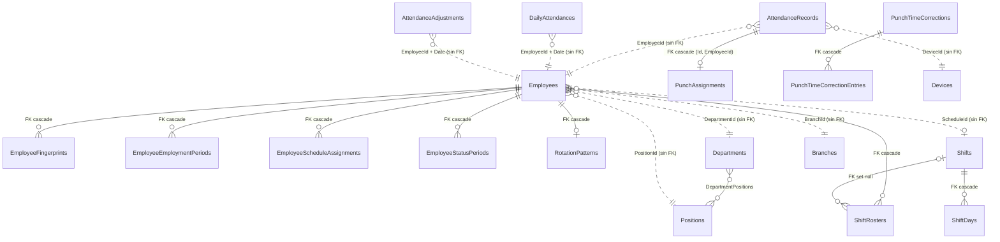

# Base de datos

Verificado contra el código en el commit `a019748` (versión `2.3.0`, [Directory.Build.props](../../Directory.Build.props)).
Cada afirmación lleva el archivo y la línea que la respalda; las rutas son relativas a la raíz del repositorio.

El detalle columna por columna de las 41 tablas del modelo está en
[02b-esquema-columnas.md](02b-esquema-columnas.md). Ese archivo lo genera un script a partir del modelo de EF Core y
no se edita a mano (ver [Cómo mantener este documento al día](#cómo-mantener-este-documento-al-día)).

## Contenido

1. [Motor y acceso](#1-motor-y-acceso)
2. [Qué hay en la base](#2-qué-hay-en-la-base)
3. [Convenciones del modelo](#3-convenciones-del-modelo)
4. [Relaciones e integridad](#4-relaciones-e-integridad)
5. [Tablas por área](#5-tablas-por-área)
6. [Valores de las columnas numéricas (enumeraciones)](#6-valores-de-las-columnas-numéricas-enumeraciones)
7. [Migraciones](#7-migraciones)
8. [Bloqueos y coordinación entre procesos](#8-bloqueos-y-coordinación-entre-procesos)
9. [Problemas posibles y cómo resolverlos](#9-problemas-posibles-y-cómo-resolverlos)
10. [Consultas de verificación](#10-consultas-de-verificación)
11. [Cómo mantener este documento al día](#cómo-mantener-este-documento-al-día)

---

## 1. Motor y acceso

| Elemento | Valor | Fuente |
|---|---|---|
| Motor | PostgreSQL, a través de Npgsql + EF Core | [AttendanceSystem.Infrastructure.csproj](../../src/Infrastructure/AttendanceSystem.Infrastructure/AttendanceSystem.Infrastructure.csproj) (`Npgsql.EntityFrameworkCore.PostgreSQL` 10.0.3, `Microsoft.EntityFrameworkCore` 10.0.10) |
| Contexto | `AttendanceDbContext`, hereda de `IdentityDbContext<ApplicationUser>` | [AttendanceDbContext.cs:20](../../src/Infrastructure/AttendanceSystem.Infrastructure/Persistence/AttendanceDbContext.cs#L20) |
| Cadena de conexión de la aplicación | `ConnectionStrings:AttendanceDb` | [InfrastructureServiceExtensions.cs:34](../../src/Infrastructure/AttendanceSystem.Infrastructure/DependencyInjection/InfrastructureServiceExtensions.cs#L34) |
| Cadena de conexión de Hangfire | `ConnectionStrings:HangfireDb` (el sitio web); el cliente WPF usa `AttendanceDb` si `HangfireDb` falta | [Program.cs:146](../../src/Presentation/AttendanceSystem.Blazor.Server/Program.cs#L146), [WpfBackendHost.cs:80](../../src/Presentation/AttendanceSystem.WPF/Services/WpfBackendHost.cs#L80) |
| Versión mínima de PostgreSQL que exige el instalador | Definida en `setup_script.iss` | [setup_script.iss:234](../../Deploy/setup_script.iss#L234) (se documenta en la fase de instalación) |

Las plantillas `appsettings.example.json` apuntan `HangfireDb` a la **misma** base que `AttendanceDb`
([appsettings.example.json:45](../../src/Presentation/AttendanceSystem.Blazor.Server/appsettings.example.json#L45)),
así que, salvo que se configure otra cosa, las tablas de Hangfire viven junto a las de la aplicación.

## 2. Qué hay en la base

Una base instalada contiene tres grupos de objetos. Sólo el primero está descrito por el modelo de EF Core.

| Esquema | Qué contiene | Quién lo crea | Fuente |
|---|---|---|---|
| `public` | 41 tablas del modelo: 34 de la aplicación y 7 de ASP.NET Core Identity (`AspNet*`), más `__EFMigrationsHistory` | Las migraciones de EF Core | [AttendanceDbContextModelSnapshot.cs](../../src/Infrastructure/AttendanceSystem.Infrastructure/Migrations/AttendanceDbContextModelSnapshot.cs) |
| `system_maintenance` | Una tabla, `maintenance_lock`, con una sola fila (`id = 1`) que guarda el estado de mantenimiento | `RestoreStateService`, con SQL propio (`CREATE SCHEMA IF NOT EXISTS`) la primera vez que guarda un estado | [RestoreStateService.cs:479](../../src/Infrastructure/AttendanceSystem.Infrastructure/Services/RestoreStateService.cs#L479) |
| esquema de Hangfire | Tablas de trabajos, colas y servidores de Hangfire | La biblioteca `Hangfire.PostgreSql` 1.21.1. El código no configura `SchemaName`, así que usa el nombre por omisión de la biblioteca (`hangfire`). Compruébelo con la [consulta 10.2](#102-esquemas-y-número-de-tablas). | [Program.cs:144-147](../../src/Presentation/AttendanceSystem.Blazor.Server/Program.cs#L144-L147) |

Quién crea el esquema de Hangfire depende de la instalación: el sitio web lo hace con la opción por omisión de la
biblioteca; el cliente WPF sólo lo crea cuando funciona sin sitio web (`PrepareSchemaIfNecessary = standalone`,
[WpfBackendHost.cs:84](../../src/Presentation/AttendanceSystem.WPF/Services/WpfBackendHost.cs#L84)).

**No hay tabla de logs.** El proyecto de infraestructura referencia el paquete `Serilog.Sinks.PostgreSQL`, pero
ningún archivo `.cs` ni `.json` del repositorio configura ese destino (búsqueda de `WriteTo.PostgreSQL` y
`"Name": "PostgreSQL"`, sin resultados). Los logs van a archivos (se documentan en la fase de operación).

**Objetos que el snapshot no muestra.** La migración
[20261019120000_AddPunchAssignments.cs:21-24](../../src/Infrastructure/AttendanceSystem.Infrastructure/Persistence/Migrations/20261019120000_AddPunchAssignments.cs#L21-L24)
crea la restricción única `AK_AttendanceRecords_Id_EmployeeId` en `AttendanceRecords (Id, EmployeeId)`, que
necesita la llave foránea compuesta de `PunchAssignments`. El snapshot no la lista como clave alterna; existe en la
base.

## 3. Convenciones del modelo

### 3.1 Fechas y horas: todo instante se guarda en UTC

- Toda propiedad `DateTime`/`DateTime?` pasa por un convertidor que la guarda como UTC y la lee marcada como UTC
  ([AttendanceDbContext.cs:71-84](../../src/Infrastructure/AttendanceSystem.Infrastructure/Persistence/AttendanceDbContext.cs#L71-L84)).
  Una hora `Local` se convierte con `ToUniversalTime()` (la zona del **servidor**); una hora sin zona
  (`Unspecified`) se marca como UTC **sin convertirla**.
- La columna resultante es `timestamp with time zone`. PostgreSQL guarda el instante; al consultarla con `psql`, la
  muestra en la zona de la sesión (`SHOW timezone;`), no en UTC.
- El sitio web desactiva el comportamiento heredado de Npgsql (`Npgsql.EnableLegacyTimestampBehavior = false`,
  [Program.cs:53](../../src/Presentation/AttendanceSystem.Blazor.Server/Program.cs#L53)).
- Las fechas sin hora (`date`) y las horas del día (`interval`) no tienen zona. La hora civil de una checada y su
  fecha laboral (`AttendanceRecords.WorkDate`) se interpretan con la zona guardada en la misma fila
  (`TimeZoneId`). Cómo se elige esa zona se documenta en la fase de dispositivos.

### 3.2 Identificadores

| Entidad | Tipo de la PK | Cómo se genera | Fuente |
|---|---|---|---|
| Empleado (`Employees.Id`) | `character varying(20)`, el número de empleado | Lo captura el usuario; el dominio rechaza más de 20 caracteres | [EmployeeId.cs:12](../../src/Core/AttendanceSystem.Domain/ValueObjects/EmployeeId.cs#L12) |
| Reloj (`Devices.Id`) | `character varying(50)` | Un GUID en texto, generado al dar de alta el reloj | [CreateDeviceCommand.cs:55-56](../../src/Core/AttendanceSystem.Application/Features/Devices/Commands/CreateDevice/CreateDeviceCommand.cs#L55-L56) |
| Casi todas las demás | `uuid` | Las genera la aplicación | snapshot |
| Tablas de Identity | `text` (usuarios y roles) o `integer` identity (claims) | ASP.NET Core Identity | snapshot |

`EmployeeId` aparece como texto de hasta 20 caracteres en muchas tablas (`AttendanceRecords`, `DailyAttendances`,
`AttendanceAdjustments`, etc.). **No** es llave foránea salvo en las tablas indicadas en la
[sección 4](#4-relaciones-e-integridad).

### 3.3 Enumeraciones guardadas como número

Los estados, tipos y métodos se guardan como enteros. Algunas columnas cambian de nombre respecto a la propiedad
(`Status` → `StatusId`, `CheckType` → `CheckTypeId`, `VerifyMethod` → `VerifyMethodId` en `AttendanceRecords`;
`Status` → `StatusId` en `Devices` y `ExternalAttendanceLogs`). La tabla de valores está en la
[sección 6](#6-valores-de-las-columnas-numéricas-enumeraciones).

### 3.4 Concurrencia optimista con `xmin`

`DailyAttendances`, `AttendanceAdjustments` y `PunchAssignments` mapean la columna de sistema `xmin` de PostgreSQL
como token de concurrencia (propiedad `Version`, snapshot líneas
[492-496](../../src/Infrastructure/AttendanceSystem.Infrastructure/Migrations/AttendanceDbContextModelSnapshot.cs#L492-L496),
[859-863](../../src/Infrastructure/AttendanceSystem.Infrastructure/Migrations/AttendanceDbContextModelSnapshot.cs#L859-L863),
[909-913](../../src/Infrastructure/AttendanceSystem.Infrastructure/Migrations/AttendanceDbContextModelSnapshot.cs#L909-L913)).
`xmin` existe en toda tabla de PostgreSQL; las migraciones no la crean. Si otra sesión modificó la fila después de
leerla, `SaveChanges` falla con `DbUpdateConcurrencyException` en lugar de sobrescribirla.

### 3.5 Valores compuestos guardados como texto

| Columna | Formato | Fuente |
|---|---|---|
| `Employees.RestDays`, `EmployeeScheduleAssignments.RestDays` | Días de la semana como números separados por coma (`"0,6"` = domingo y sábado, ver `WeekDay`). `NULL` en `Employees` = sin días | [EmployeeConfiguration.cs:96-103](../../src/Infrastructure/AttendanceSystem.Infrastructure/Persistence/Configurations/EmployeeConfiguration.cs#L96-L103), [EmployeeConfiguration.cs:217-223](../../src/Infrastructure/AttendanceSystem.Infrastructure/Persistence/Configurations/EmployeeConfiguration.cs#L217-L223) |
| `AttendanceAdjustments.ExitClassifications` | JSON: diccionario de id de checada → `TemporaryExitStatus` | [AttendanceAdjustmentConfiguration.cs:84-89](../../src/Infrastructure/AttendanceSystem.Infrastructure/Persistence/Configurations/AttendanceAdjustmentConfiguration.cs#L84-L89) |
| `AttendanceAdjustments.ExcludedPunches` | Arreglo nativo `uuid[]` | snapshot [447-449](../../src/Infrastructure/AttendanceSystem.Infrastructure/Migrations/AttendanceDbContextModelSnapshot.cs#L447-L449) |
| `DailyAttendances.IntervalsData`, `DailyAttendances.TemporaryExitsData`, `RotationPatterns.Definition` | Texto libre que escribe la aplicación (JSON); su estructura se documenta en la fase del motor de cálculo | [DailyAttendanceConfiguration.cs:111](../../src/Infrastructure/AttendanceSystem.Infrastructure/Persistence/Configurations/DailyAttendanceConfiguration.cs#L111), [DailyAttendanceConfiguration.cs:169](../../src/Infrastructure/AttendanceSystem.Infrastructure/Persistence/Configurations/DailyAttendanceConfiguration.cs#L169), [RotationPatternConfiguration.cs:29](../../src/Infrastructure/AttendanceSystem.Infrastructure/Persistence/Configurations/RotationPatternConfiguration.cs#L29) |
| `EmployeeAuditLogs.ChangesJson` | JSON con la lista de campos cambiados (nombre, valor anterior y nuevo) | [AttendanceDbContext.cs:324](../../src/Infrastructure/AttendanceSystem.Infrastructure/Persistence/AttendanceDbContext.cs#L324) |
| `OutboxMessages.Content` | El evento de dominio serializado | [AttendanceDbContext.cs:111](../../src/Infrastructure/AttendanceSystem.Infrastructure/Persistence/AttendanceDbContext.cs#L111) |
| `Employees.Photo` (hasta 1 000 000 caracteres), `Employees.FaceTemplate` (200 000), `EmployeeFingerprints.Template` (16 000) | Texto | snapshot [1271-1273](../../src/Infrastructure/AttendanceSystem.Infrastructure/Migrations/AttendanceDbContextModelSnapshot.cs#L1271-L1273), [1229-1231](../../src/Infrastructure/AttendanceSystem.Infrastructure/Migrations/AttendanceDbContextModelSnapshot.cs#L1229-L1231), [2328-2331](../../src/Infrastructure/AttendanceSystem.Infrastructure/Migrations/AttendanceDbContextModelSnapshot.cs#L2328-L2331) |
| `SystemConfiguration.CompanyLogo` | Binario (`bytea`) | snapshot [1782-1783](../../src/Infrastructure/AttendanceSystem.Infrastructure/Migrations/AttendanceDbContextModelSnapshot.cs#L1782-L1783) |

### 3.6 Datos sensibles sin cifrar

Estas columnas guardan texto plano. Ningún archivo del código usa `IDataProtector`, `Protect(`/`Unprotect(` ni una
rutina de cifrado (búsqueda en `src/`, sin resultados):

- `SystemConfiguration.SmtpPassword`: la contraseña del correo saliente.
- `SystemConfiguration.CloudDbConnectionString`: la cadena de conexión a la base en la nube, con su contraseña.
- `Devices.Username` / `Devices.Password`: el usuario y la contraseña ISAPI de un reloj Hikvision. En relojes ZKTeco
  no se usan: el mensaje gRPC de conexión sólo lleva IP, puerto y tiempo de espera
  ([zkteco.proto:59-63](../../src/Infrastructure/AttendanceSystem.ZKTeco/Protos/zkteco.proto#L59-L63)).
- `Employees.DevicePassword`: la contraseña del empleado en el reloj. El registro de auditoría la oculta con
  `********` ([AttendanceDbContext.cs:474-478](../../src/Infrastructure/AttendanceSystem.Infrastructure/Persistence/AttendanceDbContext.cs#L474-L478)),
  pero la columna de `Employees` no está cifrada.

Cualquiera que pueda leer la base o un respaldo puede leer estos valores. Las contraseñas de los usuarios del sistema
sí se guardan como hash (`AspNetUsers.PasswordHash`, ASP.NET Core Identity).

### 3.7 Lo que se escribe solo al guardar

`AttendanceDbContext.SaveChangesAsync` hace tres cosas además de guardar
([AttendanceDbContext.cs:93-159](../../src/Infrastructure/AttendanceSystem.Infrastructure/Persistence/AttendanceDbContext.cs#L93-L159)):

1. **Outbox.** Cada evento de dominio pendiente se convierte en una fila de `OutboxMessages` que se guarda en la
   misma transacción que el cambio que lo produjo (líneas 98-119). Así un evento no se pierde si el proceso cae justo
   después de guardar.
2. **Auditoría de empleados.** Cada alta o cambio de un empleado agrega una fila a `EmployeeAuditLogs` con el usuario
   (o `"Sistema"` si no hay sesión) y los campos cambiados (líneas 247-340).
3. **Jornadas sin cambios.** Al recalcular, una jornada se borra y se vuelve a insertar. Si la nueva es idéntica a la
   anterior, se conserva la fila existente y no se escribe nada (líneas 161-186).

## 4. Relaciones e integridad

**La mayoría de las relaciones no son llaves foráneas.** El modelo declara estas llaves foráneas reales (todas en
[AttendanceDbContextModelSnapshot.cs:2210-2567](../../src/Infrastructure/AttendanceSystem.Infrastructure/Migrations/AttendanceDbContextModelSnapshot.cs#L2210-L2567)):

| Desde | Hacia | Al borrar el origen |
|---|---|---|
| `PunchTimeCorrectionEntries.CorrectionId` | `PunchTimeCorrections.Id` | Cascade |
| `PunchAssignments (AttendanceRecordId, EmployeeId)` | `AttendanceRecords (Id, EmployeeId)` | Cascade |
| `RotationPatterns.EmployeeId` | `Employees.Id` | Cascade |
| `ShiftRosters.EmployeeId` | `Employees.Id` | Cascade |
| `ShiftRosters.ShiftId` | `Shifts.Id` | SetNull |
| `DepartmentPositions.DepartmentId` / `.PositionsId` | `Departments.Id` / `Positions.Id` | Cascade |
| `EmployeeFingerprints`, `EmployeeEmploymentPeriods`, `EmployeeScheduleAssignments`, `EmployeeStatusPeriods` (`EmployeeId`) | `Employees.Id` | Cascade (tipos propios) |
| `ShiftDays.ShiftId` | `Shifts.Id` | Cascade (tipo propio) |
| Tablas `AspNet*` | `AspNetUsers` / `AspNetRoles` | Cascade |

**Relaciones que sólo existen en el código** (la base no las protege; el snapshot no tiene `HasOne` para ellas):

- `Employees.BranchId`, `.DepartmentId`, `.PositionId`, `.ScheduleId` → sucursal, departamento, puesto y horario.
  Tienen índice, no llave foránea.
- `AttendanceRecords.EmployeeId` y `.DeviceId`, `DailyAttendances.EmployeeId`, `AttendanceAdjustments.EmployeeId`,
  `DownloadLogs.DeviceId`, `QuarantinedPunches.DeviceId`, etc.
- `DailyAttendances.CheckInRecordId`, `.Block1CheckOutRecordId`, `.Block2CheckInRecordId`, `.CheckOutRecordId` →
  `AttendanceRecords.Id`. Tampoco tienen índice; la migración
  [20261017160000_AddAttendanceIntegrityAndOutbox.cs](../../src/Infrastructure/AttendanceSystem.Infrastructure/Persistence/Migrations/20261017160000_AddAttendanceIntegrityAndOutbox.cs)
  lo señala en un comentario porque buscar por ellas era lento.
- `AdmsCommands.SerialNumber` → `Devices.SerialNumber`.

Consecuencia: borrar con SQL directo una sucursal, un turno o un empleado no falla aunque haya filas que lo
referencien; esas filas quedan huérfanas. Las reglas de borrado están en los comandos de la aplicación (por ejemplo
`DeleteShiftCommandHandler`). La [consulta 10.4](#104-filas-huérfanas) busca huérfanos.

**Unicidad que protege los datos:**

| Índice único | Protege | Fuente |
|---|---|---|
| `AttendanceRecords (EmployeeId, CheckTime)` con filtro `"VoidedAt" IS NULL` | Una sola checada vigente por empleado e instante. Una checada anulada no cuenta, así que puede volver a registrarse la misma hora | snapshot [112-114](../../src/Infrastructure/AttendanceSystem.Infrastructure/Migrations/AttendanceDbContextModelSnapshot.cs#L112-L114) |
| `DailyAttendances (EmployeeId, Date)` | Una jornada por empleado y día | snapshot [883-884](../../src/Infrastructure/AttendanceSystem.Infrastructure/Migrations/AttendanceDbContextModelSnapshot.cs#L883-L884) |
| `AttendanceAdjustments (EmployeeId, Date)` | Un ajuste manual por empleado y día | snapshot [502-503](../../src/Infrastructure/AttendanceSystem.Infrastructure/Migrations/AttendanceDbContextModelSnapshot.cs#L502-L503) |
| `ShiftRosters (EmployeeId, Date)` | Una asignación de rol por empleado y día | snapshot [1698-1699](../../src/Infrastructure/AttendanceSystem.Infrastructure/Migrations/AttendanceDbContextModelSnapshot.cs#L1698-L1699) |
| `RotationPatterns (EmployeeId)` | Un patrón de rotación por empleado | snapshot [1655-1656](../../src/Infrastructure/AttendanceSystem.Infrastructure/Migrations/AttendanceDbContextModelSnapshot.cs#L1655-L1656) |
| `QuarantinedPunches (DeviceId, EmployeeId, ReportedTime)` | Que la misma checada de un reloj no entre dos veces a cuarentena | snapshot [329-330](../../src/Infrastructure/AttendanceSystem.Infrastructure/Migrations/AttendanceDbContextModelSnapshot.cs#L329-L330) |
| `AttendanceConsolidationRequests (EmployeeId)` con filtro `"Status" IN (0, 1)` | Una sola solicitud activa (pendiente o en proceso) por empleado | snapshot [620-623](../../src/Infrastructure/AttendanceSystem.Infrastructure/Migrations/AttendanceDbContextModelSnapshot.cs#L620-L623) |
| `Devices (IpAddress)` | Dos relojes no pueden tener la misma IP registrada, aunque uno sea ADMS | snapshot [1120-1121](../../src/Infrastructure/AttendanceSystem.Infrastructure/Migrations/AttendanceDbContextModelSnapshot.cs#L1120-L1121) |
| `Employees (Email)` con filtro `"Email" IS NOT NULL` | Correo de empleado sin repetir | snapshot [1310-1312](../../src/Infrastructure/AttendanceSystem.Infrastructure/Migrations/AttendanceDbContextModelSnapshot.cs#L1310-L1312) |
| `ExternalEmployees (BranchId, EmployeeNumber)` | Número de empleado externo sin repetir dentro de su sucursal | snapshot [1422-1423](../../src/Infrastructure/AttendanceSystem.Infrastructure/Migrations/AttendanceDbContextModelSnapshot.cs#L1422-L1423) |

`PunchAssignments` además tiene dos restricciones CHECK: `Origin IN (1, 2)` y `Role BETWEEN 1 AND 9`
(snapshot [924-929](../../src/Infrastructure/AttendanceSystem.Infrastructure/Migrations/AttendanceDbContextModelSnapshot.cs#L924-L929)).



Las líneas continuas son llaves foráneas reales; las punteadas, relaciones que sólo maneja el código.

## 5. Tablas por área

El propósito de cada tabla se toma del comentario de su clase o de su uso en el código. Las columnas completas están
en [02b-esquema-columnas.md](02b-esquema-columnas.md).

### 5.1 Organización y personal

| Tabla | Para qué sirve | Notas verificadas |
|---|---|---|
| `Branches` | Sucursales | `Code` es `character(3)` de longitud fija. `IsExternal` + `ExternalHost` marcan sucursales cuyas checadas se envían a otra base (ver `ExternalAttendanceLogs`). `TimeZoneId` es la zona de la sucursal. |
| `Departments`, `Positions`, `DepartmentPositions` | Departamentos, puestos y qué puestos pertenecen a cada departamento | `Positions.IsCritical` marca puestos cuya ausencia genera alerta (`AlertType.CriticalPositionAbsence`). `Positions.BaseSalary` es `decimal(18,2)`. |
| `Employees` | Empleados | PK = número de empleado. Guarda turno (`ShiftType`, `ScheduleId`), descansos, reglas de horas extra, credenciales del reloj (`CardNumber`, `DevicePassword`, `DevicePrivilege`), foto y rostro. `CreatedAt` tiene `DEFAULT CURRENT_TIMESTAMP`. |
| `EmployeeFingerprints` | Plantillas de huella por dedo (`FingerIndex`) | Tipo propio de `Employee`. |
| `EmployeeEmploymentPeriods` | Periodos de alta (inicio, fin opcional) | Tipo propio de `Employee`. |
| `EmployeeStatusPeriods` | Periodos con estado (alta, baja, vacaciones, incapacidad…) | Tipo propio de `Employee`. |
| `EmployeeScheduleAssignments` | Historial de horario con fecha de vigencia (`EffectiveFrom`) | Tipo propio de `Employee`. Guarda sucursal, tipo de turno, horario y descansos vigentes desde esa fecha. |
| `EmployeeAuditLogs` | Bitácora de cambios a empleados | La escribe `AttendanceDbContext` al guardar (sección 3.7). |
| `ExternalEmployees` | Empleados de sucursales externas | Su `BranchId` declara `HasMaxLength(50)` aunque es `uuid`; la longitud no tiene efecto en una columna `uuid`. |

### 5.2 Horarios

| Tabla | Para qué sirve | Notas verificadas |
|---|---|---|
| `Shifts` | Definición de turnos: horario, tolerancia, segundo bloque (turno partido), ventana flexible, comida, redondeo | `ShiftType` usa el enum de la sección 6 (el valor 4 está retirado). |
| `ShiftDays` | Horario por día de la semana de un turno mixto | PK compuesta `(ShiftId, DayOfWeek)`. `DayShiftId` es el horario existente que rige ese día; el cálculo usa ese horario completo y las columnas de hora se copian sólo para mostrar. `NULL` = formato anterior, con horas por día ([ShiftDay.cs:16-20](../../src/Core/AttendanceSystem.Domain/Aggregates/ShiftAggregate/ShiftDay.cs#L16-L20)). |
| `ShiftRosters` | Rol de turnos: qué turno (o descanso) tiene un empleado en una fecha concreta | Único por empleado y fecha. |
| `RotationPatterns` | Patrón de rotación de un empleado; `GeneratedThrough` es hasta qué fecha ya se generó el rol | Uno por empleado. |

### 5.3 Checadas

| Tabla | Para qué sirve | Notas verificadas |
|---|---|---|
| `AttendanceRecords` | Cada checada recibida o capturada | `CheckTime` es el instante UTC; `WorkDate` y `TimeZoneId`, la fecha laboral y la zona con que se interpretó. Las checadas no se modifican: se **anulan** (`VoidedAt`, `VoidedBy`, `VoidReason`) y, si se corrigen, se enlazan con `ReplacesRecordId` / `ReplacedByRecordId` (migración `20261105120000_ImmutablePunches`). `Source` indica el origen. |
| `QuarantinedPunches` | Checadas retenidas por hora sospechosa, pendientes de que el Administrador las libere o descarte | `Rule` guarda qué regla la retuvo; `Status`: 1 pendiente, 2 liberada, 3 descartada. |
| `DeviceClockIncidents` | Periodos en que un reloj tuvo la hora mal (`ReportedFrom`–`ReportedTo`, `OffsetMinutes`) | |
| `PunchTimeCorrections` / `PunchTimeCorrectionEntries` | Corrección masiva de la hora de las checadas de un reloj en un rango de fechas, y cada checada que se corrigió | Cada entrada guarda la hora vieja y la nueva (UTC y civil) y la checada nueva (`NewRecordId`). |
| `DownloadLogs` | Cada descarga de un reloj: cuándo, cuántos registros, si tuvo éxito, quién la inició | `DownloadType`: 1 manual, 2 automática. |
| `ExternalAttendanceLogs` | Checadas de empleados de otra sucursal, en espera de subirse a la base en la nube | Se identifican por el prefijo del ID en el reloj ([ExternalBranchCodes.cs:5-9](../../src/Core/AttendanceSystem.Application/Features/Attendance/Services/ExternalBranchCodes.cs#L5-L9)). `StatusId`: 1 pendiente, 2 transferida, 3 fallida. |

### 5.4 Cálculo de asistencia

| Tabla | Para qué sirve | Notas verificadas |
|---|---|---|
| `DailyAttendances` | Resultado calculado de cada empleado por día: horario aplicado, checadas usadas, retardo, salida anticipada, horas trabajadas, horas extra, comida, salidas temporales, descanso, falta | Se **recalcula** (se borra y vuelve a insertar, sección 3.7); no editar a mano. `CalculationIssue` explica por qué una jornada no se pudo calcular. Se detalla en la fase del motor de cálculo. |
| `PunchAssignments` | Qué papel tuvo cada checada en su jornada (entrada, salida, intermedia, descartada…) y si se asignó automática o manualmente | PK = `AttendanceRecordId`: una checada pertenece a lo más a una jornada. |
| `AttendanceAdjustments` | Decisiones manuales de RH sobre un día: checada forzada o vaciada por posición, turno distinto, descanso, horas extra autorizadas, clasificación de salidas | `Revision` cuenta los cambios. |
| `AttendanceAdjustmentHistory` | Cada versión de un ajuste: antes, después, quién y por qué | `Before`/`After` de hasta 2000 caracteres. |
| `AttendanceConsolidationRequests` | Cola durable de recálculo: qué empleado y qué rango de fechas hay que recalcular | Se reclama con `FOR UPDATE SKIP LOCKED` ([AttendanceConsolidationRepository.cs:111](../../src/Infrastructure/AttendanceSystem.Infrastructure/Persistence/Repositories/AttendanceConsolidationRepository.cs#L111)). `LeaseExpiresAt`: si el proceso que la tomó muere, otro la retoma al vencer. |
| `AttendancePeriodClosures` | Periodos cerrados y su reapertura. Mientras un cierre está vigente, ningún día del periodo se recalcula ni acepta ajustes; un cierre nunca se borra, se reabre con autor y motivo ([AttendancePeriodClosure.cs:3-7](../../src/Core/AttendanceSystem.Domain/Aggregates/PeriodClosureAggregate/AttendancePeriodClosure.cs#L3-L7)) | `Automatic` distingue el cierre automático (tarea `auto-close-periods`). |

### 5.5 Dispositivos y ADMS

| Tabla | Para qué sirve | Notas verificadas |
|---|---|---|
| `Devices` | Relojes checadores | Incluye las columnas de hardware del tipo propio `DeviceHardwareInfo` (número de serie, firmware, capacidades) en la misma tabla. `Brand`: 0 ZKTeco, 1 Hikvision. `DownloadMethod`: 0 SDK, 1 ADMS. `RealtimeEnabled`: escucha en tiempo real por SDK. `AcceptPunchesFrom`: fecha mínima aceptada. |
| `AdmsCommands` | Comandos en cola para relojes ADMS y su resultado | Se identifican por `SerialNumber`. `Status`: 1 pendiente, 2 enviado, 3 confirmado, 4 fallido, 5 vencido. |
| `AdmsIngestionIncidents` | Datos que un reloj ADMS envió y no se pudieron procesar, con el texto original (`RawData`) | |

### 5.6 Sistema

| Tabla | Para qué sirve | Notas verificadas |
|---|---|---|
| `SystemConfiguration` | Configuración global: empresa, zona horaria por omisión, periodos de nómina, tareas automáticas, correo, ADMS, nube, reglas de comida y de cuarentena | Una sola fila. Los valores por omisión de la base se ven en [02b-esquema-columnas.md](02b-esquema-columnas.md#systemconfiguration); se documentan uno por uno en la fase de configuración. |
| `SystemAlerts` | Alertas mostradas en la interfaz | `Type` usa `AlertType` (sección 6). |
| `OutboxMessages` | Eventos de dominio pendientes de publicar | `LockedBy`/`LockedUntilUtc` = quién lo tiene reclamado; `DeadLetteredOnUtc` = se dio por perdido tras agotar reintentos. |
| `AspNet*` | Usuarios, roles y sesiones (ASP.NET Core Identity) | Roles que crea el sistema: `Administrador`, `RH`, `Usuario` ([Permissions.cs:8-12](../../src/Core/AttendanceSystem.Application/Authorization/Permissions.cs#L8-L12)). |

## 6. Valores de las columnas numéricas (enumeraciones)

| Columna(s) | Valores | Fuente |
|---|---|---|
| `AttendanceRecords.StatusId` | 1 Pendiente, 2 Validado, 3 Rechazado, 4 Duplicado, 5 Procesado, 6 Anómalo | [AttendanceStatus.cs:5-10](../../src/Core/AttendanceSystem.Domain/Enumerations/AttendanceStatus.cs#L5-L10) |
| `AttendanceRecords.CheckTypeId`, `.OriginalCheckTypeId`, `ExternalAttendanceLogs.CheckType` | 0 Entrada, 1 Salida, 2 Inicio de descanso, 3 Fin de descanso, 4 Inicio tiempo extra, 5 Fin tiempo extra | [CheckType.cs:5-10](../../src/Core/AttendanceSystem.Domain/Enumerations/CheckType.cs#L5-L10) |
| `AttendanceRecords.VerifyMethodId`, `ExternalAttendanceLogs.VerifyMethod` | 0 Otro, 1 Huella, 2 Tarjeta RFID, 3 Contraseña, 15 Rostro, 99 Manual | [VerifyMethod.cs:3-8](../../src/Core/AttendanceSystem.Domain/Enumerations/VerifyMethod.cs#L3-L8) |
| `Employees.Status`, `ExternalEmployees.Status`, `EmployeeStatusPeriods.Status` | 0 Alta, 1 Baja, 2 Baja temporal, 3 Vacaciones, 4 Incapacidad | [EmployeeStatus.cs:5-9](../../src/Core/AttendanceSystem.Domain/Enumerations/EmployeeStatus.cs#L5-L9) |
| `Employees.Gender` | 1 Masculino, 2 Femenino | [Gender.cs:5-6](../../src/Core/AttendanceSystem.Domain/Enumerations/Gender.cs#L5-L6) |
| `Employees.DevicePrivilege` | 0 Usuario, 1 Registrador, 2 Administrador, 3 Superadministrador | [DevicePrivilege.cs:5-8](../../src/Core/AttendanceSystem.Domain/Enumerations/DevicePrivilege.cs#L5-L8) |
| `Employees.ShiftType`, `Shifts.ShiftType`, `ShiftDays.ShiftType`, `DailyAttendances.ShiftType`, `EmployeeScheduleAssignments.ShiftType` | 0 Matutino, 1 Vespertino, 2 Nocturno, 3 Mixto, 5 Flexible, 6 Partido, 7 Rotativo. **4 (Continuo) está retirado**; lo reemplazó Flexible | [ShiftType.cs:5-12](../../src/Core/AttendanceSystem.Domain/Enumerations/ShiftType.cs#L5-L12), migración `20261030120000_RetireContinuousShiftType` |
| `Employees.RestDay`, días en `RestDays`, `ShiftDays.DayOfWeek` | 0 Domingo … 6 Sábado | [DayOfWeek.cs:5-11](../../src/Core/AttendanceSystem.Domain/Enumerations/DayOfWeek.cs#L5-L11) |
| `Employees.OvertimeCalculationMethod`, `DailyAttendances.OvertimeCalculationMethod` | 0 Sin redondeo, 1 Por media hora, 2 Por hora | [OvertimeCalculationMethod.cs:5-7](../../src/Core/AttendanceSystem.Domain/Enumerations/OvertimeCalculationMethod.cs#L5-L7) |
| `Employees.OvertimeCapType` | 0 Sin tope, 1 Diario, 2 Por periodo | [OvertimeCapType.cs:5-7](../../src/Core/AttendanceSystem.Domain/Enumerations/OvertimeCapType.cs#L5-L7) |
| `Shifts.PunchTrackingMode`, `DailyAttendances.PunchTrackingMode` | 0 Un intervalo (entrada y salida), 1 Varios intervalos | [PunchTrackingMode.cs:5-6](../../src/Core/AttendanceSystem.Domain/Enumerations/PunchTrackingMode.cs#L5-L6) |
| `SystemConfiguration.WorkPeriodMode` | 0 Semanal, 1 Quincenal, 2 Mensual | [WorkPeriodMode.cs:5-7](../../src/Core/AttendanceSystem.Domain/Enumerations/WorkPeriodMode.cs#L5-L7) |
| `Devices.Brand` | 0 ZKTeco, 1 Hikvision | [DeviceBrand.cs:5-6](../../src/Core/AttendanceSystem.Domain/Enumerations/DeviceBrand.cs#L5-L6) |
| `Devices.DownloadMethod` | 0 SDK, 1 ADMS | [DeviceDownloadMethod.cs:5-6](../../src/Core/AttendanceSystem.Domain/Enumerations/DeviceDownloadMethod.cs#L5-L6) |
| `ExternalAttendanceLogs.StatusId` | 1 Pendiente, 2 Transferido, 3 Fallido | [ExternalLogStatus.cs:7-9](../../src/Core/AttendanceSystem.Domain/Enumerations/ExternalLogStatus.cs#L7-L9) |
| `SystemAlerts.Type` | 1 Ausencia en puesto crítico, 2 Reloj desconectado, 3 Memoria del reloj llena, 4 Desfase de hora del reloj, 5 Checada en cuarentena, 6 Integridad de horarios, 99 Error del sistema | [AlertType.cs:5-11](../../src/Core/AttendanceSystem.Domain/Enumerations/AlertType.cs#L5-L11) |
| `QuarantinedPunches.Status` | 1 Pendiente, 2 Liberada, 3 Descartada | [QuarantinedPunch.cs:5-9](../../src/Core/AttendanceSystem.Domain/Aggregates/AttendanceAggregate/QuarantinedPunch.cs#L5-L9) |
| `AttendanceConsolidationRequests.Status` | 0 Pendiente, 1 En proceso, 2 Completada, 3 Fallida, 4 Reemplazada | [AttendanceConsolidationRequest.cs:22-28](../../src/Core/AttendanceSystem.Domain/Aggregates/DailyAttendanceAggregate/AttendanceConsolidationRequest.cs#L22-L28) |
| `DailyAttendances.TemporaryExitStatus`, `AttendanceAdjustments.TemporaryExitStatus`, valores de `ExitClassifications` | 0 Pendiente, 1 Aprobada con goce, 2 Aprobada sin goce, 3 Descartada, 4 Comida | [DailyAttendance.cs:9-20](../../src/Core/AttendanceSystem.Domain/Aggregates/DailyAttendanceAggregate/DailyAttendance.cs#L9-L20) |
| `AttendanceAdjustments.CheckInOverride`, `.Block1CheckOutOverride`, `.Block2CheckInOverride`, `.CheckOutOverride` | 0 Sin decisión, 1 Checada asignada, 2 Vacío forzado | [AttendanceAdjustment.cs:18-27](../../src/Core/AttendanceSystem.Domain/Aggregates/DailyAttendanceAggregate/AttendanceAdjustment.cs#L18-L27) |
| `PunchAssignments.Role` | 1 Entrada, 2 Salida del bloque 1, 3 Entrada del bloque 2, 4 Salida, 5 Intermedia, 6 Límite de intervalo, 7 Doble toque descartado, 8 Pendiente de revisión, 9 Excluida manualmente | [PunchAssignment.cs:11-32](../../src/Core/AttendanceSystem.Domain/Aggregates/DailyAttendanceAggregate/PunchAssignment.cs#L11-L32) |
| `PunchAssignments.Origin` | 1 Automática, 2 Manual | [PunchAssignment.cs:34-37](../../src/Core/AttendanceSystem.Domain/Aggregates/DailyAttendanceAggregate/PunchAssignment.cs#L34-L37) |
| `AdmsCommands.Status` | 1 Pendiente, 2 Enviado, 3 Confirmado, 4 Fallido, 5 Vencido | [AdmsCommandStatus.cs:5-9](../../src/Core/AttendanceSystem.Domain/Aggregates/DeviceAggregate/AdmsCommandStatus.cs#L5-L9) |
| `DownloadLogs.DownloadType` | 1 Manual, 2 Automática | [DownloadLog.cs:93-96](../../src/Core/AttendanceSystem.Domain/Aggregates/DownloadLogAggregate/DownloadLog.cs#L93-L96) |
| `system_maintenance.maintenance_lock.state` (texto) | `Normal`, `Preparing`, `Draining`, `Restoring`, `Validating`, `Recovering`, `Failed` | [MaintenanceState.cs](../../src/Core/AttendanceSystem.Application/Common/MaintenanceState.cs) |

## 7. Migraciones

### 7.1 Dónde están

Hay 68 migraciones (atributo `[Migration("...")]`), de `20260125233852_InitialPostgreSQL` a
`20261113120000_AddDeviceRealtimeEnabled`, repartidas en dos carpetas del mismo proyecto y del mismo contexto:

- `src/Infrastructure/AttendanceSystem.Infrastructure/Migrations/`: 10 migraciones antiguas y el
  `AttendanceDbContextModelSnapshot.cs`. Estas 10 no tienen archivo `.Designer.cs`.
- `src/Infrastructure/AttendanceSystem.Infrastructure/Persistence/Migrations/`: las otras 58, con su `.Designer.cs`.

EF Core las ordena por su identificador, no por carpeta.

### 7.2 Cómo se aplican

Las migraciones **no** se aplican con `dotnet ef database update` en producción: las aplica el propio programa al
arrancar, mediante `StartupMigrationService.RunAsync`
([StartupMigrationService.cs:72-152](../../src/Infrastructure/AttendanceSystem.Infrastructure/Services/StartupMigrationService.cs#L72-L152)).

Qué proceso las aplica ([ServerStartup.cs:34-38](../../src/Infrastructure/AttendanceSystem.Infrastructure/Services/ServerStartup.cs#L34-L38)):

- El sitio web, siempre ([Program.cs:168](../../src/Presentation/AttendanceSystem.Blazor.Server/Program.cs#L168)).
- El cliente WPF, sólo si está instalado sin sitio web (`Hosting:Standalone = true`,
  [App.xaml.cs:112](../../src/Presentation/AttendanceSystem.WPF/App.xaml.cs#L112)). Instalado junto al sitio, sólo
  comprueba: si hay migraciones pendientes, pausa sus tareas y espera a que el sitio actualice el esquema
  ([ServerStartup.cs:56-67](../../src/Infrastructure/AttendanceSystem.Infrastructure/Services/ServerStartup.cs#L56-L67)).

Pasos de `RunAsync`, en orden:

1. **Conecta**, con hasta `Database:StartupConnectAttempts` intentos (6 por omisión) y espera creciente desde
   `Database:StartupConnectRetrySeconds` (2 s), hasta 15 s entre intentos. Si la base no existe, la crea vacía
   (líneas 158-183).
2. **Toma el bloqueo de migración** (sección 8): si otro proceso está migrando, espera a que termine (líneas 83-84).
3. **Compara** las migraciones del código con las de `__EFMigrationsHistory`. Si la base tiene migraciones que el
   código no conoce (se instaló una versión anterior encima de una más nueva), **no migra** y entra en
   mantenimiento (líneas 90-97). Hay una excepción para un identificador retirado
   ([RetiredMigrations.cs](../../src/Infrastructure/AttendanceSystem.Infrastructure/Persistence/RetiredMigrations.cs)).
4. **Respalda** la base antes de migrar, salvo que esté vacía. Si el respaldo falla, no migra y entra en
   mantenimiento (líneas 113-124).
5. **Aplica** las pendientes una por una, cada una en su transacción, registrando cuánto tarda
   ([SchemaMigrator.cs:47-70](../../src/Infrastructure/AttendanceSystem.Infrastructure/Persistence/SchemaMigrator.cs#L47-L70)).
   Si alguna pendiente tiene un identificador **anterior** a la última aplicada, las aplica todas juntas
   (líneas 52-59).
6. Si algo falla, la base queda en la última migración que terminó y el programa **arranca en modo
   mantenimiento** en vez de detenerse, para que el administrador pueda restaurar un respaldo (líneas 137-151). Sólo
   se detiene si no consigue conectar con PostgreSQL.

Parámetros de configuración (sección `Database`):

| Clave | Por omisión | Efecto | Fuente |
|---|---|---|---|
| `Database:MigrationTimeoutMinutes` | 30 | Tiempo máximo de cada comando de migración y de la espera al bloqueo | [StartupMigrationService.cs:69-70](../../src/Infrastructure/AttendanceSystem.Infrastructure/Services/StartupMigrationService.cs#L69-L70) |
| `Database:MigrationLockTimeoutSeconds` | 120 | `lock_timeout` de PostgreSQL: cuánto espera una sentencia a que otra sesión suelte una tabla | [SchemaMigrator.cs:19-20](../../src/Infrastructure/AttendanceSystem.Infrastructure/Persistence/SchemaMigrator.cs#L19-L20) |
| `Database:StartupMigrationBudgetMinutes` | 50 | Tiempo total para respaldar y migrar al arrancar; si se agota, se detiene entre migraciones | [SchemaMigrator.cs:35-36](../../src/Infrastructure/AttendanceSystem.Infrastructure/Persistence/SchemaMigrator.cs#L35-L36) |
| `Database:StartupConnectAttempts` | 6 | Intentos de conexión al arrancar | [StartupMigrationService.cs:61](../../src/Infrastructure/AttendanceSystem.Infrastructure/Services/StartupMigrationService.cs#L61) |
| `Database:StartupConnectRetrySeconds` | 2 | Espera inicial entre intentos | [StartupMigrationService.cs:62](../../src/Infrastructure/AttendanceSystem.Infrastructure/Services/StartupMigrationService.cs#L62) |

### 7.3 Migraciones que transforman datos

Estas migraciones ejecutan SQL propio (`migrationBuilder.Sql`) además de cambiar el esquema. Varias no tienen vuelta
atrás exacta; por eso el respaldo del paso 4:

`20260423210254_AddOvertimeFlagsToDailyAttendance`, `20261009153817_AddEmployeeAuditLogs`,
`20260727215325_AddShiftTypeToShiftDays`, `20261017160000_AddAttendanceIntegrityAndOutbox` (elimina checadas
duplicadas antes de crear el índice único), `20261020120000_AddDurableConsolidationAndOutboxLeases`,
`20261021120000_AddExplicitAdjustmentOverrides`, `20261022120000_AddEmploymentHistoryAndCalculationIssues`,
`20261029120000_AddDatedRestDays`, `20261030120000_RetireContinuousShiftType`,
`20261102120000_ClassifyEachTemporaryExit`, `20261103120000_AuthorizePartialOvertime`,
`20261105120000_ImmutablePunches`, `20261106120000_EmployeeStatusPeriods`, `20261110120000_ConvertLegacyCivilTimes`.

(Lista obtenida con `grep -l "migrationBuilder.Sql"` sobre las dos carpetas.)

## 8. Bloqueos y coordinación entre procesos

Varios procesos (sitio web, cliente WPF, varios workers de IIS) usan la misma base. Se coordinan con bloqueos
consultivos (*advisory locks*) de PostgreSQL y con `FOR UPDATE SKIP LOCKED`. Los bloqueos consultivos se ven en
`pg_locks` con `locktype = 'advisory'`.

| Bloqueo | Clave | Para qué | Fuente |
|---|---|---|---|
| Migración | `pg_try_advisory_lock(7235002)`, sesión con `application_name = attendance_migration_lock` | Un solo proceso aplica migraciones a la vez | [DatabaseMigrationLock.cs:15](../../src/Infrastructure/AttendanceSystem.Infrastructure/Persistence/DatabaseMigrationLock.cs#L15) |
| Mantenimiento / restauración | `pg_try_advisory_lock(7235001)`, sesión `attendance_maintenance_lock` | Dueño del estado de mantenimiento | [RestoreStateService.cs:28](../../src/Infrastructure/AttendanceSystem.Infrastructure/Services/RestoreStateService.cs#L28) |
| Tareas programadas | `pg_try_advisory_lock(1246708307, clave)` (`0x4A4F4253`) | Una sola ejecución a la vez de cada tarea | [JobExclusionLock.cs:17](../../src/Infrastructure/AttendanceSystem.Infrastructure/Services/JobExclusionLock.cs#L17) |
| Recálculo por empleado | `pg_advisory_xact_lock(1096045636, clave)` (`0x41545444`), dura la transacción | Dos procesos no recalculan al mismo empleado a la vez | [PostgresAttendanceCalculationLockService.cs:25](../../src/Infrastructure/AttendanceSystem.Infrastructure/Services/PostgresAttendanceCalculationLockService.cs#L25) |
| Reclamar filas de cola | `FOR UPDATE SKIP LOCKED` | Outbox, solicitudes de consolidación, comandos ADMS, subida a la nube | [OutboxStore.cs:48](../../src/Infrastructure/AttendanceSystem.Infrastructure/Persistence/Outbox/OutboxStore.cs#L48), [AttendanceConsolidationRepository.cs:111](../../src/Infrastructure/AttendanceSystem.Infrastructure/Persistence/Repositories/AttendanceConsolidationRepository.cs#L111), [AdmsCommandService.cs:170](../../src/Infrastructure/AttendanceSystem.Infrastructure/Services/AdmsCommandService.cs#L170), [CloudLogSyncService.cs:88](../../src/Infrastructure/AttendanceSystem.Infrastructure/Services/CloudLogSyncService.cs#L88) |

Un bloqueo de sesión se libera al cerrarse la conexión. La conexión del bloqueo de migración usa `KeepAlive = 15`
para que PostgreSQL detecte un proceso muerto
([DatabaseMigrationLock.cs:32-33](../../src/Infrastructure/AttendanceSystem.Infrastructure/Persistence/DatabaseMigrationLock.cs#L32-L33)).

## 9. Problemas posibles y cómo resolverlos

### 9.1 El sistema arranca en mantenimiento después de actualizar

**Causa:** falló el respaldo previo, falló una migración, o la base es de una versión más nueva (sección 7.2, pasos
3, 4 y 6). El motivo exacto queda en el log del sitio web y en `system_maintenance.maintenance_lock.details`.

**Cómo verlo:**

```sql
SELECT state, owner_id, updated_at, details FROM system_maintenance.maintenance_lock;
SELECT "MigrationId" FROM "__EFMigrationsHistory" ORDER BY "MigrationId" DESC LIMIT 5;
```

**Qué hacer según el motivo:**

- *"La base de datos es de una versión más nueva del sistema"*: instale la versión que corresponde a esa base o una
  posterior. No borre filas de `__EFMigrationsHistory`.
- *"falló el respaldo previo"*: la base no se modificó. Revise la carpeta y los permisos de respaldo y el log del
  respaldo, corrija y reinicie el sitio.
- *"Falló la actualización del esquema"*: el mensaje dice en qué migración quedó la base y dónde está el respaldo
  previo. Corrija la causa y reinicie: las migraciones ya aplicadas se conservan y continúa con las demás. Si la
  causa no se puede corregir, restaure el respaldo previo.

### 9.2 La migración se cancela por `lock_timeout`

**Mensaje:** *"Una sentencia esperó más de N s a que otras sesiones soltaran tablas de la base y se canceló sin
aplicar cambios. Sesiones que las tienen: pid …"* ([SchemaMigrator.cs:155-159](../../src/Infrastructure/AttendanceSystem.Infrastructure/Persistence/SchemaMigrator.cs#L155-L159)).

**Causa:** otra sesión tiene una tabla tomada: típicamente un cliente WPF abierto con una transacción, o la sesión de
un proceso que murió mientras migraba.

**Qué hacer:** cierre los clientes WPF; si la sesión sigue, termínela con el `pid` que da el mensaje y reinicie el
sitio:

```sql
SELECT pg_terminate_backend(<pid>);
```

### 9.3 "Otro proceso lleva más de N minutos aplicando migraciones"

**Causa:** otro proceso tiene el bloqueo `7235002` ([DatabaseMigrationLock.cs:55-58](../../src/Infrastructure/AttendanceSystem.Infrastructure/Persistence/DatabaseMigrationLock.cs#L55-L58)).

**Cómo verlo:**

```sql
SELECT pid, application_name, client_addr, state, now() - backend_start AS edad
FROM pg_stat_activity WHERE application_name = 'attendance_migration_lock';
```

Si ese proceso ya no existe en Windows, termine la sesión con `pg_terminate_backend(pid)`.

### 9.4 Una migración nueva queda ordenada antes que las existentes

**Situación verificada:** 9 migraciones tienen un identificador con fecha posterior al 2026-11-04 (de
`20261105120000_ImmutablePunches` a `20261113120000_AddDeviceRealtimeEnabled`). `dotnet ef migrations add` pone la
fecha y hora real al nombre, así que una migración generada antes del 2026-11-14 quedaría ordenada **antes** de
ellas.

**Efecto:** en una base que ya tiene esas 9, la nueva aparece como pendiente "anterior a la última aplicada" y
`SchemaMigrator` aplica todas las pendientes juntas (sección 7.2, paso 5). En una base nueva, se aplicaría antes que
migraciones de las que puede depender.

**Qué hacer:** al crear una migración, renombre su identificador (archivo y atributo `[Migration]`) para que sea
mayor que `20261113120000`, siguiendo la convención `AAAAMMDD120000_Nombre` que usan las recientes.

### 9.5 Checadas que "desaparecen" del cálculo

No se borran: o están anuladas (`AttendanceRecords."VoidedAt" IS NOT NULL`) o están en cuarentena
(`QuarantinedPunches."Status" = 1`) y no entraron a `AttendanceRecords`. Consultas en la
[sección 10.3](#103-estado-de-las-checadas-de-un-empleado).

### 9.6 La cola de recálculo no avanza

Revise solicitudes envejecidas y fallidas:

```sql
SELECT "Status", count(*), min("RequestedAt") FROM "AttendanceConsolidationRequests" GROUP BY "Status";
SELECT "EmployeeId", "StartDate", "EndDate", "RetryCount", "ErrorMessage"
FROM "AttendanceConsolidationRequests" WHERE "Status" = 3 ORDER BY "LastRequestedAt" DESC LIMIT 20;
SELECT count(*) FILTER (WHERE "ProcessedOnUtc" IS NULL AND "DeadLetteredOnUtc" IS NULL) AS pendientes,
       count(*) FILTER (WHERE "DeadLetteredOnUtc" IS NOT NULL) AS perdidos
FROM "OutboxMessages";
```

Quién procesa la cola y cómo se reintenta se documenta en la fase del motor de cálculo.

## 10. Consultas de verificación

Todas son de sólo lectura. Los nombres de tabla y columna llevan comillas dobles porque tienen mayúsculas.

### 10.1 Versión del esquema

```sql
SELECT count(*) AS aplicadas, max("MigrationId") AS ultima FROM "__EFMigrationsHistory";
-- Esperado con el código de este commit: 68 y 20261113120000_AddDeviceRealtimeEnabled
```

### 10.2 Esquemas y número de tablas

```sql
SELECT table_schema, count(*) AS tablas
FROM information_schema.tables
WHERE table_type = 'BASE TABLE' AND table_schema NOT IN ('pg_catalog', 'information_schema')
GROUP BY table_schema ORDER BY table_schema;
-- Esperado en public: 42 (41 del modelo + __EFMigrationsHistory)
```

### 10.3 Estado de las checadas de un empleado

```sql
-- Sustituya '123' por el número de empleado y ajuste las fechas.
SELECT "Id", "CheckTime", "WorkDate", "TimeZoneId", "Source", "VoidedAt", "VoidReason"
FROM "AttendanceRecords"
WHERE "EmployeeId" = '123' AND "CheckTime" >= '2026-11-01' AND "CheckTime" < '2026-11-08'
ORDER BY "CheckTime";

SELECT "ReportedTime", "Rule", "Reason", "Status"
FROM "QuarantinedPunches" WHERE "EmployeeId" = '123' ORDER BY "ReportedTime" DESC;
```

### 10.4 Filas huérfanas

```sql
-- Empleados que apuntan a sucursal, departamento o puesto inexistente
SELECT e."Id" FROM "Employees" e
LEFT JOIN "Branches" b ON b."Id" = e."BranchId"
LEFT JOIN "Departments" d ON d."Id" = e."DepartmentId"
LEFT JOIN "Positions" p ON p."Id" = e."PositionId"
WHERE b."Id" IS NULL OR d."Id" IS NULL OR p."Id" IS NULL;

-- Checadas de empleados que no existen
SELECT a."EmployeeId", count(*) FROM "AttendanceRecords" a
LEFT JOIN "Employees" e ON e."Id" = a."EmployeeId"
WHERE e."Id" IS NULL GROUP BY a."EmployeeId";
```

### 10.5 Bloqueos activos del sistema

```sql
SELECT a.pid, a.application_name, l.classid, l.objid, l.granted, now() - a.backend_start AS edad
FROM pg_locks l JOIN pg_stat_activity a ON a.pid = l.pid
WHERE l.locktype = 'advisory' AND a.datname = current_database();
```

## Cómo mantener este documento al día

- **Al agregar o cambiar una migración:** regenere el detalle de columnas y revise si cambia algo de este documento
  (tablas nuevas, enumeraciones, índices únicos, llaves foráneas).

  ```bash
  python Docs/tools/generar_esquema.py
  ```

- **Para comprobar que el detalle de columnas coincide con el código** (útil en revisión de PR):

  ```bash
  python Docs/tools/generar_esquema.py --check
  ```

- Los números de línea citados corresponden al commit indicado al inicio. Si un archivo cambia, actualice la cita o
  quítela.
