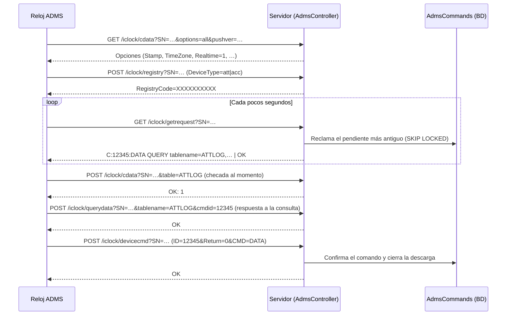

# 04 · Relojes checadores: SDK, ADMS, Hikvision, hora y cuarentena

Este documento describe cómo el sistema habla con los relojes, qué mensajes intercambia con cada protocolo, cómo
interpreta la hora de un marcaje y cuándo lo aparta en cuarentena. Cada afirmación cita el archivo y la línea que la
respalda. Lo que se comprobó además con una prueba automática lo indica con el nombre de la prueba.

> **Qué no está comprobado.** Nada de este documento se probó contra un reloj físico. Los valores que espera cada
> firmware (por ejemplo, qué hace un reloj con el `Stamp` que recibe) vienen de los comentarios del propio código, no de
> una medición. Tampoco hay en el repositorio una lista de modelos probados en producción, así que no se documenta
> ninguno como "soportado": el código sólo distingue marca, método de descarga y tipo `att`/`acc`.

Documentos relacionados: [arquitectura](01-arquitectura.md) (procesos, puertos y recorrido de una checada),
[base de datos](02-base-de-datos.md) (tablas `Devices`, `AdmsCommands`, `QuarantinedPunches`, `DeviceClockIncidents`)
y [motor de cálculo](03-motor-de-calculo.md) (lo que pasa con un marcaje una vez guardado).

Índice

1. [Cómo se elige el protocolo de un reloj](#1-cómo-se-elige-el-protocolo-de-un-reloj)
2. [ZKTeco por SDK (servicio de Windows)](#2-zkteco-por-sdk-servicio-de-windows)
3. [ZKTeco por ADMS (el reloj llama al servidor)](#3-zkteco-por-adms-el-reloj-llama-al-servidor)
4. [Hikvision (experimental)](#4-hikvision-experimental)
5. [Zona horaria y hora de los relojes](#5-zona-horaria-y-hora-de-los-relojes)
6. [Cuarentena de marcajes](#6-cuarentena-de-marcajes)
7. [Estado en línea y monitoreo](#7-estado-en-línea-y-monitoreo)
8. [Problemas posibles y cómo resolverlos](#8-problemas-posibles-y-cómo-resolverlos)
9. [Comportamientos verificados que conviene revisar](#9-comportamientos-verificados-que-conviene-revisar)
10. [Pruebas que respaldan este documento](#10-pruebas-que-respaldan-este-documento)

---

## 1. Cómo se elige el protocolo de un reloj

Cada fila de `Devices` tiene una marca (`Brand`), un método de descarga (`DownloadMethod`) y, para ADMS, un tipo
(`DeviceType`, `att` o `acc`) que el propio reloj anuncia. La fábrica de clientes decide así
([DeviceClientFactory.cs:17-49](../../src/Infrastructure/AttendanceSystem.Infrastructure/Adapters/DeviceClientFactory.cs#L17-L49)):

| `DownloadMethod` | `Brand` | Cliente | Cómo llega un marcaje |
|---|---|---|---|
| `Adms` | cualquiera | `AdmsDeviceClient` | El reloj lo envía por HTTP al servidor (sección 3) |
| `Sdk` | `ZKTeco` | `GrpcZKTecoDeviceClient` → servicio ZKTeco | El servidor lo lee al descargar, o en tiempo real si está activado (sección 2) |
| `Sdk` | `Hikvision` | `HikvisionDeviceClient` | El servidor lo consulta por HTTP/ISAPI (sección 4) |

El tiempo real por SDK sólo se puede activar en un reloj ZKTeco por SDK
([Device.cs:29-38](../../src/Core/AttendanceSystem.Domain/Aggregates/DeviceAggregate/Device.cs#L29-L38)).

---

## 2. ZKTeco por SDK (servicio de Windows)

### 2.1 Por qué hay un servicio aparte

El SDK de ZKTeco (`zkemkeeper`) es un componente COM de 32 bits, así que corre en el servicio de Windows
`AttendanceSystem.ZKTeco.Service` (x86), y el sitio web (x64) y el WPF le hablan por gRPC. El detalle está en
[arquitectura, secciones 2 y 3](01-arquitectura.md).

### 2.2 Configuración

| Clave | Dónde | Valor por omisión | Efecto | Código |
|---|---|---|---|---|
| `GrpcPort` | Servicio ZKTeco | `5001` | Puerto gRPC (HTTP/2 sin TLS) | [Program.cs:142](../../src/Presentation/AttendanceSystem.ZKTeco.Service/Program.cs#L142) |
| `GrpcBindLocalOnly` | Servicio ZKTeco | `true` | Con `true` sólo escucha en `localhost`; con `false`, en todas las interfaces | [Program.cs:143-157](../../src/Presentation/AttendanceSystem.ZKTeco.Service/Program.cs#L143-L157) |
| `ApiKey` (o `ZKTecoService:ApiKey`) | Servicio ZKTeco | ninguno | Obligatoria. El interceptor que la exige se crea en cada llamada (no está registrado en el contenedor, [Program.cs:125](../../src/Presentation/AttendanceSystem.ZKTeco.Service/Program.cs#L125)): sin ella el servicio arranca, pero cada llamada falla | [ApiKeyAuthInterceptor.cs:19-25](../../src/Presentation/AttendanceSystem.ZKTeco.Service/Interceptors/ApiKeyAuthInterceptor.cs#L19-L25) |
| `ShutdownTimeoutSeconds` | Servicio ZKTeco | `15` | Espera al detener el servicio | [Program.cs:78-82](../../src/Presentation/AttendanceSystem.ZKTeco.Service/Program.cs#L78-L82) |
| `Realtime:HeartbeatInterval`, `Realtime:ReconnectDelays`, `Realtime:ChannelCapacity` | Servicio ZKTeco | 30 s; 5, 10, 30, 60 s; 10 000 | Escucha en tiempo real (sección 2.7) | [RealtimeModels.cs:25-38](../../src/Infrastructure/AttendanceSystem.ZKTeco/Realtime/RealtimeModels.cs#L25-L38) |
| `ZKTecoService:Url` | Sitio web y WPF | `http://localhost:5001` | Dirección del servicio | [InfrastructureServiceExtensions.cs:144-148](../../src/Infrastructure/AttendanceSystem.Infrastructure/DependencyInjection/InfrastructureServiceExtensions.cs#L144-L148) |
| `ZKTecoService:ApiKey` (o `ApiKey`) | Sitio web y WPF | ninguno | Se envía como cabecera `x-api-key`; debe coincidir con la del servicio | [InfrastructureServiceExtensions.cs:149-157](../../src/Infrastructure/AttendanceSystem.Infrastructure/DependencyInjection/InfrastructureServiceExtensions.cs#L149-L157) |
| `ZKTecoService:Realtime:Enabled` | Sitio web | `false` | Activa la suscripción a marcajes en tiempo real | [ZKTecoRealtimeSubscriber.cs:21](../../src/Infrastructure/AttendanceSystem.Infrastructure/Services/ZKTecoRealtime/ZKTecoRealtimeSubscriber.cs#L21), [líneas 48-52](../../src/Infrastructure/AttendanceSystem.Infrastructure/Services/ZKTecoRealtime/ZKTecoRealtimeSubscriber.cs#L48-L52) |

Ejemplo de configuración del servicio:
[appsettings.Example.json](../../src/Presentation/AttendanceSystem.ZKTeco.Service/appsettings.Example.json).

Límites de tamaño: el servicio acepta y envía mensajes de hasta 32 MB
([Program.cs:120-126](../../src/Presentation/AttendanceSystem.ZKTeco.Service/Program.cs#L120-L126)); el cliente del
sitio web y del WPF, hasta 10 MB
([InfrastructureServiceExtensions.cs:158-162](../../src/Infrastructure/AttendanceSystem.Infrastructure/DependencyInjection/InfrastructureServiceExtensions.cs#L158-L162)).
Una respuesta de más de 10 MB (por ejemplo, todos los usuarios con huellas de un reloj grande) la rechaza el cliente,
aunque el servicio la envíe.

### 2.3 Contrato gRPC

Los métodos están en [zkteco.proto:6-55](../../src/Infrastructure/AttendanceSystem.ZKTeco/Protos/zkteco.proto#L6-L55):
`ConnectDevice`, `GetAttendanceLogs`, `ClearDeviceLogs`, `DisconnectDevice`, `RegisterEmployee`, `DeleteEmployee`,
`GetEmployee`, `GetDeviceInfo`, `GetAllUsers`, `DeleteUserFingerprints`, `ResetToFactorySettings`, `SetDeviceTime`,
`GetDeviceTime`, `DiscoverDevices`, `SetRealtimeDevices` y `SubscribeRealtime` (stream).

- **Autenticación.** Toda llamada salvo `grpc.health.v1.Health` exige `x-api-key`; la comparación es de tiempo
  constante ([ApiKeyAuthInterceptor.cs:68-103](../../src/Presentation/AttendanceSystem.ZKTeco.Service/Interceptors/ApiKeyAuthInterceptor.cs#L68-L103)).
- **Sin contraseña del reloj.** `ConnectDeviceRequest` sólo lleva IP, puerto y tiempo límite
  ([zkteco.proto:59-63](../../src/Infrastructure/AttendanceSystem.ZKTeco/Protos/zkteco.proto#L59-L63)), y la conexión
  es `Connect_Net(ip, puerto)` ([ZKTecoDeviceClient.cs:51](../../src/Infrastructure/AttendanceSystem.ZKTeco/Adapters/ZKTecoDeviceClient.cs#L51)).
  Un reloj con clave de comunicación (*comm key*) distinta de 0 no se puede conectar por SDK.
- **Fechas.** Viajan como texto ISO 8601 (`"o"`)
  ([GrpcZKTecoDeviceClient.cs:74-79](../../src/Infrastructure/AttendanceSystem.Infrastructure/Adapters/GrpcZKTecoDeviceClient.cs#L74-L79)).
  Una fecha con `Kind = Utc` llega al servicio como UTC; una sin zona llega sin zona
  ([ZKTecoGrpcService.cs:82-92](../../src/Presentation/AttendanceSystem.ZKTeco.Service/Services/ZKTecoGrpcService.cs#L82-L92)).

### 2.4 Sesiones y exclusión por reloj

- Cada instancia de `GrpcZKTecoDeviceClient` genera un identificador de sesión y lo envía en la cabecera
  `x-session-id` ([GrpcZKTecoDeviceClient.cs:17](../../src/Infrastructure/AttendanceSystem.Infrastructure/Adapters/GrpcZKTecoDeviceClient.cs#L17),
  [líneas 27-30](../../src/Infrastructure/AttendanceSystem.Infrastructure/Adapters/GrpcZKTecoDeviceClient.cs#L27-L30)).
  El cliente se registra como *transient*, así que cada operación tiene su propia sesión
  ([InfrastructureServiceExtensions.cs:95](../../src/Infrastructure/AttendanceSystem.Infrastructure/DependencyInjection/InfrastructureServiceExtensions.cs#L95)).
  Sin cabecera, el servicio usa `default-session` ([ZKTecoGrpcService.cs:29-33](../../src/Presentation/AttendanceSystem.ZKTeco.Service/Services/ZKTecoGrpcService.cs#L29-L33)).
- El servicio permite **una sola sesión a la vez por reloj** (`IP:puerto`): la segunda espera el candado hasta el tiempo
  límite de conexión y luego falla con "El dispositivo … está ocupado por otra operación"
  ([ZKTecoSessionManager.cs:126-134](../../src/Infrastructure/AttendanceSystem.ZKTeco/Adapters/ZKTecoSessionManager.cs#L126-L134)).
  El cliente pide 30 s de tiempo límite ([GrpcZKTecoDeviceClient.cs:38-43](../../src/Infrastructure/AttendanceSystem.Infrastructure/Adapters/GrpcZKTecoDeviceClient.cs#L38-L43)).
- Una sesión sin uso por más de 3 minutos se cierra sola; la revisión corre cada minuto
  ([ZKTecoSessionManager.cs:92](../../src/Infrastructure/AttendanceSystem.ZKTeco/Adapters/ZKTecoSessionManager.cs#L92),
  [líneas 347-374](../../src/Infrastructure/AttendanceSystem.ZKTeco/Adapters/ZKTecoSessionManager.cs#L347-L374)).
  Al cerrar, espera hasta 5 s a que terminen las operaciones en curso
  ([líneas 306-322](../../src/Infrastructure/AttendanceSystem.ZKTeco/Adapters/ZKTecoSessionManager.cs#L306-L322)).
- Si el reloj está en escucha de tiempo real, la sesión **toma prestada** esa conexión en lugar de abrir otra
  ([líneas 142-153](../../src/Infrastructure/AttendanceSystem.ZKTeco/Adapters/ZKTecoSessionManager.cs#L142-L153)).
- Además, en el sitio web y en el WPF, la descarga de un reloj toma un candado por reloj
  ([DownloadFromDeviceCommand.cs:113-116](../../src/Core/AttendanceSystem.Application/Features/Attendance/Commands/DownloadFromDevice/DownloadFromDeviceCommand.cs#L113-L116)).
  Ese candado vive en la memoria del proceso
  ([DeviceLockService.cs:9-29](../../src/Infrastructure/AttendanceSystem.Infrastructure/Services/DeviceLockService.cs#L9-L29)):
  no coordina el sitio web con el WPF. Entre procesos, la exclusión la da el candado por IP del servicio ZKTeco.

### 2.5 Descarga de marcajes

Recorrido de `DownloadFromDeviceCommand` para un reloj por SDK
([DownloadFromDeviceCommand.cs:121-599](../../src/Core/AttendanceSystem.Application/Features/Attendance/Commands/DownloadFromDevice/DownloadFromDeviceCommand.cs#L121-L599)):

1. **Ventana.** Desde `FromDate` o, si no se indica, desde `Devices.LastDownloadAt`; con `ForceFullSync`, sin
   límite inferior. Hasta `ToDate` o el momento de la solicitud
   ([líneas 140-141](../../src/Core/AttendanceSystem.Application/Features/Attendance/Commands/DownloadFromDevice/DownloadFromDeviceCommand.cs#L140-L141)).
   Las fechas UTC se convierten a la hora civil del reloj; las que vienen de pantalla ya son civiles
   ([líneas 605-606](../../src/Core/AttendanceSystem.Application/Features/Attendance/Commands/DownloadFromDevice/DownloadFromDeviceCommand.cs#L605-L606)).
2. **Permisos.** Re-descargar todo exige `DevicesForceFullDownload`; borrar el reloj tras descargar exige
   `DevicesManage` ([líneas 35-39](../../src/Core/AttendanceSystem.Application/Features/Attendance/Commands/DownloadFromDevice/DownloadFromDeviceCommand.cs#L35-L39)).
3. **Hora del reloj.** Antes de leer se compara la hora del reloj con la de su zona y, si hace falta, se resincroniza
   (sección 5.4). Si el desfase supera el umbral de cuarentena, los marcajes nuevos quedan apartados y la lectura se
   amplía hacia atrás ([líneas 282-317](../../src/Core/AttendanceSystem.Application/Features/Attendance/Commands/DownloadFromDevice/DownloadFromDeviceCommand.cs#L282-L317)).
4. **Lectura en el servicio.** `ReadAllGLogData` lee **todos** los marcajes del reloj y el servicio descarta los que
   caen fuera de la ventana ([ZKTecoDeviceClient.cs:123-159](../../src/Infrastructure/AttendanceSystem.ZKTeco/Adapters/ZKTecoDeviceClient.cs#L123-L159)).
   Mientras lee, el reloj queda deshabilitado (`EnableDevice(1, false)`) y no acepta checadas; se rehabilita al
   terminar, aun con error ([líneas 103](../../src/Infrastructure/AttendanceSystem.ZKTeco/Adapters/ZKTecoDeviceClient.cs#L103), [175](../../src/Infrastructure/AttendanceSystem.ZKTeco/Adapters/ZKTecoDeviceClient.cs#L175)).
   El tiempo de lectura crece con el total de marcajes guardados en el reloj, no con los de la ventana.
5. **Conversión y cuarentena.** Cada hora civil se pasa a UTC con la zona del reloj; los PIN de sucursales externas se
   guardan aparte; los demás pasan por la cuarentena (sección 6) y la ingesta deduplicada
   ([líneas 362-455](../../src/Core/AttendanceSystem.Application/Features/Attendance/Commands/DownloadFromDevice/DownloadFromDeviceCommand.cs#L362-L455)).
6. **Cursor.** `LastDownloadAt` avanza al "hasta" de la descarga sólo si la lectura no fue parcial
   ([líneas 463-470](../../src/Core/AttendanceSystem.Application/Features/Attendance/Commands/DownloadFromDevice/DownloadFromDeviceCommand.cs#L463-L470)).
7. **Borrar tras descargar** (si el reloj o la solicitud lo piden). Sólo con lectura completa y con datos, y sólo el
   rango entre el primer y el último marcaje leídos
   ([líneas 497-529](../../src/Core/AttendanceSystem.Application/Features/Attendance/Commands/DownloadFromDevice/DownloadFromDeviceCommand.cs#L497-L529)).
   El servicio usa `DeleteAttlogBetweenTheDate`
   ([ZKTecoDeviceClient.cs:207-215](../../src/Infrastructure/AttendanceSystem.ZKTeco/Adapters/ZKTecoDeviceClient.cs#L207-L215))
   y rechaza un borrado sin fechas ([líneas 196-200](../../src/Infrastructure/AttendanceSystem.ZKTeco/Adapters/ZKTecoDeviceClient.cs#L196-L200)).
   **Atención:** ese rango se envía en UTC, no en la hora del reloj; ver la sección 9, punto 1.

### 2.6 Hora del reloj por SDK

El SDK no maneja zonas: se lee y se fija la hora civil con `GetDeviceTime` y `SetDeviceTime2`
([ZKTecoDeviceClient.cs:689-742](../../src/Infrastructure/AttendanceSystem.ZKTeco/Adapters/ZKTecoDeviceClient.cs#L689-L742)).
Para SDK, "fijar zona y hora" es sólo fijar la hora: la implementación por omisión ignora el desfase
([IDeviceClient.cs:51-52](../../src/Core/AttendanceSystem.Application/Abstractions/IDeviceClient.cs#L51-L52)).

### 2.7 Tiempo real por SDK

Apagado por omisión (`ZKTecoService:Realtime:Enabled = false`). Encendido:

- **Quién se suscribe.** Sólo el sitio web registra el suscriptor
  ([Program.cs:159-160](../../src/Presentation/AttendanceSystem.Blazor.Server/Program.cs#L159-L160)); el WPF no. Sin
  sitio web (WPF en modo `Standalone`) no hay tiempo real por SDK. El servicio admite **un** suscriptor: uno nuevo
  desplaza al anterior ([ZKTecoRealtimeChannel.cs:30-41](../../src/Infrastructure/AttendanceSystem.ZKTeco/Realtime/ZKTecoRealtimeChannel.cs#L30-L41)).
- **Qué relojes.** Los activos con `RealtimeEnabled`, ZKTeco por SDK y con IP; la lista se reenvía al servicio cada
  5 minutos si cambió ([ZKTecoRealtimeSubscriber.cs:130-150](../../src/Infrastructure/AttendanceSystem.Infrastructure/Services/ZKTecoRealtime/ZKTecoRealtimeSubscriber.cs#L130-L150), [líneas 23-27](../../src/Infrastructure/AttendanceSystem.Infrastructure/Services/ZKTecoRealtime/ZKTecoRealtimeSubscriber.cs#L23-L27)).
  Dos relojes con la misma `IP:puerto` se escuchan como uno solo ([ZKTecoSessionManager.cs:259-266](../../src/Infrastructure/AttendanceSystem.ZKTeco/Adapters/ZKTecoSessionManager.cs#L259-L266)).
- **En el servicio.** Cada reloj tiene una conexión fija con `RegEvent(1, 65535)`
  ([ZKTecoDeviceClient.cs:255-277](../../src/Infrastructure/AttendanceSystem.ZKTeco/Adapters/ZKTecoDeviceClient.cs#L255-L277)).
  Como el SDK no avisa la caída, cada 30 s se lee la hora del reloj como latido; si falla, se reconecta con esperas de
  5, 10, 30 y 60 s ([ZKTecoRealtimeListener.cs:73-135](../../src/Infrastructure/AttendanceSystem.ZKTeco/Realtime/ZKTecoRealtimeListener.cs#L73-L135)).
  Un marcaje repetido (mismo usuario y hora entre los últimos 256) se publica una sola vez
  ([líneas 211-230](../../src/Infrastructure/AttendanceSystem.ZKTeco/Realtime/ZKTecoRealtimeListener.cs#L211-L230)).
  Sin suscriptor se guardan hasta 10 000 eventos; al llenarse se descartan **los más viejos**
  ([ZKTecoRealtimeChannel.cs:24](../../src/Infrastructure/AttendanceSystem.ZKTeco/Realtime/ZKTecoRealtimeChannel.cs#L24)).
- **En el sitio web.** Los marcajes se agrupan por reloj y se guardan cada 500 ms como tiempo real
  ([ZKTecoRealtimeDispatcher.cs:84-113](../../src/Infrastructure/AttendanceSystem.Infrastructure/Services/ZKTecoRealtime/ZKTecoRealtimeDispatcher.cs#L84-L113),
  [RecordRealtimePunchesCommand.cs:112-117](../../src/Core/AttendanceSystem.Application/Features/Attendance/Commands/RecordRealtimePunches/RecordRealtimePunchesCommand.cs#L112-L117)).
  Al (re)conectarse una escucha se encola una **descarga de respaldo**, como máximo una cada 10 minutos por reloj; si
  un lote no se guarda, la descarga se encola sin esperar
  ([ZKTecoRealtimeDispatcher.cs:19](../../src/Infrastructure/AttendanceSystem.Infrastructure/Services/ZKTecoRealtime/ZKTecoRealtimeDispatcher.cs#L19),
  [líneas 63-79](../../src/Infrastructure/AttendanceSystem.Infrastructure/Services/ZKTecoRealtime/ZKTecoRealtimeDispatcher.cs#L63-L79),
  [líneas 126-145](../../src/Infrastructure/AttendanceSystem.Infrastructure/Services/ZKTecoRealtime/ZKTecoRealtimeDispatcher.cs#L126-L145)).

### 2.8 Descubrimiento de relojes

`DiscoverDevices` llama a `SearchDevice("UDP", "255.255.255.255", …)` del SDK
([ZKTecoDiscoveryService.cs:34](../../src/Infrastructure/AttendanceSystem.ZKTeco/Adapters/ZKTecoDiscoveryService.cs#L34)):
es una difusión UDP desde la máquina del servicio ZKTeco, así que sólo encuentra relojes de su mismo segmento de red.

---

## 3. ZKTeco por ADMS (el reloj llama al servidor)

En ADMS (también llamado *push*) el servidor nunca abre conexión con el reloj: el reloj consulta periódicamente al
servidor, le entrega sus marcajes y recoge los comandos que tenga pendientes.

### 3.1 Dónde escucha y cómo se identifica el reloj

- **Quién recibe.** El sitio web (en el enlace de IIS del puerto ADMS) o, sin sitio web, el WPF en el puerto
  `SystemConfiguration.AdmsPort` (18373 por omisión). Ver [arquitectura, sección 4](01-arquitectura.md#4-formas-de-instalación).
- **Rutas.** Todas existen con y sin el prefijo `/iclock` ([AdmsController.cs:24-25](../../src/Presentation/AttendanceSystem.Adms/AdmsController.cs#L24-L25)).
- **Identificación.** El reloj se identifica sólo con su número de serie en `?SN=`. Se busca sin distinguir mayúsculas
  ([DeviceRepository.cs:40-49](../../src/Infrastructure/AttendanceSystem.Infrastructure/Persistence/Repositories/DeviceRepository.cs#L40-L49));
  si no está registrado o está inactivo, la respuesta es `401` ([AdmsController.cs:91-109](../../src/Presentation/AttendanceSystem.Adms/AdmsController.cs#L91-L109)).
  No hay otra autenticación: quien conozca un número de serie registrado puede enviar marcajes en su nombre. Se trata
  en la fase de limitaciones.
- **Durante una restauración** de la base, todas estas rutas responden `503` con `Retry-After: 30`
  ([RestoreMaintenanceMiddleware.cs:26-47](../../src/Presentation/AttendanceSystem.Adms/RestoreMaintenanceMiddleware.cs#L26-L47)).
- **Bitácora.** Cada petición ADMS se registra con cabeceras y cuerpo. Las tablas de usuarios y biometría y los
  campos de contraseña se ocultan, y el resto se recorta a 512 bytes (2 048 en `devicecmd` y opciones)
  ([AdmsRequestLoggingMiddleware.cs:77-142](../../src/Infrastructure/AttendanceSystem.Infrastructure/Logging/AdmsRequestLoggingMiddleware.cs#L77-L142)).

### 3.2 Secuencia típica



### 3.3 Mensajes por ruta

| Ruta | Qué envía el reloj | Qué hace el servidor | Qué responde | Código |
|---|---|---|---|---|
| `GET cdata` | `SN`, y opcionalmente `options`, `PushOptionsFlag`, `pushver`, `DeviceType` | Guarda `pushver` y `DeviceType` si cambiaron; marca el reloj en línea | Con `options` o `PushOptionsFlag`: el bloque de opciones (3.4). Si no: `registry=ok` | [AdmsController.cs:126-177](../../src/Presentation/AttendanceSystem.Adms/AdmsController.cs#L126-L177) |
| `POST registry` | Cuerpo `clave=valor,…` con `DeviceType` | Fija el tipo (`att` si no lo dice), lo marca en línea y **borra `LastDownloadAt`** | `RegistryCode=` y 10 caracteres al azar | [AdmsController.cs:180-212](../../src/Presentation/AttendanceSystem.Adms/AdmsController.cs#L180-L212) |
| `POST push` | Cuerpo (no se interpreta) | — | El bloque de opciones (3.4) | [AdmsController.cs:215-232](../../src/Presentation/AttendanceSystem.Adms/AdmsController.cs#L215-L232) |
| `POST cdata` | `table=` y líneas en el cuerpo | `ATTLOG`, `rtlog`, `Transaction`: marcajes (3.5). `USER`, `USERINFO`, `USERPIC`, `BIOPHOTO`, `BIODATA`, `TEMPLATEV10`, `FINGERPRINT`, `FINGERTMP`, `TEMPLATE`: datos de empleados (3.9). `options`, `tabledata`: información técnica (3.8). Otras: nada | Marcajes: `OK: n` o `500` si el lote no se guardó. Resto: `OK` | [AdmsController.cs:302-358](../../src/Presentation/AttendanceSystem.Adms/AdmsController.cs#L302-L358) |
| `POST querydata` | `tablename` (o `table`), `type`, `cmdid`, `count`; líneas en el cuerpo | Lo mismo que `cdata`, más `User Transaction` y `USERTRANSACTION` como marcajes; asocia el lote a la descarga del `cmdid` | `OK` (sin conteo: el reloj espera exactamente `OK` para mandar el paquete siguiente) o `500` | [AdmsController.cs:361-426](../../src/Presentation/AttendanceSystem.Adms/AdmsController.cs#L361-L426) |
| `GET getrequest` | `SN` | Lo marca en línea y reclama un comando pendiente | `C:<id>:<comando>` o `OK` | [AdmsController.cs:429-457](../../src/Presentation/AttendanceSystem.Adms/AdmsController.cs#L429-L457) |
| `POST devicecmd` | `ID`, `Return`, `CMD` en la URL o en la primera línea del cuerpo; a veces datos | Si es respuesta a `INFO`, guarda la información técnica; si trae marcajes, los procesa; confirma el comando y cierra la descarga asociada | `OK` siempre | [AdmsController.cs:484-626](../../src/Presentation/AttendanceSystem.Adms/AdmsController.cs#L484-L626) |
| `GET ping` | `SN` opcional | Con `SN` registra actividad | `OK` | [AdmsController.cs:474-482](../../src/Presentation/AttendanceSystem.Adms/AdmsController.cs#L474-L482) |
| `GET debug/pending-commands` | `SN` | Indica si hay comandos pendientes | JSON; exige rol `Administrador` | [AdmsController.cs:460-471](../../src/Presentation/AttendanceSystem.Adms/AdmsController.cs#L460-L471) |

Todas las respuestas llevan la cabecera `Date` en UTC: el reloj calcula su hora con ella más el desfase `TimeZone`
([AdmsController.cs:140](../../src/Presentation/AttendanceSystem.Adms/AdmsController.cs#L140),
[AdmsController.cs:255-256](../../src/Presentation/AttendanceSystem.Adms/AdmsController.cs#L255-L256)).

**Códigos de retorno en `devicecmd`.** `Return >= 0` o `-2` se toma como éxito
([AdmsController.cs:577](../../src/Presentation/AttendanceSystem.Adms/AdmsController.cs#L577),
[AdmsCommandService.cs:360](../../src/Infrastructure/AttendanceSystem.Infrastructure/Services/AdmsCommandService.cs#L360)).
Los errores que el sistema traduce son `-1` (error general), `-5` (reloj ocupado), `-629` (tabla no soportada),
`-1001` (memoria llena) y `-1002` (comando no reconocido)
([AdmsController.cs:599-607](../../src/Presentation/AttendanceSystem.Adms/AdmsController.cs#L599-L607)).

### 3.4 El bloque de opciones

Es fijo salvo `Stamp`, la zona y `TransTables`
([AdmsController.cs:234-299](../../src/Presentation/AttendanceSystem.Adms/AdmsController.cs#L234-L299)). Para un reloj
`att` con zona `America/Mexico_City` y sin descargas previas:

```text
GET OPTION FROM: <SN>
Stamp=1970-01-01 00:00:00
TransStamp=1970-01-01 00:00:00
ATTLOGStamp=1970-01-01 00:00:00
OpStamp=0
OPERLOGStamp=0
PhotoStamp=0
ATTPHOTOStamp=0
TimeZone=-6
~TimeZone=-6
TZ=-6
DaylightSavingTime=0
~DaylightSavingTime=0
ErrorDelay=60
Delay=10
RequestDelay=5
TransTimes=00:00;14:00
TransInterval=1
TransTables=Transaction
Realtime=1
SessionID=<32 caracteres al azar>
TimeoutSec=10
ServerVersion=3.1.2
ServerName=ADMS
PushVersion=3.1.2
```

- `Stamp`, `TransStamp` y `ATTLOGStamp` valen `Devices.LastDownloadAt` con formato `yyyy-MM-dd HH:mm:ss`, o
  `1970-01-01 00:00:00` si está vacío ([AdmsController.cs:247-250](../../src/Presentation/AttendanceSystem.Adms/AdmsController.cs#L247-L250),
  [DeviceRepository.cs:52-58](../../src/Infrastructure/AttendanceSystem.Infrastructure/Persistence/Repositories/DeviceRepository.cs#L52-L58)).
  Cómo se llena ese campo está en la sección 3.6.
- `TimeZone` es el desfase de la zona del reloj en horas enteras (sección 5.3).
- `TransTables` es `Transaction,User Transaction` para un reloj `acc` y `Transaction` para los demás
  ([AdmsController.cs:244](../../src/Presentation/AttendanceSystem.Adms/AdmsController.cs#L244), [253](../../src/Presentation/AttendanceSystem.Adms/AdmsController.cs#L253)).
- Ninguno de los demás valores es configurable.

Pruebas: `Handshake_SendsTheClockZone_NotTheServerZone`
([AdmsDeviceTimeZoneTests.cs:59](../../tests/AttendanceSystem.Blazor.UnitTests/Controllers/AdmsDeviceTimeZoneTests.cs#L59)),
`S04` y `S05` ([AdmsStampDocumentacionTests.cs:103](../../tests/AttendanceSystem.Blazor.UnitTests/Controllers/AdmsStampDocumentacionTests.cs#L103),
[116](../../tests/AttendanceSystem.Blazor.UnitTests/Controllers/AdmsStampDocumentacionTests.cs#L116)).

### 3.5 Líneas de marcaje

Cada línea del cuerpo es un marcaje, en uno de dos formatos
([AdmsController.cs:645-804](../../src/Presentation/AttendanceSystem.Adms/AdmsController.cs#L645-L804)):

- **Por posiciones**, separado por tabuladores: `PIN  fecha  estado  verificación`, por ejemplo
  `78\t2022-11-14 13:46:27\t0\t15` ([líneas 744-754](../../src/Presentation/AttendanceSystem.Adms/AdmsController.cs#L744-L754)).
- **Clave=valor**, separado por tabuladores o comas (relojes `acc` y `rtlog`). Si una línea contiene `=`, `time` o
  `pin`, se trata así ([línea 659](../../src/Presentation/AttendanceSystem.Adms/AdmsController.cs#L659)). Se aceptan
  estas claves, sin distinguir mayúsculas y en este orden de preferencia:

| Dato | Claves | Código |
|---|---|---|
| Empleado | `pin`, `user_id`, `userid`, `cardno` | [líneas 679-688](../../src/Presentation/AttendanceSystem.Adms/AdmsController.cs#L679-L688) |
| Hora | `time`, `time_second`, `logtime` | [líneas 691-697](../../src/Presentation/AttendanceSystem.Adms/AdmsController.cs#L691-L697) |
| Evento | `event`, `eventtype`, `event_type` | [líneas 705-719](../../src/Presentation/AttendanceSystem.Adms/AdmsController.cs#L705-L719) |
| Estado (entrada/salida) | `inoutstatus`, `inoutstate`, `state`, `status` | [líneas 722-730](../../src/Presentation/AttendanceSystem.Adms/AdmsController.cs#L722-L730) |
| Verificación | `verifytype`, `verified`, `verifystyle` | [líneas 732-739](../../src/Presentation/AttendanceSystem.Adms/AdmsController.cs#L732-L739) |

Reglas:

- Un evento entre 20 y 199 (acceso denegado o alarma) se descarta sin registrarlo
  ([líneas 710-718](../../src/Presentation/AttendanceSystem.Adms/AdmsController.cs#L710-L718)).
- Una verificación `0` se guarda como `3`; sin verificación, también `3`
  ([líneas 654](../../src/Presentation/AttendanceSystem.Adms/AdmsController.cs#L654), [738](../../src/Presentation/AttendanceSystem.Adms/AdmsController.cs#L738), [751](../../src/Presentation/AttendanceSystem.Adms/AdmsController.cs#L751)).
- Formatos de hora ([líneas 1101-1161](../../src/Presentation/AttendanceSystem.Adms/AdmsController.cs#L1101-L1161)):
  texto (`DateTime.TryParse`, primero con cultura invariante y luego con la del servidor); número en el formato
  comprimido de ZKTeco (segundos desde 2000 con meses de 31 días); o, si no es válido así, segundos Unix. **El formato
  Unix se convierte a la hora local del servidor** ([línea 1150](../../src/Presentation/AttendanceSystem.Adms/AdmsController.cs#L1150))
  y después se interpreta como hora del reloj: sólo es correcto si servidor y reloj están en la misma zona.
- Una línea sin PIN u hora legible queda como incidente en `AdmsIngestionIncidents` y marca el lote "con fallas"
  ([líneas 797-814](../../src/Presentation/AttendanceSystem.Adms/AdmsController.cs#L797-L814),
  [líneas 876-890](../../src/Presentation/AttendanceSystem.Adms/AdmsController.cs#L876-L890)).

### 3.6 Qué pasa con un lote de marcajes

[AdmsController.cs:627-940](../../src/Presentation/AttendanceSystem.Adms/AdmsController.cs#L627-L940):

1. La hora se interpreta en la zona del reloj ([línea 643](../../src/Presentation/AttendanceSystem.Adms/AdmsController.cs#L643)).
2. Un PIN con prefijo de sucursal externa se guarda en `ExternalAttendanceLogs`, sin duplicar
   ([líneas 758-775](../../src/Presentation/AttendanceSystem.Adms/AdmsController.cs#L758-L775), [817-840](../../src/Presentation/AttendanceSystem.Adms/AdmsController.cs#L817-L840)).
3. Los demás van a `RecordAttendanceBatchCommand`. Si no hay descarga ni comando en curso, el lote es **tiempo real**;
   si responde a una consulta, es **re-descarga** ([líneas 846-854](../../src/Presentation/AttendanceSystem.Adms/AdmsController.cs#L846-L854)).
   La diferencia importa para la cuarentena (sección 6).
4. Si el lote no se guarda, la respuesta es `500` y nada avanza, para que el reloj lo reenvíe
   ([líneas 856-866](../../src/Presentation/AttendanceSystem.Adms/AdmsController.cs#L856-L866)). Prueba:
   `ReceiveData_WhenProcessAttLogsFails_ShouldReturn500InternalServerError`
   ([AdmsControllerTests.cs:333](../../tests/AttendanceSystem.Blazor.UnitTests/Controllers/AdmsControllerTests.cs#L333)).
5. El conteo `OK: n` es el número de líneas válidas del lote: guardadas, ya existentes, apartadas en cuarentena o de
   sucursales externas ([AdmsController.cs:773](../../src/Presentation/AttendanceSystem.Adms/AdmsController.cs#L773),
   [790](../../src/Presentation/AttendanceSystem.Adms/AdmsController.cs#L790),
   [939](../../src/Presentation/AttendanceSystem.Adms/AdmsController.cs#L939)).
   No incluye los eventos descartados ni las líneas malformadas (`ReceiveData_WhenPartialLinesMalformed_…`,
   [AdmsControllerTests.cs:386](../../tests/AttendanceSystem.Blazor.UnitTests/Controllers/AdmsControllerTests.cs#L386)).
6. **Reloj adelantado.** Si el marcaje más reciente del lote supera la hora actual de su zona por más de la tolerancia
   de sincronización (2 min por omisión), se encolan los comandos de zona y hora y, pasado el umbral de alerta (10 min),
   queda una alerta ([líneas 897-920](../../src/Presentation/AttendanceSystem.Adms/AdmsController.cs#L897-L920)).
   Prueba: `PunchFromTheFuture_QueuesTheClockZoneAndTime`
   ([AdmsDeviceTimeZoneTests.cs:88](../../tests/AttendanceSystem.Blazor.UnitTests/Controllers/AdmsDeviceTimeZoneTests.cs#L88)).
7. **El cursor (`LastDownloadAt`, que se envía como `Stamp`).** Lo escriben tres caminos, con valores de distinta
   naturaleza:

| Camino | Valor que queda | Código | Prueba |
|---|---|---|---|
| Lote sin fallas | Hora **civil** del marcaje más reciente (o la hora actual del reloj si el lote venía del futuro) | [AdmsController.cs:918-925](../../src/Presentation/AttendanceSystem.Adms/AdmsController.cs#L918-L925) | `S01` ([AdmsStampDocumentacionTests.cs:62](../../tests/AttendanceSystem.Blazor.UnitTests/Controllers/AdmsStampDocumentacionTests.cs#L62)) |
| Lote con alguna línea mala | La hora **UTC** de recepción: `RecordSuccessfulDownload` ya la escribió antes de decidir no avanzar | [AdmsController.cs:894](../../src/Presentation/AttendanceSystem.Adms/AdmsController.cs#L894), [Device.cs:207-209](../../src/Core/AttendanceSystem.Domain/Aggregates/DeviceAggregate/Device.cs#L207-L209) | `S02` ([línea 73](../../tests/AttendanceSystem.Blazor.UnitTests/Controllers/AdmsStampDocumentacionTests.cs#L73)) |
| Acuse de una consulta de descarga | El "hasta" de la descarga, en **UTC** | [AdmsController.cs:584-589](../../src/Presentation/AttendanceSystem.Adms/AdmsController.cs#L584-L589) | `S03` ([línea 88](../../tests/AttendanceSystem.Blazor.UnitTests/Controllers/AdmsStampDocumentacionTests.cs#L88)) |
| `POST registry` | Vacío (el siguiente `Stamp` es 1970) | [AdmsController.cs:203](../../src/Presentation/AttendanceSystem.Adms/AdmsController.cs#L203) | `S05` ([línea 116](../../tests/AttendanceSystem.Blazor.UnitTests/Controllers/AdmsStampDocumentacionTests.cs#L116)) |

   La base guarda cualquier fecha sin zona como si fuera UTC
   ([AttendanceDbContext.cs:80-81](../../src/Infrastructure/AttendanceSystem.Infrastructure/Persistence/AttendanceDbContext.cs#L80-L81)),
   así que después no se distingue cuál de los dos es. En una zona UTC−6, un `Stamp` escrito por los dos caminos UTC
   queda 6 horas por delante de la hora del reloj. Qué hace el firmware con ese valor no está comprobado (ver la
   sección 9, punto 2).

### 3.7 Cola de comandos

La tabla `AdmsCommands` es la fuente de verdad; cualquier proceso puede encolar y el que atiende al reloj reclama
([AdmsCommandService.cs:15-21](../../src/Infrastructure/AttendanceSystem.Infrastructure/Services/AdmsCommandService.cs#L15-L21)).

| Estado | Valor | Cuándo |
|---|---|---|
| `Pending` | 1 | Al encolar ([AdmsCommand.cs:24-51](../../src/Core/AttendanceSystem.Domain/Aggregates/DeviceAggregate/AdmsCommand.cs#L24-L51)) |
| `Sent` | 2 | Al entregarlo en `getrequest`, con un `CommandId` nuevo |
| `Confirmed` | 3 | Acuse con `Return >= 0` o `-2` |
| `Failed` | 4 | Acuse con otro código |
| `Expired` | 5 | Entregado hace más de 10 min sin acuse, **revisado sólo al arrancar** el proceso ([AdmsCommandService.cs:25](../../src/Infrastructure/AttendanceSystem.Infrastructure/Services/AdmsCommandService.cs#L25), [líneas 59-88](../../src/Infrastructure/AttendanceSystem.Infrastructure/Services/AdmsCommandService.cs#L59-L88)) |

Valores en [AdmsCommandStatus.cs:3-10](../../src/Core/AttendanceSystem.Domain/Aggregates/DeviceAggregate/AdmsCommandStatus.cs#L3-L10).

- **Entrega.** Un único `UPDATE … FOR UPDATE SKIP LOCKED` marca como entregado el pendiente más antiguo del reloj
  ([AdmsCommandService.cs:157-179](../../src/Infrastructure/AttendanceSystem.Infrastructure/Services/AdmsCommandService.cs#L157-L179)):
  un comando sale una sola vez aunque haya varios procesos. Se entrega **un comando por consulta** del reloj. Pruebas:
  `ConcurrentPolls_DeliverEachCommandExactlyOnce`
  ([PostgresAdmsCommandQueueTests.cs:33](../../tests/AttendanceSystem.Infrastructure.Tests/Persistence/PostgresAdmsCommandQueueTests.cs#L33)),
  `ACommandEnqueuedByOneProcess_IsDeliveredByAnother_Once`
  ([AdmsCommandServiceTests.cs:112](../../tests/AttendanceSystem.Infrastructure.Tests/Services/AdmsCommandServiceTests.cs#L112)).
- **CommandId.** Un número entre 10000 y 99999 que no esté entregado sin acuse en el mismo reloj; cada proceso
  arranca la secuencia en un punto al azar ([AdmsCommandService.cs:53](../../src/Infrastructure/AttendanceSystem.Infrastructure/Services/AdmsCommandService.cs#L53),
  [líneas 115-124](../../src/Infrastructure/AttendanceSystem.Infrastructure/Services/AdmsCommandService.cs#L115-L124)).
- **Reintentos.** Un comando no destructivo que falla vuelve a pendiente hasta acumular 3 fallos; uno destructivo
  nunca se reintenta ([AdmsCommand.cs:93-97](../../src/Core/AttendanceSystem.Domain/Aggregates/DeviceAggregate/AdmsCommand.cs#L93-L97),
  [AdmsCommandService.cs:364-373](../../src/Infrastructure/AttendanceSystem.Infrastructure/Services/AdmsCommandService.cs#L364-L373)).
  Pruebas: `D08` ([DispositivosEjemplosTests.cs:158](../../tests/AttendanceSystem.Application.UnitTests/Features/Devices/Documentation/DispositivosEjemplosTests.cs#L158)).
- **Destructivo** es todo texto que contenga `CLEAR ATTLOG`, `CLEAR LOG`, `CLEAR DATA`, `RESET`, `REBOOT` o
  `DELETE` ([AdmsCommand.cs:109-118](../../src/Core/AttendanceSystem.Domain/Aggregates/DeviceAggregate/AdmsCommand.cs#L109-L118)).
  Prueba: `D09` ([DispositivosEjemplosTests.cs:182](../../tests/AttendanceSystem.Application.UnitTests/Features/Devices/Documentation/DispositivosEjemplosTests.cs#L182)).
- **Contadores de una descarga.** Lo recibido y lo nuevo de cada consulta se acumulan **en la memoria** del proceso
  que atiende al reloj ([AdmsCommandService.cs:31-45](../../src/Infrastructure/AttendanceSystem.Infrastructure/Services/AdmsCommandService.cs#L31-L45)).
  Si el proceso se reinicia a mitad de una descarga, el acuse la cierra igual (la fila del comando guarda a qué descarga
  pertenece, [AdmsCommandService.cs:376](../../src/Infrastructure/AttendanceSystem.Infrastructure/Services/AdmsCommandService.cs#L376)),
  pero el total registrado pasa a ser el código de retorno del reloj y los nuevos quedan en 0
  ([AdmsController.cs:579-580](../../src/Presentation/AttendanceSystem.Adms/AdmsController.cs#L579-L580)).
- **Respuesta a INFO.** Se guarda en la fila del comando (`ResultPayload`); quien la espera la lee cada 500 ms hasta
  30 s ([AdmsCommandService.cs:387-419](../../src/Infrastructure/AttendanceSystem.Infrastructure/Services/AdmsCommandService.cs#L387-L419),
  [AdmsDeviceClient.cs:166-167](../../src/Infrastructure/AttendanceSystem.Infrastructure/Adapters/AdmsDeviceClient.cs#L166-L167)).

### 3.8 Comandos que envía el sistema

La sintaxis depende del tipo: los relojes `acc` usan las tablas en minúscula del protocolo de acceso y los `att` las
del de asistencia. Según el comentario del código, un `att` rechaza las de acceso con `-1004`
([AdmsDeviceClient.cs:37-46](../../src/Infrastructure/AttendanceSystem.Infrastructure/Adapters/AdmsDeviceClient.cs#L37-L46)).

| Operación | Reloj `att` | Reloj `acc` | Código |
|---|---|---|---|
| Descargar marcajes con fechas | `DATA QUERY ATTLOG StartTime=…\tEndTime=…` | `DATA QUERY tablename=Transaction,starttime=…,endtime=…` | [AdmsLogQuery.cs:26-30](../../src/Core/AttendanceSystem.Application/Common/AdmsLogQuery.cs#L26-L30), [DownloadFromDeviceCommand.cs:182-207](../../src/Core/AttendanceSystem.Application/Features/Attendance/Commands/DownloadFromDevice/DownloadFromDeviceCommand.cs#L182-L207) |
| Descargar todo | `DATA QUERY ATTLOG StartTime=2000-01-01 00:00:00\tEndTime=2099-12-31 23:59:59` | `DATA QUERY tablename=Transaction,fields=*` | [AdmsLogQuery.cs:15-24](../../src/Core/AttendanceSystem.Application/Common/AdmsLogQuery.cs#L15-L24) |
| Información técnica | `INFO` | `INFO` | [AdmsDeviceClient.cs:166](../../src/Infrastructure/AttendanceSystem.Infrastructure/Adapters/AdmsDeviceClient.cs#L166) |
| Leer usuarios y biometría | `DATA QUERY tablename=user,fields=*` y lo mismo con `userpic`, `biophoto`, `biodata` | (igual) | [AdmsDeviceClient.cs:232-235](../../src/Infrastructure/AttendanceSystem.Infrastructure/Adapters/AdmsDeviceClient.cs#L232-L235) |
| Enviar usuario | `DATA UPDATE USERINFO PIN=…\tName=…\tPri=…[\tPasswd=…][\tCard=…]` | `DATA UPDATE user\tPIN=…` (mismos campos) | [AdmsDeviceClient.cs:361-369](../../src/Infrastructure/AttendanceSystem.Infrastructure/Adapters/AdmsDeviceClient.cs#L361-L369) |
| Enviar huella | `DATA UPDATE FINGERTMP PIN=…\tFID=…\tSize=…\tValid=1\tTMP=…` | `DATA UPDATE biodata\tPIN=…\tType=0\tIndex=…\tVersion=10.0\tContent=…` | [AdmsDeviceClient.cs:372-382](../../src/Infrastructure/AttendanceSystem.Infrastructure/Adapters/AdmsDeviceClient.cs#L372-L382) |
| Enviar rostro | `DATA UPDATE BIODATA Pin=…\t…\tType=9\tMajorVer=58\t…\tTmp=…` | `DATA UPDATE biodata\tPIN=…\tType=9\tVersion=58.0\tContent=…` | [AdmsDeviceClient.cs:385-393](../../src/Infrastructure/AttendanceSystem.Infrastructure/Adapters/AdmsDeviceClient.cs#L385-L393) |
| Enviar foto | `DATA UPDATE USERPIC PIN=…\tSize=…\tContent=…` | `DATA UPDATE userpic\tPIN=…\tContent=…` | [AdmsDeviceClient.cs:396-403](../../src/Infrastructure/AttendanceSystem.Infrastructure/Adapters/AdmsDeviceClient.cs#L396-L403) |
| Borrar usuario | `DATA DELETE USERINFO PIN=…` | `DATA DELETE user\tPIN=…` | [AdmsDeviceClient.cs:243-249](../../src/Infrastructure/AttendanceSystem.Infrastructure/Adapters/AdmsDeviceClient.cs#L243-L249) |
| Borrar huellas | `DATA DELETE FINGERTMP PIN=…` | `DATA DELETE biodata\tPIN=…\tType=0` | [AdmsDeviceClient.cs:251-257](../../src/Infrastructure/AttendanceSystem.Infrastructure/Adapters/AdmsDeviceClient.cs#L251-L257) |
| Vaciar marcajes | `CLEAR ATTLOG` (**borra todo**, sin rango) | (igual) | [AdmsDeviceClient.cs:102-112](../../src/Infrastructure/AttendanceSystem.Infrastructure/Adapters/AdmsDeviceClient.cs#L102-L112) |
| Zona y hora | `SET OPTIONS TimeZone=…,TZ=…,~TimeZone=…,DaylightSavingTime=0,~DaylightSavingTime=0` y `SET OPTIONS DateTime=…` | (igual) | [AdmsTimeZone.cs:13-21](../../src/Core/AttendanceSystem.Application/Common/AdmsTimeZone.cs#L13-L21) |
| Sólo hora | `SET OPTIONS DateTime=…` | (igual) | [AdmsDeviceClient.cs:261-269](../../src/Infrastructure/AttendanceSystem.Infrastructure/Adapters/AdmsDeviceClient.cs#L261-L269) |
| Restaurar de fábrica | No disponible (devuelve `false`) | | [AdmsDeviceClient.cs:259](../../src/Infrastructure/AttendanceSystem.Infrastructure/Adapters/AdmsDeviceClient.cs#L259) |

Pruebas de la descarga: `D02` a `D04`
([DispositivosEjemplosTests.cs:96-123](../../tests/AttendanceSystem.Application.UnitTests/Features/Devices/Documentation/DispositivosEjemplosTests.cs#L96-L123)).

Cuatro detalles que se derivan del código:

- **Una descarga ADMS termina "exitosa" con 0 registros al encolar.** Los marcajes llegan después, cuando el reloj
  consulta y contesta ([DownloadFromDeviceCommand.cs:217-226](../../src/Core/AttendanceSystem.Application/Features/Attendance/Commands/DownloadFromDevice/DownloadFromDeviceCommand.cs#L217-L226)).
  El registro de la descarga se cierra con el acuse en `devicecmd`. Si el reloj nunca contesta, ese registro queda
  abierto.
- **"Borrar tras descargar" no se aplica a ADMS**: el camino ADMS termina antes de la limpieza
  ([DownloadFromDeviceCommand.cs:157-232](../../src/Core/AttendanceSystem.Application/Features/Attendance/Commands/DownloadFromDevice/DownloadFromDeviceCommand.cs#L157-L232)).
  Prueba: `D05` ([DispositivosEjemplosTests.cs:126](../../tests/AttendanceSystem.Application.UnitTests/Features/Devices/Documentation/DispositivosEjemplosTests.cs#L126)).
- **La lectura de usuarios usa siempre las tablas en minúscula**, también en relojes `att`
  ([AdmsDeviceClient.cs:232-235](../../src/Infrastructure/AttendanceSystem.Infrastructure/Adapters/AdmsDeviceClient.cs#L232-L235)),
  aunque, según el comentario de las líneas 37-39, esos relojes las rechazan. No está comprobado con un reloj.
- **SDK primero.** En un reloj ADMS con IP y puerto, leer información, usuarios o un usuario, y enviar usuarios, se
  intenta antes por el servicio ZKTeco; si no responde, se usa ADMS
  ([AdmsDeviceClient.cs:114-151](../../src/Infrastructure/AttendanceSystem.Infrastructure/Adapters/AdmsDeviceClient.cs#L114-L151),
  [líneas 326-355](../../src/Infrastructure/AttendanceSystem.Infrastructure/Adapters/AdmsDeviceClient.cs#L326-L355)).
  Sin servicio ZKTeco instalado, cada intento espera hasta su tiempo límite (30 s de conexión) antes del respaldo;
  en un envío masivo, la sesión SDK se reutiliza y sólo se espera una vez
  ([líneas 25-28](../../src/Infrastructure/AttendanceSystem.Infrastructure/Adapters/AdmsDeviceClient.cs#L25-L28)).

### 3.9 Información técnica y datos de empleados que envía el reloj

- **Información técnica** (respuesta a `INFO` o tabla `options`)
  ([AdmsController.cs:1163-1372](../../src/Presentation/AttendanceSystem.Adms/AdmsController.cs#L1163-L1372)): se
  descarta si el `~SerialNumber` reportado no coincide con el `SN` ([líneas 1297-1302](../../src/Presentation/AttendanceSystem.Adms/AdmsController.cs#L1297-L1302)).
  Si el reloj tiene lector de huella se decide con `FingerFunOn`; si no lo declara, con la posición 1 de
  `MultiBioDataSupport`; si tampoco, con un firmware que contenga `-NF-` o termine en `-NF`
  ([líneas 1229-1239](../../src/Presentation/AttendanceSystem.Adms/AdmsController.cs#L1229-L1239)). Las capacidades de
  100 o menos se multiplican por 100 (usuarios, huellas, rostros) o por 10 000 (marcajes)
  ([líneas 1251-1295](../../src/Presentation/AttendanceSystem.Adms/AdmsController.cs#L1251-L1295)). Pruebas:
  `DeviceCmd_InfoScalesCapacitiesAndSuppressesFingerprintsOnNfModel` y
  `DeviceCmd_InfoKeepsFingerprintsWhenDeviceDeclaresFingerFunOn`
  ([AdmsControllerTests.cs:147](../../tests/AttendanceSystem.Blazor.UnitTests/Controllers/AdmsControllerTests.cs#L147),
  [178](../../tests/AttendanceSystem.Blazor.UnitTests/Controllers/AdmsControllerTests.cs#L178)).
- **Usuarios y biometría** ([AdmsController.cs:942-1095](../../src/Presentation/AttendanceSystem.Adms/AdmsController.cs#L942-L1095)):
  sólo se actualizan empleados que ya existen (por PIN). Se guardan foto, huellas (`Type=0` o tablas de plantillas),
  rostro (`Type=9`), tarjeta, contraseña del reloj y privilegio. **No se crean empleados** desde el reloj.

---

## 4. Hikvision (experimental)

Implementación parcial sobre ISAPI
([HikvisionDeviceClient.cs](../../src/Infrastructure/AttendanceSystem.Infrastructure/Adapters/HikvisionDeviceClient.cs)).
No hay pruebas contra un equipo real; las del repositorio usan respuestas simuladas
([HikvisionDeviceClientTests.cs](../../tests/AttendanceSystem.Infrastructure.Tests/Adapters/HikvisionDeviceClientTests.cs)).

| Aspecto | Comportamiento | Código |
|---|---|---|
| Conexión | `http://IP:puerto` (sin HTTPS); "conectar" es pedir `/ISAPI/System/deviceInfo` | [líneas 25-41](../../src/Infrastructure/AttendanceSystem.Infrastructure/Adapters/HikvisionDeviceClient.cs#L25-L41) |
| Autenticación | Sólo **Basic**; Digest no está implementado (el propio código lo anota). Un equipo que sólo acepte Digest responde 401 | [líneas 244-265](../../src/Infrastructure/AttendanceSystem.Infrastructure/Adapters/HikvisionDeviceClient.cs#L244-L265) |
| Usuario por omisión | `admin` | [línea 27](../../src/Infrastructure/AttendanceSystem.Infrastructure/Adapters/HikvisionDeviceClient.cs#L27) |
| Marcajes | `POST /ISAPI/AccessControl/AcsEvent`, en páginas de 50; un error a mitad devuelve lectura parcial | [líneas 43-110](../../src/Infrastructure/AttendanceSystem.Infrastructure/Adapters/HikvisionDeviceClient.cs#L43-L110) |
| Borrar marcajes | No soportado (devuelve `false`) | [líneas 200-208](../../src/Infrastructure/AttendanceSystem.Infrastructure/Adapters/HikvisionDeviceClient.cs#L200-L208) |
| Borrar huellas | No implementado, pero **devuelve éxito**: la aplicación lo da por hecho y sólo queda una advertencia en la bitácora | [líneas 472-478](../../src/Infrastructure/AttendanceSystem.Infrastructure/Adapters/HikvisionDeviceClient.cs#L472-L478) |
| Hora y zona | `GET`/`PUT /ISAPI/System/time`, zona en notación POSIX | [líneas 493-536](../../src/Infrastructure/AttendanceSystem.Infrastructure/Adapters/HikvisionDeviceClient.cs#L493-L536) |
| Restaurar de fábrica | `PUT /ISAPI/System/factoryReset` | [líneas 480-490](../../src/Infrastructure/AttendanceSystem.Infrastructure/Adapters/HikvisionDeviceClient.cs#L480-L490) |

---

## 5. Zona horaria y hora de los relojes

### 5.1 De qué zona es un reloj

`AuthoritativeTimeZoneResolver.ResolveForDeviceAsync`
([AuthoritativeTimeZoneResolver.cs:34-53](../../src/Infrastructure/AttendanceSystem.Infrastructure/Services/AuthoritativeTimeZoneResolver.cs#L34-L53)):

1. `Devices.TimeZoneId`, si tiene.
2. Si no, `SystemConfiguration.DefaultTimeZoneId`
   ([líneas 101-117](../../src/Infrastructure/AttendanceSystem.Infrastructure/Services/AuthoritativeTimeZoneResolver.cs#L101-L117)),
   que por omisión es `America/Mexico_City` ([SystemConfiguration.cs:80](../../src/Core/AttendanceSystem.Domain/Aggregates/SystemConfigurationAggregate/SystemConfiguration.cs#L80)).
3. Si falla la lectura, `America/Mexico_City` ([línea 13](../../src/Infrastructure/AttendanceSystem.Infrastructure/Services/AuthoritativeTimeZoneResolver.cs#L13)).

**La zona de la sucursal no interviene** en la zona de un reloj (sí en la de un empleado,
[líneas 55-78](../../src/Infrastructure/AttendanceSystem.Infrastructure/Services/AuthoritativeTimeZoneResolver.cs#L55-L78)).
La zona del sistema operativo del servidor tampoco interviene, salvo en el formato Unix de la sección 3.5. Prueba:
`Verify_ClockShowingTheServerZone_IsResynchronizedToItsOwnZone`
([DeviceClockTests.cs:74](../../tests/AttendanceSystem.Application.UnitTests/Features/Devices/DeviceClockTests.cs#L74)).

### 5.2 Conversión de hora civil a UTC

[TimeNormalizer.cs:75-99](../../src/Infrastructure/AttendanceSystem.Infrastructure/Services/TimeNormalizer.cs#L75-L99):

- Una hora que no existe (el salto del cambio de horario) se adelanta una hora.
- Una hora ambigua (la que se repite al regresar el horario) se toma como horario estándar.
- Un identificador de zona desconocido cae en `America/Mexico_City`, salvo `America/Ciudad_Juarez`, que en sistemas sin
  esa zona se resuelve como `America/Denver`
  ([TimeNormalizer.cs:18-57](../../src/Infrastructure/AttendanceSystem.Infrastructure/Services/TimeNormalizer.cs#L18-L57),
  [TimeZoneEquivalents.cs:10-13](../../src/Core/AttendanceSystem.Domain/Services/TimeZoneEquivalents.cs#L10-L13)).
  Al cambiar la zona de un reloj desde la aplicación, una zona desconocida se rechaza
  (`UnknownZone_IsRejected`, [DeviceClockTests.cs:202](../../tests/AttendanceSystem.Application.UnitTests/Features/Devices/DeviceClockTests.cs#L202)).

### 5.3 Zonas en ADMS: sólo horas enteras

El desfase que se envía al reloj se redondea a la hora más cercana, alejándose de cero en las medias horas
([AdmsTimeZone.cs:6-7](../../src/Core/AttendanceSystem.Application/Common/AdmsTimeZone.cs#L6-L7)). Una zona con
minutos (por ejemplo UTC+5:30) deja el reloj 30 minutos corrido y sólo produce una advertencia en la bitácora
([AdmsController.cs:260-263](../../src/Presentation/AttendanceSystem.Adms/AdmsController.cs#L260-L263)). El horario de
verano siempre se envía apagado. Pruebas: `D06` y `D07`
([DispositivosEjemplosTests.cs:142](../../tests/AttendanceSystem.Application.UnitTests/Features/Devices/Documentation/DispositivosEjemplosTests.cs#L142),
[148](../../tests/AttendanceSystem.Application.UnitTests/Features/Devices/Documentation/DispositivosEjemplosTests.cs#L148)).

### 5.4 Verificación y resincronización

`DeviceClockService.VerifyAsync` ([DeviceClockService.cs:89-130](../../src/Core/AttendanceSystem.Application/Features/Devices/Clock/DeviceClockService.cs#L89-L130))
compara la hora del reloj con la de su zona:

| Desfase (valor absoluto) | Qué hace |
|---|---|
| Hasta la tolerancia de sincronización (2 min) | Nada |
| Más que la tolerancia, hasta el umbral de alerta (10 min) | Resincroniza, sin alerta |
| Más que el umbral de alerta | Resincroniza y deja una alerta `DeviceClockDrift` |
| Resincronización fallida | Alerta, con cualquier desfase mayor que la tolerancia |

Sólo aplica donde se puede leer la hora del reloj (SDK y Hikvision); en ADMS la hora no se lee, se deduce de los
marcajes (secciones 3.6 y 6). Pruebas en
[DeviceClockTests.cs:61-146](../../tests/AttendanceSystem.Application.UnitTests/Features/Devices/DeviceClockTests.cs#L61-L146).

---

## 6. Cuarentena de marcajes

Un marcaje en cuarentena se guarda en `QuarantinedPunches` y **no entra al cálculo** hasta que alguien con el permiso
`DevicesManage` lo libera (con la hora corregida) o lo descarta
([PunchTimeCorrectionCommands.cs:232-247](../../src/Core/AttendanceSystem.Application/Features/Devices/Quarantine/PunchTimeCorrectionCommands.cs#L232-L247)).
Ninguna regla corrige una hora por su cuenta. En la interfaz web, la pantalla es "Hora de relojes"
([ClockTime.razor:1](../../src/Presentation/AttendanceSystem.Blazor.Server/Components/Pages/ClockTime.razor#L1)).

### 6.1 Política

Configurable en el sistema (`SystemConfiguration.QuarantinePolicy`,
[SystemConfiguration.cs:199-215](../../src/Core/AttendanceSystem.Domain/Aggregates/SystemConfigurationAggregate/SystemConfiguration.cs#L199-L215));
sin configuración se usa la predeterminada ([ClockPolicy.cs:10-13](../../src/Core/AttendanceSystem.Application/Common/ClockPolicy.cs#L10-L13)).

| Parámetro | Por omisión | Rango válido | Para qué | Código |
|---|---|---|---|---|
| `MinDateDaysBeforeDevice` | 30 días | 0 a 3650 | R1: fecha mínima = alta del reloj menos estos días | [PunchQuarantinePolicy.cs:17-24](../../src/Core/AttendanceSystem.Domain/Services/PunchQuarantinePolicy.cs#L17-L24) |
| `FutureToleranceMinutes` | 5 min | 1 a 1440 | R2: adelanto tolerado | (mismo) |
| `BackwardJumpMinutes` | 60 min | 5 a 10080 | R3: retroceso que indica un salto de hora | (mismo) |
| `RealtimeLagMinutes` | 30 min | 5 a 10080 | Desfase que manda a cuarentena (R4 y al descargar por SDK) | (mismo) |
| `ClockDriftAlertMinutes` | 10 min | 1 a `RealtimeLagMinutes` | R5: desfase que genera alerta | (mismo) |
| `SdkReadMarginDays` | 1 día | 0 a 30 | Margen extra al releer un reloj SDK atrasado | (mismo) |
| `ClockSyncToleranceMinutes` | 2 min | 1 a min(alerta, futuro) | Desfase tolerado antes de resincronizar | (mismo) |

Validación en [PunchQuarantinePolicy.cs:33-42](../../src/Core/AttendanceSystem.Domain/Services/PunchQuarantinePolicy.cs#L33-L42).
Pruebas: `D10` y `D11` ([DispositivosEjemplosTests.cs:194](../../tests/AttendanceSystem.Application.UnitTests/Features/Devices/Documentation/DispositivosEjemplosTests.cs#L194),
[208](../../tests/AttendanceSystem.Application.UnitTests/Features/Devices/Documentation/DispositivosEjemplosTests.cs#L208)).

La **fecha mínima** de R1 es el alta del reloj menos `MinDateDaysBeforeDevice`, o la fecha que fije el Administrador en
el reloj (`AcceptPunchesFrom`); nunca antes del 1/1/2000
([Device.cs:48-51](../../src/Core/AttendanceSystem.Domain/Aggregates/DeviceAggregate/Device.cs#L48-L51),
[PunchTimePlausibility.cs:13-20](../../src/Core/AttendanceSystem.Domain/Aggregates/AttendanceAggregate/PunchTimePlausibility.cs#L13-L20)).
Prueba: `D12` ([DispositivosEjemplosTests.cs:217](../../tests/AttendanceSystem.Application.UnitTests/Features/Devices/Documentation/DispositivosEjemplosTests.cs#L217)).

### 6.2 Orden de evaluación

Para cada marcaje del lote, en el orden en que llegó, se aplica la primera regla que coincida
([PunchQuarantineService.cs:142-265](../../src/Core/AttendanceSystem.Application/Features/Devices/Quarantine/PunchQuarantineService.cs#L142-L265)):

| # | Regla | Condición | Aplica a | Corrección sugerida | Código | Prueba |
|---|---|---|---|---|---|---|
| 1 | Ya ingresado | Mismo empleado e instante ya existe (aunque esté anulado) | Todo | — (lo descarta la ingesta como duplicado) | [líneas 155-159](../../src/Core/AttendanceSystem.Application/Features/Devices/Quarantine/PunchQuarantineService.cs#L155-L159), [189-193](../../src/Core/AttendanceSystem.Application/Features/Devices/Quarantine/PunchQuarantineService.cs#L189-L193) | — |
| 2 | Memoria | Mismo reloj, empleado y hora reportada ya pasó por cuarentena (pendiente, liberado o descartado) | Todo | — (no vuelve a entrar) | [líneas 161-163](../../src/Core/AttendanceSystem.Application/Features/Devices/Quarantine/PunchQuarantineService.cs#L161-L163), [194-199](../../src/Core/AttendanceSystem.Application/Features/Devices/Quarantine/PunchQuarantineService.cs#L194-L199) | `ARedownload_DoesNotUndoWhatTheQuarantineResolved` ([RobustQuarantineTests.cs:267](../../tests/AttendanceSystem.Application.UnitTests/Features/Attendance/Phase07/RobustQuarantineTests.cs#L267)) |
| 3 | Periodo con hora atrasada | La hora cae en un incidente registrado del reloj | Todo | La del incidente | [líneas 202-205](../../src/Core/AttendanceSystem.Application/Features/Devices/Quarantine/PunchQuarantineService.cs#L202-L205) | `APunchNeverSent_FromThePeriodTheClockWasBehind_…` ([línea 283](../../tests/AttendanceSystem.Application.UnitTests/Features/Attendance/Phase07/RobustQuarantineTests.cs#L283)) |
| 4 | R1 Fecha mínima | Anterior a la fecha mínima | Todo | — | [líneas 206-209](../../src/Core/AttendanceSystem.Application/Features/Devices/Quarantine/PunchQuarantineService.cs#L206-L209) | `ADeviceMigratedWithItsHistory_…` ([línea 311](../../tests/AttendanceSystem.Application.UnitTests/Features/Attendance/Phase07/RobustQuarantineTests.cs#L311)) |
| 5 | R2 Futuro | Más de 5 min después de la hora actual de la zona | Todo | En tiempo real: lo que adelanta; al descargar por SDK: el desfase medido | [líneas 210-217](../../src/Core/AttendanceSystem.Application/Features/Devices/Quarantine/PunchQuarantineService.cs#L210-L217) | `APunchFromTheFutureInRealTime_…` ([línea 187](../../tests/AttendanceSystem.Application.UnitTests/Features/Attendance/Phase07/RobustQuarantineTests.cs#L187)) |
| 6 | R3 Salto hacia atrás | Más de 60 min antes del marcaje más reciente visto (en tiempo real, el último del reloj; en descargas, el del propio lote) | Todo | — | [líneas 166-171](../../src/Core/AttendanceSystem.Application/Features/Devices/Quarantine/PunchQuarantineService.cs#L166-L171), [218-221](../../src/Core/AttendanceSystem.Application/Features/Devices/Quarantine/PunchQuarantineService.cs#L218-L221) | `OnARedownload_OldPunchesAreNormal_ButTheClockRulesStillApply` ([línea 295](../../tests/AttendanceSystem.Application.UnitTests/Features/Attendance/Phase07/RobustQuarantineTests.cs#L295)) |
| 7 | Atraso o adelanto al descargar | Reloj SDK desfasado más de 30 min al conectarse; el marcaje es posterior a la descarga anterior (menos el atraso y el margen) | Descarga normal por SDK | Menos el desfase medido | [líneas 222-229](../../src/Core/AttendanceSystem.Application/Features/Devices/Quarantine/PunchQuarantineService.cs#L222-L229) | `AnSdkClockBehindAtDownload_…`, `AnSdkClockAheadAtDownload_…` ([líneas 152](../../tests/AttendanceSystem.Application.UnitTests/Features/Attendance/Phase07/RobustQuarantineTests.cs#L152), [169](../../tests/AttendanceSystem.Application.UnitTests/Features/Attendance/Phase07/RobustQuarantineTests.cs#L169)) |
| 8 | R4 Atraso en tiempo real | Llega en tiempo real con hora de hace más de 30 min, es el más nuevo del reloj y el reloj estaba conectado desde antes de esa hora | Tiempo real (ADMS o SDK) | Lo que atrasa | [líneas 230-239](../../src/Core/AttendanceSystem.Application/Features/Devices/Quarantine/PunchQuarantineService.cs#L230-L239) | `AnAdmsClockBehind_SendingInRealTime_…` ([línea 108](../../tests/AttendanceSystem.Application.UnitTests/Features/Attendance/Phase07/RobustQuarantineTests.cs#L108)) |
| — | R5 | Mismo caso que R4 pero con atraso de más de 2 min y hasta 30: **entra**, y el reloj se resincroniza (con alerta si pasa de 10) | Tiempo real | — | [líneas 240-244](../../src/Core/AttendanceSystem.Application/Features/Devices/Quarantine/PunchQuarantineService.cs#L240-L244) | `ASmallRealtimeDrift_OnlyAlertsAndResyncs` ([línea 137](../../tests/AttendanceSystem.Application.UnitTests/Features/Attendance/Phase07/RobustQuarantineTests.cs#L137)) |

Las reglas 7, 8 y R5 no aplican en re-descargas ni en respuestas a una consulta ADMS, donde lo viejo es normal.
"Conectado desde antes" sale del registro de actividad en memoria: una comunicación se considera continua mientras no
pasen más de 5 minutos sin actividad ([DeviceHeartbeatTracker.cs:17-35](../../src/Infrastructure/AttendanceSystem.Infrastructure/Services/DeviceHeartbeatTracker.cs#L17-L35)).
Por eso, un reloj que vuelve tras un corte y envía su atraso no cae en R4
(`ABacklogAfterAnOutage_IsNotTreatedAsAClockBehind`, [RobustQuarantineTests.cs:125](../../tests/AttendanceSystem.Application.UnitTests/Features/Attendance/Phase07/RobustQuarantineTests.cs#L125)).

### 6.3 Qué pasa después

- **Alerta.** Cada lote con marcajes apartados deja una alerta `PunchQuarantined`
  ([PunchQuarantineService.cs:267-291](../../src/Core/AttendanceSystem.Application/Features/Devices/Quarantine/PunchQuarantineService.cs#L267-L291)).
- **Reloj atrasado en tiempo real** ([RecordAttendanceBatchCommand.cs:216-274](../../src/Core/AttendanceSystem.Application/Features/Attendance/Commands/RecordAttendance/RecordAttendanceBatchCommand.cs#L216-L274)):
  en ADMS se le encolan zona y hora; en SDK se encola una descarga de respaldo, que verifica y ajusta la hora antes de
  leer. Si hubo R4, se registra el periodo atrasado como incidente y, en ADMS, se vuelve a pedir ese periodo
  (`DATA QUERY … starttime … endtime …`), cuyas respuestas caen en la regla 3. Prueba:
  `ASdkClockBehindInRealtime_QueuesTheDownloadThatFixesItsTime_InsteadOfAdmsCommands`
  ([RobustQuarantineTests.cs:365](../../tests/AttendanceSystem.Application.UnitTests/Features/Attendance/Phase07/RobustQuarantineTests.cs#L365)).
- **Liberar** valida la hora corregida contra la fecha mínima y el futuro, igual que R1 y R2
  ([PunchQuarantineService.cs:127-133](../../src/Core/AttendanceSystem.Application/Features/Devices/Quarantine/PunchQuarantineService.cs#L127-L133)).
  Pruebas: `Releasing_ValidatesTheCorrectedTimeAgainstTheConfiguredMinimumDate` y
  `AllPendingPunchesOfADevice_AreReleasedWithTheirSuggestedCorrection`
  ([RobustQuarantineTests.cs:323](../../tests/AttendanceSystem.Application.UnitTests/Features/Attendance/Phase07/RobustQuarantineTests.cs#L323),
  [342](../../tests/AttendanceSystem.Application.UnitTests/Features/Attendance/Phase07/RobustQuarantineTests.cs#L342)).

---

## 7. Estado en línea y monitoreo

- **ADMS.** Cada petición de un reloj registrado guarda su actividad en memoria
  ([AdmsController.cs:85-89](../../src/Presentation/AttendanceSystem.Adms/AdmsController.cs#L85-L89),
  [DeviceHeartbeatTracker.cs:23-35](../../src/Infrastructure/AttendanceSystem.Infrastructure/Services/DeviceHeartbeatTracker.cs#L23-L35)).
  Además, varias rutas marcan `Devices.Status = Online` en la base.
- **Tarea `device-heartbeat-monitor`** (cada 10 min, ver [arquitectura, sección 8.1](01-arquitectura.md#81-tareas-de-hangfire)).
  **No hace nada si las alertas del sistema están desactivadas**, que es el valor por omisión
  ([MonitorDeviceHealthCommand.cs:71-74](../../src/Core/AttendanceSystem.Application/Features/Devices/Commands/MonitorDeviceHealth/MonitorDeviceHealthCommand.cs#L71-L74),
  [SystemConfiguration.cs:111](../../src/Core/AttendanceSystem.Domain/Aggregates/SystemConfigurationAggregate/SystemConfiguration.cs#L111)).
  Con alertas activadas:
  - Un reloj ADMS está en línea si se reportó en los últimos 60 s. Durante los 2 minutos siguientes al arranque del
    proceso no se marca a nadie fuera de línea
    ([líneas 83](../../src/Core/AttendanceSystem.Application/Features/Devices/Commands/MonitorDeviceHealth/MonitorDeviceHealthCommand.cs#L83), [95-101](../../src/Core/AttendanceSystem.Application/Features/Devices/Commands/MonitorDeviceHealth/MonitorDeviceHealthCommand.cs#L95-L101)).
  - Un reloj por SDK o Hikvision se conecta y se le pide su información; si está ocupado, se revisa en la siguiente
    pasada ([líneas 104-110](../../src/Core/AttendanceSystem.Application/Features/Devices/Commands/MonitorDeviceHealth/MonitorDeviceHealthCommand.cs#L104-L110),
    [165-189](../../src/Core/AttendanceSystem.Application/Features/Devices/Commands/MonitorDeviceHealth/MonitorDeviceHealthCommand.cs#L165-L189)).
  - Con 90 % o más de la memoria de marcajes ocupada, alerta `DeviceMemoryFull`
    ([línea 28](../../src/Core/AttendanceSystem.Application/Features/Devices/Commands/MonitorDeviceHealth/MonitorDeviceHealthCommand.cs#L28)).
- El registro de actividad es **por proceso**. Ver la sección 9, punto 3.

---

## 8. Problemas posibles y cómo resolverlos

| Síntoma | Causa según el código | Cómo comprobarlo | Qué hacer |
|---|---|---|---|
| El reloj ADMS no aparece / sus marcajes no llegan, y la bitácora muestra `401` | `SN` no registrado, distinto del que envía el reloj, o reloj inactivo (3.1) | Buscar en la bitácora `Intento de acceso ADMS rechazado` con el SN; `SELECT "Id","Name","IsActive","SerialNumber" FROM "Devices";` (la columna exacta está en [02b](02b-esquema-columnas.md)) | Registrar el reloj con el SN exacto y activo |
| El reloj ADMS no llega al servidor (nada en la bitácora) | Puerto o firewall: el reloj apunta a `http://IP:AdmsPort` | `Test-NetConnection <IP_SERVIDOR> -Port 18373` desde un equipo de la red del reloj | Revisar el enlace IIS o el WPF `Standalone`, y la regla `AttendanceSystem ADMS` ([arquitectura, secciones 4 y 5](01-arquitectura.md#5-puertos-y-protocolos)) |
| Respuestas `503` a los relojes | Restauración de base en curso (3.1) | La bitácora dice `Base de datos en proceso de restauración` | Esperar a que termine; el reloj reintenta |
| Una descarga ADMS queda "en curso" y nunca termina | El reloj no recogió el comando o no lo confirmó (3.7, 3.8) | `SELECT "CommandText","Status","SentAtUtc","ReturnCode","ErrorMessage" FROM "AdmsCommands" WHERE "SerialNumber" = '<SN EN MAYÚSCULAS>' ORDER BY "CreatedAtUtc" DESC LIMIT 20;` | Si sigue en `Pending` (1), el reloj no está consultando: revisar su conexión. Si quedó en `Sent` (2), el reloj no respondió: reiniciar el proceso lo pasa a `Expired` |
| Comando ADMS falla con `-1004` | Tabla del protocolo equivocado para el tipo del reloj (3.8) | `Devices.DeviceType` y el `CommandText` en `AdmsCommands` | Verificar que el reloj anunció su tipo (`att`/`acc`) en `registry` o `cdata` |
| El reloj ADMS queda con la hora corrida 30 min | La zona tiene minutos y ADMS sólo admite horas enteras (5.3) | Advertencia `ADMS sólo admite horas enteras` en la bitácora | No hay solución en el sistema; ajustar la hora en el reloj o usar SDK |
| Conectar por SDK falla siempre con un reloj que sí responde a ping | El reloj tiene *comm key* (2.3), o ya hay otra sesión (2.4) | Bitácora del servicio ZKTeco: `Error al conectar … Código:` o `está ocupado por otra operación` | Poner la *comm key* del reloj en 0; esperar o cerrar la otra operación. Con `-2` en el reloj de pruebas ayudó apagarlo y encenderlo |
| Llamadas al servicio ZKTeco fallan con `Unauthenticated` | `ApiKey` distinta entre el servicio y el sitio web o WPF (2.2) | Bitácora del servicio: `clave de API inválida` o `Falta la cabecera` | Igualar `ApiKey` en ambos `appsettings` y reiniciar |
| El servicio ZKTeco está en marcha pero toda llamada falla | Falta `ApiKey` en su `appsettings` (2.2) | `logs\errors\zkteco-errors-*.log` junto al ejecutable ([Program.cs:106-114](../../src/Presentation/AttendanceSystem.ZKTeco.Service/Program.cs#L106-L114)), con el mensaje `No se ha configurado 'ApiKey'` ([ApiKeyAuthInterceptor.cs:21-25](../../src/Presentation/AttendanceSystem.ZKTeco.Service/Interceptors/ApiKeyAuthInterceptor.cs#L21-L25)) | Configurar `ApiKey` y reiniciar el servicio |
| Una descarga por SDK tarda mucho y el reloj no acepta checadas mientras tanto | La lectura recorre toda la memoria del reloj y lo deshabilita (2.5) | En la bitácora del servicio, `Lectura completada. Leídos: N` | Vaciar periódicamente la memoria del reloj (con respaldo) |
| Marcajes en cuarentena tras cambiar la hora del reloj | Reglas R1 a R4 (6.2) | Pantalla "Hora de relojes"; `SELECT "Rule", count(*) FROM "QuarantinedPunches" WHERE "Status" = 1 GROUP BY 1;` (1 = pendiente, [QuarantinedPunch.cs:7](../../src/Core/AttendanceSystem.Domain/Aggregates/AttendanceAggregate/QuarantinedPunch.cs#L7)) | Liberar con la corrección sugerida o descartar |
| Un reloj migrado con historial manda todo a cuarentena (R1) | Sus marcajes son anteriores al alta del reloj menos 30 días (6.1) | Regla `R1 Fecha mínima` en la cuarentena | Fijar "aceptar marcajes desde" en el reloj y liberar |
| Tiempo real por SDK no recibe nada | Desactivado (`ZKTecoService:Realtime:Enabled`), sin sitio web, o el reloj no tiene activado el tiempo real (2.7) | Bitácora del sitio web: `Tiempo real por SDK desactivado` o `relojes en escucha` | Activar la clave y el tiempo real en el reloj |

---

## 9. Comportamientos verificados que conviene revisar

Se confirmaron con pruebas o con la lectura del código; se tratarán en la fase de limitaciones.

1. **Borrar tras descargar por SDK manda el rango en hora civil.** (Corregido, antes defecto `D01`). Anteriormente,
   la descarga pasaba al servicio el primer y el último marcaje convertidos a UTC, y el servicio escribía esas fechas
   tal cual en `DeleteAttlogBetweenTheDate`, que compara con la hora civil del reloj. Ahora se pasa el rango confirmado
   en la hora civil del reloj (`OriginalCheckTime`), garantizando que coincida con la hora del reloj. Pruebas: `D01`
   ([DispositivosEjemplosTests.cs:70](../../tests/AttendanceSystem.Application.UnitTests/Features/Devices/Documentation/DispositivosEjemplosTests.cs#L70))
   y `Handle_WhenReadStatusIsSuccessWithData_ClearsLogsOnlyWithBoundedRange_H03`
   ([DownloadFromDeviceSafetyTests.cs:160](../../tests/AttendanceSystem.Application.UnitTests/Features/Attendance/DownloadFromDeviceSafetyTests.cs#L160)).
2. **El `Stamp` de ADMS mezcla hora civil y UTC** (sección 3.6, pruebas `S01` a `S04`). Si el firmware usa el
   `Stamp` para decidir qué ya entregó, un `Stamp` 6 horas adelantado podría hacer que no reenvíe marcajes de esas
   horas. No está comprobado con un reloj.
3. **El estado en línea de ADMS depende del proceso.** La actividad se guarda en memoria del proceso que recibe al
   reloj, pero la tarea de monitoreo es de Hangfire y la puede tomar cualquier proceso con servidor de Hangfire,
   también el WPF ([WpfBackendHost.cs:85-88](../../src/Presentation/AttendanceSystem.WPF/Services/WpfBackendHost.cs#L85-L88)).
   Con el sitio web recibiendo ADMS y un WPF abierto, una pasada que corra en el WPF no ve actividad y, con las alertas
   activadas, marcaría los relojes ADMS fuera de línea. Deducido del código; no reproducido.
4. **Formato de hora Unix en ADMS** interpretado con la zona del servidor (sección 3.5).
5. **`CLEAR ATTLOG` borra todo el reloj ADMS** sin rango (sección 3.8). Hoy sólo se usa si se invoca el borrado de
   un reloj ADMS directamente: la descarga no lo hace (prueba `D05`).
6. **La alerta de cuarentena de un lote ADMS o de tiempo real muestra el identificador del reloj**, no su nombre:
   se pasa `command.DeviceId` como nombre
   ([RecordAttendanceBatchCommand.cs:130](../../src/Core/AttendanceSystem.Application/Features/Attendance/Commands/RecordAttendance/RecordAttendanceBatchCommand.cs#L130)).
7. **ADMS sin otra autenticación que el número de serie** (sección 3.1).
8. **Hikvision sin Digest ni HTTPS** (sección 4).
9. **Valor por omisión del puerto ADMS inconsistente:** el dominio usa 18373
   ([SystemConfiguration.cs:97](../../src/Core/AttendanceSystem.Domain/Aggregates/SystemConfigurationAggregate/SystemConfiguration.cs#L97)),
   pero el DTO, el comando de actualización y la pantalla de configuración usan 16373 como valor inicial
   ([SharedDtos.cs:179](../../src/Core/AttendanceSystem.Application/DTOs/SharedDtos.cs#L179),
   [UpdateSystemConfigurationCommand.cs:20](../../src/Core/AttendanceSystem.Application/Features/Configuration/Commands/UpdateSystemConfiguration/UpdateSystemConfigurationCommand.cs#L20),
   [Settings.razor:416](../../src/Presentation/AttendanceSystem.Blazor.Server/Components/Pages/Settings.razor#L416)).
   Sólo importa si alguno de esos valores se guarda sin haberse leído antes de la base.

---

## 10. Pruebas que respaldan este documento

Las pruebas nuevas de este documento:

```bash
dotnet test tests/AttendanceSystem.Application.UnitTests --filter "FullyQualifiedName~DispositivosEjemplosTests"
```

```bash
dotnet test tests/AttendanceSystem.Blazor.UnitTests --filter "FullyQualifiedName~AdmsStampDocumentacionTests"
```

Las que ya existían y se citan arriba:

```bash
dotnet test tests/AttendanceSystem.Application.UnitTests --filter "FullyQualifiedName~RobustQuarantineTests|FullyQualifiedName~DeviceClockTests|FullyQualifiedName~DownloadFromDeviceSafetyTests"
```

```bash
dotnet test tests/AttendanceSystem.Blazor.UnitTests --filter "FullyQualifiedName~AdmsControllerTests|FullyQualifiedName~AdmsDeviceTimeZoneTests"
```

```bash
dotnet test tests/AttendanceSystem.Infrastructure.Tests --filter "FullyQualifiedName~AdmsCommandServiceTests|FullyQualifiedName~ZKTecoRealtime"
```

`PostgresAdmsCommandQueueTests` necesita un PostgreSQL: usa la cadena de la variable `TEST_POSTGRES_CONNECTION` o,
sin ella, `localhost:5432` con el usuario `attendanceuser`, y crea una base temporal
([PostgresTestDatabaseFixture.cs:31-45](../../tests/AttendanceSystem.Infrastructure.Tests/Persistence/PostgresTestDatabaseFixture.cs#L31-L45)).
